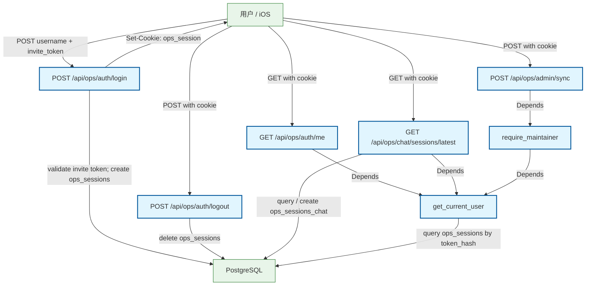

# Authentication Flow

Login, logout, session validation, and iOS latest chat session flow

## Mermaid

## Structured Data

### Nodes

| ID | Label | Kind |
|----|-------|------|
| client | 用户 / iOS | external |
| login | POST /api/ops/auth/login | flow |
| logout | POST /api/ops/auth/logout | flow |
| me | GET /api/ops/auth/me | flow |
| latest_session | GET /api/ops/chat/sessions/latest | flow |
| session_check | get_current_user | flow |
| maintainer_check | require_maintainer | flow |
| admin_sync | POST /api/ops/admin/sync | flow |
| db | PostgreSQL | external |

### Edges

| From | To | Mark | Type | Label | Anchors |
|------|----|------|------|-------|---------|
| client | login | -> | depends_on | POST username + invite_token | 1 anchor(s) |
| login | db | -> | depends_on | validate invite token; create ops_sessions | 1 anchor(s) |
| login | client | -> | depends_on | Set-Cookie: ops_session | 1 anchor(s) |
| client | logout | -> | depends_on | POST with cookie | 1 anchor(s) |
| logout | db | -> | depends_on | delete ops_sessions | 1 anchor(s) |
| client | me | -> | depends_on | GET with cookie | 1 anchor(s) |
| me | session_check | -> | depends_on | Depends | 1 anchor(s) |
| client | latest_session | -> | depends_on | GET with cookie | 1 anchor(s) |
| latest_session | session_check | -> | depends_on | Depends | 1 anchor(s) |
| latest_session | db | -> | depends_on | query / create ops_sessions_chat | 1 anchor(s) |
| client | admin_sync | -> | depends_on | POST with cookie | 1 anchor(s) |
| admin_sync | maintainer_check | -> | depends_on | Depends | 1 anchor(s) |
| maintainer_check | session_check | -> | depends_on | Depends | 1 anchor(s) |
| session_check | db | -> | depends_on | query ops_sessions by token_hash | 1 anchor(s) |
