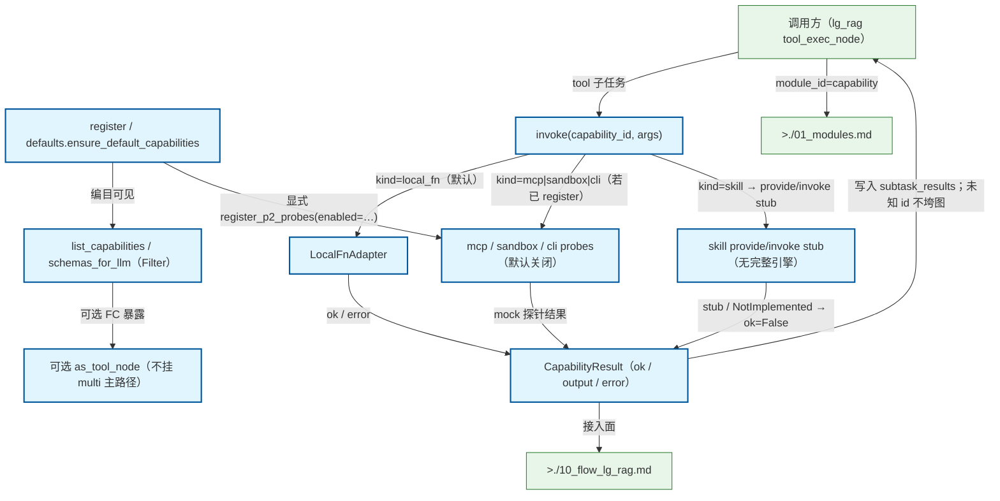

# Capability Gateway 注册与 invoke

能力注册表 + Filter + 统一 invoke；local_fn 默认；可选 schemas_for_llm/ToolNode；mcp/sandbox/cli mock 探针与 skill stub 默认关闭。不是业界 LLM Gateway。首接入面：lg_rag tool_exec_node。

## Mermaid

## Structured Data

### Nodes

| ID | Label | Kind |
|----|-------|------|
| caller | 调用方（lg_rag tool_exec_node） | external |
| register | register / defaults.ensure_default_capabilities | flow |
| list_filter | list_capabilities / schemas_for_llm（Filter） | flow |
| invoke | invoke(capability_id, args) | flow |
| local_fn | LocalFnAdapter | flow |
| probes | mcp / sandbox / cli probes（默认关闭） | flow |
| skill_stub | skill provide/invoke stub（无完整引擎） | flow |
| result | CapabilityResult（ok / output / error） | flow |
| fc_optional | 可选 as_tool_node（不挂 multi 主路径） | flow |
| lg_rag_doc | >./10_flow_lg_rag.md | external |
| modules_doc | >./01_modules.md | external |

### Edges

| From | To | Mark | Type | Label | Anchors |
|------|----|------|------|-------|---------|
| register | list_filter | -> | depends_on | 编目可见 | 1 anchor(s) |
| list_filter | fc_optional | ?> | branches | 可选 FC 暴露 | 1 anchor(s) |
| caller | invoke | -> | depends_on | tool 子任务 | 1 anchor(s) |
| invoke | local_fn | -> | depends_on | kind=local_fn（默认） | 1 anchor(s) |
| invoke | probes | ?> | branches | kind=mcp\|sandbox\|cli（若已 register） | 1 anchor(s) |
| invoke | skill_stub | ?> | branches | kind=skill → provide/invoke stub | 1 anchor(s) |
| local_fn | result | -> | depends_on | ok / error | 1 anchor(s) |
| probes | result | -> | depends_on | mock 探针结果 |  |
| skill_stub | result | -> | depends_on | stub / NotImplemented → ok=False |  |
| result | caller | -> | depends_on | 写入 subtask_results；未知 id 不垮图 | 1 anchor(s) |
| register | probes | ?> | branches | 显式 register_p2_probes(enabled=…) |  |
| result | lg_rag_doc | -> | depends_on | 接入面 |  |
| caller | modules_doc | -> | depends_on | module_id=capability |  |
