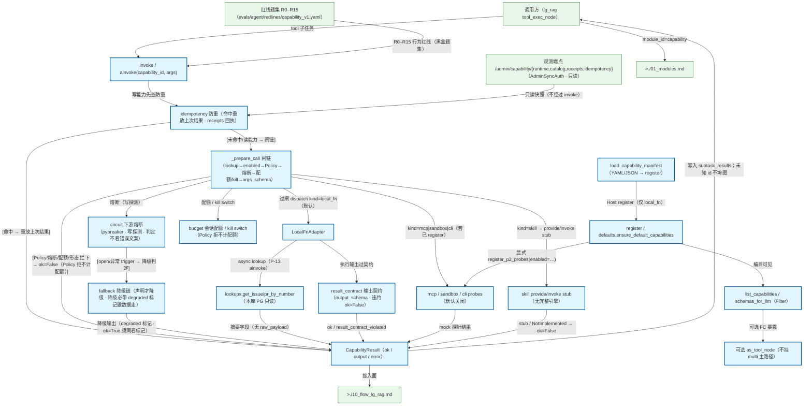

# Capability Gateway 注册与 invoke

能力进程内注册表 + Filter + 统一 invoke/ainvoke（非跨进程注册中心）；YAML/JSON manifest 加载 register（仅 local_fn · defaults/lookups 前缀）；local_fn 默认含本库 issue/PR 只读 lookup（tenant_scoped + 最小 args_schema）；可选 schemas_for_llm/ToolNode；mcp/sandbox/cli mock 探针与 skill stub 默认关闭。不是业界 LLM Gateway。首接入面：lg_rag tool_exec_node。C1（2026-09-01）：harness.verify / harness.task_lint 白名单 CLI Capability（harness_cli.py · 代码路径 gateway.register · 显式 register_harness_cli_capabilities() · Policy 默认关 · 不进默认目录；harness.status 可选未做）。阶段 H（2026-09-17）：Gateway args_schema 校验 + tenant_scoped 门 + span args/policy/subtask 摘要。治理层（2026-09-21）：执行期 _prepare_call 闸链（lookup→enabled→Policy→熔断→配额/kill→args_schema；Policy 拒不计配额）+ 写能力幂等（命中重放）+ 降级链（声明才降级/降级必带 degraded 标记 · ok=True 须同看标记）+ output_schema 输出契约 + 观测端点 /admin/capability/* + 红线 R0–R15。

## Mermaid

## Structured Data

### Nodes

| ID | Label | Kind |
|----|-------|------|
| caller | 调用方（lg_rag tool_exec_node） | external |
| load_manifest | load_capability_manifest（YAML/JSON → register） | flow |
| register | register / defaults.ensure_default_capabilities | flow |
| list_filter | list_capabilities / schemas_for_llm（Filter） | flow |
| invoke | invoke / ainvoke(capability_id, args) | flow |
| pg_lookup | lookups.get_issue/pr_by_number（本库 PG 只读） | flow |
| local_fn | LocalFnAdapter | flow |
| probes | mcp / sandbox / cli probes（默认关闭） | flow |
| skill_stub | skill provide/invoke stub（无完整引擎） | flow |
| result | CapabilityResult（ok / output / error） | flow |
| idempotency | idempotency 防重（命中重放上次结果 · receipts 回执） | flow |
| precheck | _prepare_call 闸链（lookup→enabled→Policy→熔断→配额/kill→args_schema） | flow |
| circuit | circuit 下游熔断（pybreaker · 写探测 · 判定不看错误文案） | flow |
| budget | budget 会话配额 / kill switch（Policy 拒不计配额） | flow |
| fallback | fallback 降级链（声明才降级 · 降级必带 degraded 标记跟数据走） | flow |
| result_contract | result_contract 输出契约（output_schema · 违约 ok=False） | flow |
| obs_admin | 观测端点 /admin/capability/{runtime,catalog,receipts,idempotency}（AdminSyncAuth · 只读） | external |
| redlines | 红线题集 R0–R15（evals/agent/redlines/capability_v1.yaml） | external |
| fc_optional | 可选 as_tool_node（不挂 multi 主路径） | flow |
| lg_rag_doc | >./10_flow_lg_rag.md | external |
| modules_doc | >./01_modules.md | external |

### Edges

| From | To | Mark | Type | Label | Anchors |
|------|----|------|------|-------|---------|
| load_manifest | register | -> | depends_on | Host register（仅 local_fn） | 1 anchor(s) |
| register | list_filter | -> | depends_on | 编目可见 | 1 anchor(s) |
| list_filter | fc_optional | ?> | branches | 可选 FC 暴露 | 1 anchor(s) |
| caller | invoke | -> | depends_on | tool 子任务 | 1 anchor(s) |
| invoke | idempotency | -> | depends_on | 写能力先查防重 | 1 anchor(s) |
| idempotency | result | ?> | branches | [命中 → 重放上次结果] | 1 anchor(s) |
| idempotency | precheck | -> | depends_on | [未命中/读能力 → 闸链] |  |
| precheck | circuit | -> | depends_on | 熔断（写探测） | 1 anchor(s) |
| precheck | budget | -> | depends_on | 配额 / kill switch | 1 anchor(s) |
| precheck | result | ?> | branches | [Policy/熔断/配额/形态 拦下 → ok=False（Policy 拒不计配额）] | 1 anchor(s) |
| precheck | local_fn | -> | depends_on | 过闸 dispatch kind=local_fn（默认） | 2 anchor(s) |
| precheck | probes | ?> | branches | kind=mcp\|sandbox\|cli（若已 register） | 1 anchor(s) |
| precheck | skill_stub | ?> | branches | kind=skill → provide/invoke stub | 1 anchor(s) |
| circuit | fallback | ?> | branches | [open/异常 trigger → 降级判定] | 1 anchor(s) |
| fallback | result | -> | depends_on | 降级输出（degraded 标记 · ok=True 须同看标记） | 1 anchor(s) |
| obs_admin | idempotency | -> | depends_on | 只读快照（不经过 invoke） | 1 anchor(s) |
| redlines | invoke | -> | depends_on | R0–R15 行为红线（黑盒题集） |  |
| local_fn | pg_lookup | ?> | branches | async lookup（P-13 ainvoke） | 1 anchor(s) |
| pg_lookup | result | -> | depends_on | 摘要字段（无 raw_payload） | 1 anchor(s) |
| local_fn | result_contract | -> | depends_on | 执行输出过契约 | 1 anchor(s) |
| result_contract | result | -> | depends_on | ok / result_contract_violated | 1 anchor(s) |
| probes | result | -> | depends_on | mock 探针结果 |  |
| skill_stub | result | -> | depends_on | stub / NotImplemented → ok=False |  |
| result | caller | -> | depends_on | 写入 subtask_results；未知 id 不垮图 | 1 anchor(s) |
| register | probes | ?> | branches | 显式 register_p2_probes(enabled=…) |  |
| result | lg_rag_doc | -> | depends_on | 接入面 |  |
| caller | modules_doc | -> | depends_on | module_id=capability |  |
