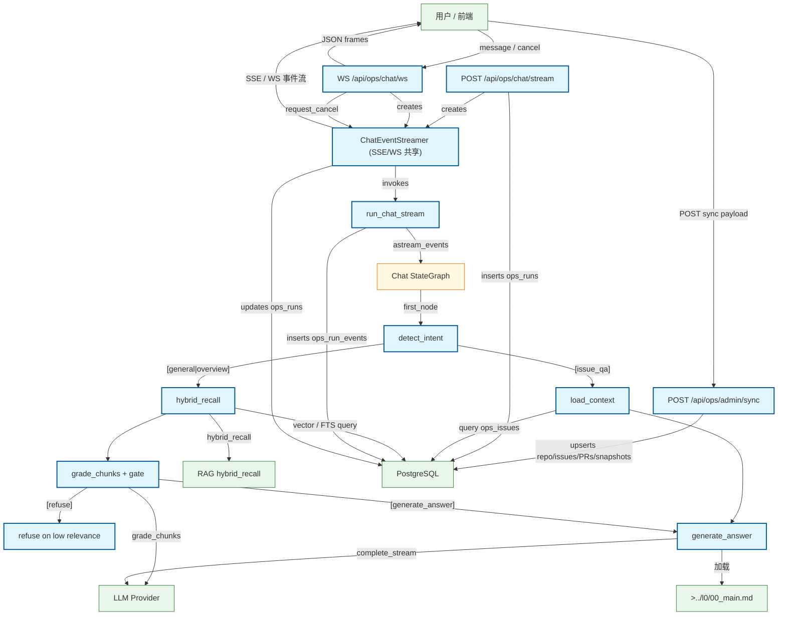

# Chat 流式对话流程

用户通过 SSE 与后端对话的完整流程：HTTP 入口、LangGraph StateGraph 执行（含 RAG 检索链）、LLM 调用、事件归档。

## Mermaid

## Structured Data

### Nodes

| ID | Label | Kind |
|----|-------|------|
| client | 用户 / 前端 | external |
| chat_stream | POST /api/ops/chat/stream | flow |
| chat_ws | WS /api/ops/chat/ws | flow |
| event_gen | ChatEventStreamer (SSE/WS 共享) | flow |
| chat_service | run_chat_stream | flow |
| stategraph | Chat StateGraph | struct |
| intent | detect_intent | flow |
| context | load_context | flow |
| retrieve | hybrid_recall | flow |
| grade | grade_chunks + gate | flow |
| refuse_answer | refuse on low relevance | flow |
| answer | generate_answer | flow |
| rag | RAG hybrid_recall | external |
| llm | LLM Provider | external |
| db | PostgreSQL | external |
| main_doc | >../l0/00_main.md | external |
| admin_sync | POST /api/ops/admin/sync | flow |

### Edges

| From | To | Mark | Type | Label | Anchors |
|------|----|------|------|-------|---------|
| client | admin_sync | -> | depends_on | POST sync payload | 1 anchor(s) |
| admin_sync | db | -> | depends_on | upserts repo/issues/PRs/snapshots | 1 anchor(s) |
| chat_stream | event_gen | -> | depends_on | creates | 1 anchor(s) |
| client | chat_ws | -> | depends_on | message / cancel | 1 anchor(s) |
| chat_ws | event_gen | -> | depends_on | creates | 1 anchor(s) |
| chat_ws | client | -> | depends_on | JSON frames |  |
| chat_ws | event_gen | -> | depends_on | request_cancel |  |
| chat_stream | db | -> | depends_on | inserts ops_runs |  |
| event_gen | client | -> | depends_on | SSE / WS 事件流 |  |
| event_gen | chat_service | -> | depends_on | invokes | 1 anchor(s) |
| chat_service | stategraph | -> | depends_on | astream_events | 2 anchor(s) |
| stategraph | intent | -> | depends_on | first_node | 1 anchor(s) |
| intent | context | ?> | branches | [issue_qa] | 1 anchor(s) |
| intent | retrieve | ?> | branches | [general\|overview] | 1 anchor(s) |
| context | db | -> | depends_on | query ops_issues |  |
| context | answer | -> | depends_on | -> | 1 anchor(s) |
| retrieve | rag | ::triggers | triggers | hybrid_recall | 2 anchor(s) |
| retrieve | db | -> | depends_on | vector / FTS query |  |
| retrieve | grade | -> | depends_on | -> | 1 anchor(s) |
| grade | refuse_answer | ?> | branches | [refuse] | 1 anchor(s) |
| grade | answer | ?> | branches | [generate_answer] | 1 anchor(s) |
| grade | llm | -> | depends_on | grade_chunks |  |
| answer | llm | -> | depends_on | complete_stream | 1 anchor(s) |
| chat_service | db | -> | depends_on | inserts ops_run_events |  |
| event_gen | db | -> | depends_on | updates ops_runs |  |
| answer | main_doc | -> | depends_on | 加载 |  |
