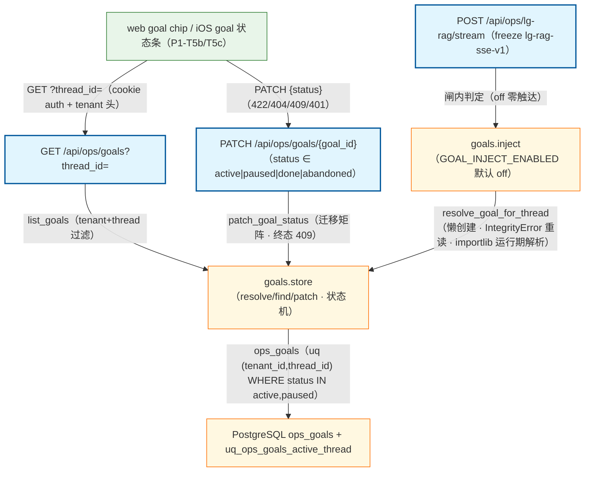

# Goal REST 面与懒创建接线（P1 · 07-p1-goal-design）

Goal 模块 REST 契约（P1-T2 · issue #390）与流入口懒创建接线（P1-T4 · issue #396）。GET /api/ops/goals?thread_id= 列当前 tenant+thread 下 goal 集（1:1 执行面下至多一条非终态）；PATCH /api/ops/goals/{goal_id} 人工状态流转（O-1 复活通道：paused 仅人工 PATCH 回 active；词表 active/paused/done/abandoned · 终态不可逆 · 迁移矩阵 active→{paused,done,abandoned} / paused→{active,done,abandoned} · 词表外 422 pydantic Literal 前置 · 跨租户/不存在 404 防探测 · 非法流转 409 GoalStateTransitionError · 未登录 401）。懒创建：POST /api/ops/lg-rag/stream 在 _prepare_thread 后闸内（GOAL_INJECT_ENABLED 默认 off）调 goals.store.resolve_goal_for_thread（importlib 运行期解析守 lg-rag-outbound 契约 · IntegrityError 并发重读 · objective=首轮 query 单行化截 200）；闸 off 零触达。DB 执行面：ops_goals 表（P0' T5）+ uq_ops_goals_active_thread 部分唯一索引 (tenant_id,thread_id) WHERE status IN ('active','paused')（P1-T4 · O-3 1:1 裁定）。注入面（P1-T3 · 图谱备注于 10_flow_lg_rag）：continuity 装配层 SystemMessage 头插 [当前目标] 横幅 · slots goal_objective 槽 untrusted · wait_for ≤300ms 降级 span goal_inject_degraded。放量 runbook：docs/guides/RUNBOOK_goal_rollout_v1_zh.md。设计真源：ops-desk-workspace docs/01-scope/03-general-agent/07-p1-goal-design.md。

## Mermaid

## Structured Data

### Nodes

| ID | Label | Kind |
|----|-------|------|
| client | web goal chip / iOS goal 状态条（P1-T5b/T5c） | external |
| goals_list | GET /api/ops/goals?thread_id= | flow |
| goals_patch | PATCH /api/ops/goals/{goal_id}（status ∈ active\|paused\|done\|abandoned） | flow |
| lg_stream | POST /api/ops/lg-rag/stream（freeze lg-rag-sse-v1） | flow |
| goal_store | goals.store（resolve/find/patch · 状态机） | struct |
| goal_inject | goals.inject（GOAL_INJECT_ENABLED 默认 off） | struct |
| db | PostgreSQL ops_goals + uq_ops_goals_active_thread | struct |

### Edges

| From | To | Mark | Type | Label | Anchors |
|------|----|------|------|-------|---------|
| client | goals_list | -> | depends_on | GET ?thread_id=（cookie auth + tenant 头） | 1 anchor(s) |
| client | goals_patch | -> | depends_on | PATCH {status}（422/404/409/401） | 1 anchor(s) |
| goals_list | goal_store | -> | depends_on | list_goals（tenant+thread 过滤） |  |
| goals_patch | goal_store | -> | depends_on | patch_goal_status（迁移矩阵 · 终态 409） |  |
| lg_stream | goal_inject | -> | depends_on | 闸内判定（off 零触达） |  |
| goal_inject | goal_store | -> | depends_on | resolve_goal_for_thread（懒创建 · IntegrityError 重读 · importlib 运行期解析） |  |
| goal_store | db | -> | depends_on | ops_goals（uq (tenant_id,thread_id) WHERE status IN active,paused） |  |
