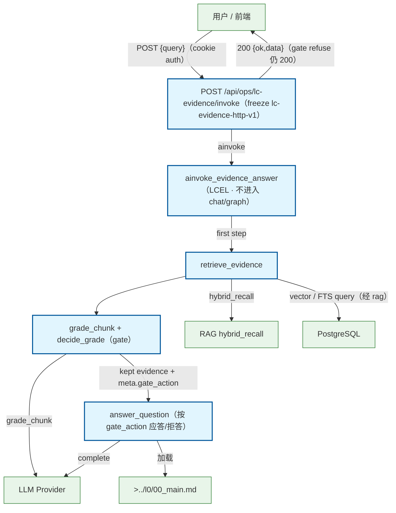

# LC Evidence 旁路答问流程

POST /api/ops/lc-evidence/invoke → LCEL chain（retrieve → grade(gate) → answer）；旁路独立链路，默认不进入 chat/graph；gate 拒答仍返回 200 {ok,data}（freeze lc-evidence-http-v1）。

## Mermaid

## Structured Data

### Nodes

| ID | Label | Kind |
|----|-------|------|
| client | 用户 / 前端 | external |
| lc_invoke | POST /api/ops/lc-evidence/invoke（freeze lc-evidence-http-v1） | flow |
| chain | ainvoke_evidence_answer（LCEL · 不进入 chat/graph） | flow |
| retrieve | retrieve_evidence | flow |
| grade | grade_chunk + decide_grade（gate） | flow |
| answer | answer_question（按 gate_action 应答/拒答） | flow |
| rag | RAG hybrid_recall | external |
| llm | LLM Provider | external |
| db | PostgreSQL | external |
| main_doc | >../l0/00_main.md | external |

### Edges

| From | To | Mark | Type | Label | Anchors |
|------|----|------|------|-------|---------|
| client | lc_invoke | -> | depends_on | POST {query}（cookie auth） | 1 anchor(s) |
| lc_invoke | chain | -> | depends_on | ainvoke | 1 anchor(s) |
| lc_invoke | client | -> | depends_on | 200 {ok,data}（gate refuse 仍 200） | 1 anchor(s) |
| chain | retrieve | -> | depends_on | first step | 1 anchor(s) |
| retrieve | rag | ::triggers | triggers | hybrid_recall | 2 anchor(s) |
| retrieve | db | -> | depends_on | vector / FTS query（经 rag） |  |
| retrieve | grade | -> | depends_on | -> | 1 anchor(s) |
| grade | answer | -> | depends_on | kept evidence + meta.gate_action | 1 anchor(s) |
| grade | llm | -> | depends_on | grade_chunk | 1 anchor(s) |
| answer | llm | -> | depends_on | complete | 1 anchor(s) |
| answer | main_doc | -> | depends_on | 加载 |  |
