# LG RAG 旁路三模式流程（basic / router / supervisor · Critic）

POST /api/ops/lg-rag/invoke（freeze lg-rag-http-v1）按 mode 分派三图；另 POST /api/ops/lg-rag/stream（freeze lg-rag-sse-v1 · 默认 supervisor · astream updates · 帧可选 cursor）与 POST /api/ops/lg-rag/replay（T4 断联续看）。stream/invoke 按 thread_id 加载独立表历史并窗口压缩后注入图输入。basic / router / supervisor；rag 黑盒复用 lc_evidence_chain；默认不进入 chat/graph。T5：终答 answer 多帧 delta（{delta}）+ 终帧 {content, final:true}（aggregator / direct_answer 经 answer_stream.py contextvar token sink 桥 complete_stream；降级整段）。T5.1：persist 后台调度不阻塞 SSE yield。§10.6：等待 update 期间 SSE comment keepalive（不落盘、不占 seq）。

## Mermaid

```mermaid
flowchart TB
    client["用户 / 前端"]
    lg_invoke["POST /api/ops/lg-rag/invoke（freeze lg-rag-http-v1）"]
    lg_stream["POST /api/ops/lg-rag/stream（freeze lg-rag-sse-v1 · cursor）"]
    lg_replay["POST /api/ops/lg-rag/replay（T4 · after_seq/cursor）"]
    basic_graph["basic 图 build_basic_agent（Phase 1 对照）"]
    router_graph["router 图 build_router_agent（Phase 2-3）"]
    sup_graph["supervisor 图 build_supervisor_agent（Phase 4）"]
    b_rag["rag_node"]
    r_router["router_node（#35;数字快路径 + LLM 三分类）"]
    r_direct["direct_answer_node"]
    r_refuse["refuse_node（固定文案）"]
    r_rag["rag_node（黑盒调 lc chain）"]
    r_evaluate["evaluate_node（复用 chain gate · 零额外 LLM）"]
    r_rewrite["rewrite_node（LLM 改写 · 熔断封顶）"]
    s_intent["intent_node（S2 IntentV1 · acomplete_structured）"]
    s_strategy_builder["strategy_builder_node（S1 allowlist · Registry∩Policy）"]
    s_supervisor["supervisor_node（LLM 拆解 ≤4 · 失败 fallback 单 rag）"]
    s_dispatch["route_next_subtask（dispatch）"]
    s_rag["rag_subtask_node（复用 router 子图）"]
    s_extract["info_extract_node"]
    s_tool["tool_exec_node（Capability Gateway）"]
    structured_output_gw["Structured Output Gateway（>./10_flow_structured_output.md）"]
    capability_gw["Capability Gateway（>./10_flow_capability.md）"]
    s_aggregator["aggregator_node（LLM 综合）"]
    s_critic["critic_node（S4 规则 stub · 预算 1+1）"]
    s_end["END（pass / 预算耗尽）"]
    lc_chain["LC Evidence chain（黑盒 · 不展开 LCEL）"]
    llm["LLM Provider"]
    db["PostgreSQL"]
    main_doc[">../l0/00_main.md"]

    client -->|"POST {query, mode, thread_id}（cookie auth）"| lg_invoke
    %% → app/ops/lg_rag/router.py#L176
    client -->|"POST SSE {query, mode=supervisor 默认}（cookie auth）"| lg_stream
    %% → app/ops/lg_rag/router.py#L219
    client -->|"POST SSE replay {run_id, after_seq#124;cursor}"| lg_replay
    %% → app/ops/lg_rag/router.py#L1
    lg_stream -->|"[默认 mode=supervisor · astream updates]"| sup_graph
    %% → app/ops/lg_rag/sse_stream.py#L1
    lg_stream -->|"text/event-stream（run.start…answer delta×N→answer final…done · cursor）"| client
    %% → app/ops/lg_rag/sse_stream.py#L1
    lg_replay -->|"text/event-stream（seq > after_seq）"| client
    %% → app/ops/lg_rag/router.py#L1
    lg_replay -->|"ops_lg_rag_run_events（read）"| db
    %% → app/ops/lg_rag/event_store.py#L1
    lg_invoke -->|"[mode=basic]"| basic_graph
    %% → app/ops/lg_rag/router.py#L141
    lg_invoke -->|"[mode=router（默认）]"| router_graph
    %% → app/ops/lg_rag/router.py#L145
    lg_invoke -->|"[mode=supervisor]"| sup_graph
    %% → app/ops/lg_rag/router.py#L143
    lg_invoke -->|"200 {ok,data}"| client
    %% → app/ops/lg_rag/router.py#L208
    lg_stream -->|"ops_lg_rag_threads / turns · ops_lg_rag_run_events"| db
    %% → app/ops/lg_rag/thread_store.py#L1
    lg_invoke -->|"ops_lg_rag_threads / turns；optional PG checkpointer"| db
    %% → app/ops/lg_rag/router.py#L151
    basic_graph -->|"START → rag → END"| b_rag
    %% → app/ops/lg_rag/graph.py#L58
    b_rag -->|"ainvoke_evidence_answer"| lc_chain
    %% → app/ops/lg_rag/nodes.py#L160
    %% → app/ops/lc_evidence_chain/chain.py::ainvoke_evidence_answer
    router_graph -->|"START → router"| r_router
    %% → app/ops/lg_rag/graph.py#L72
    r_router -->|"[rag]"| r_rag
    %% → app/ops/lg_rag/graph.py#L77
    r_router -->|"[direct → END]"| r_direct
    %% → app/ops/lg_rag/graph.py#L78
    r_router -->|"[refuse → END]"| r_refuse
    %% → app/ops/lg_rag/graph.py#L79
    r_router -->|"LLM 三分类（fallback=rag）"| llm
    %% → app/ops/lg_rag/nodes.py#L127
    r_rag --> r_evaluate
    %% → app/ops/lg_rag/graph.py#L82
    r_rag -->|"ainvoke_evidence_answer（写回 chain_meta）"| lc_chain
    %% → app/ops/lg_rag/nodes.py#L160
    %% → app/ops/lc_evidence_chain/chain.py::ainvoke_evidence_answer
    r_evaluate -->|"[low 且 retry<2 → rewrite；high/medium → END]"| r_rewrite
    %% → app/ops/lg_rag/graph.py#L87
    %% → app/ops/lg_rag/nodes.py#L204
    r_rewrite -->|"[有新 query → 重试 rag；熔断置空 → END]"| r_rag
    %% → app/ops/lg_rag/graph.py#L95
    %% → app/ops/lg_rag/nodes.py#L261
    r_direct -->|"complete_answer_streaming（delta 桥 → SSE；降级 complete）"| llm
    %% → app/ops/lg_rag/nodes.py#L269
    r_rewrite -->|"complete"| llm
    %% → app/ops/lg_rag/nodes.py#L230
    sup_graph -->|"START → intent_node"| s_intent
    %% → app/ops/lg_rag/multi/graph.py#L73
    s_intent -->|"intent dict"| s_strategy_builder
    %% → app/ops/lg_rag/multi/graph.py#L74
    s_strategy_builder -->|"allowed_capability_ids"| s_supervisor
    %% → app/ops/lg_rag/multi/graph.py#L75
    s_supervisor -->|"subtasks（≤4）"| s_dispatch
    %% → app/ops/lg_rag/multi/graph.py#L76
    s_dispatch -->|"[type=rag]"| s_rag
    %% → app/ops/lg_rag/multi/graph.py#L42
    %% → app/ops/lg_rag/multi/nodes.py#L238
    s_dispatch -->|"[type=extract]"| s_extract
    %% → app/ops/lg_rag/multi/graph.py#L43
    %% → app/ops/lg_rag/multi/nodes.py#L238
    s_dispatch -->|"[type=tool]"| s_tool
    %% → app/ops/lg_rag/multi/graph.py#L44
    %% → app/ops/lg_rag/multi/nodes.py#L238
    s_dispatch -->|"[耗尽/空 → aggregate]"| s_aggregator
    %% → app/ops/lg_rag/multi/graph.py#L45
    %% → app/ops/lg_rag/multi/nodes.py#L237
    s_rag -->|"回 dispatch（追加一条结果）"| s_dispatch
    %% → app/ops/lg_rag/multi/graph.py#L78
    s_extract -->|"回 dispatch（追加一条结果）"| s_dispatch
    %% → app/ops/lg_rag/multi/graph.py#L78
    s_tool -->|"回 dispatch（追加一条结果）"| s_dispatch
    %% → app/ops/lg_rag/multi/graph.py#L78
    s_aggregator -->|"综合后进入 Critic"| s_critic
    %% → app/ops/lg_rag/multi/graph.py#L79
    s_critic -->|"[pass#124;end → END]"| s_end
    %% → app/ops/lg_rag/multi/graph.py#L80
    %% → app/ops/strategy/critic.py::route_after_critic
    s_critic -->|"[retry_planner → supervisor]"| s_supervisor
    %% → app/ops/lg_rag/multi/graph.py#L51
    %% → app/ops/strategy/critic.py::route_after_critic
    s_critic -->|"[rebind → strategy_builder]"| s_strategy_builder
    %% → app/ops/lg_rag/multi/graph.py#L52
    %% → app/ops/strategy/critic.py::route_after_critic
    s_rag -->|"ainvoke_router_agent（复用 router 子图）"| router_graph
    %% → app/ops/lg_rag/multi/nodes.py#L266
    %% → app/ops/lg_rag/graph.py::ainvoke_router_agent
    s_supervisor -->|"complete（拆解）"| llm
    %% → app/ops/lg_rag/multi/nodes.py#L200
    s_extract -->|"complete（抽取）"| llm
    %% → app/ops/lg_rag/multi/nodes.py#L299
    s_aggregator -->|"complete_answer_streaming（delta 桥 → SSE；降级 complete）"| llm
    %% → app/ops/lg_rag/multi/nodes.py#L361
    r_router -->|"parse_only / schema 校验"| structured_output_gw
    %% → app/ops/lg_rag/nodes.py::_classify_route
    s_supervisor -->|"parse SubtasksPlan"| structured_output_gw
    %% → app/ops/lg_rag/multi/nodes.py::supervisor_node
    s_extract -->|"parse ExtractResult"| structured_output_gw
    %% → app/ops/lg_rag/multi/nodes.py::info_extract_node
    s_intent -->|"acomplete_structured（max_retries=1）"| structured_output_gw
    %% → app/ops/strategy/intent.py::intent_node
    s_intent -->|"complete（细意图）"| llm
    %% → app/ops/strategy/intent.py::intent_node
    s_strategy_builder -->|"list_capabilities（Builder catalog）"| capability_gw
    %% → app/ops/strategy/builder.py::strategy_builder_node
    s_supervisor -->|"list_capabilities ∩ allowlist"| capability_gw
    %% → app/ops/lg_rag/multi/nodes.py::supervisor_node
    s_tool -->|"capability.invoke"| capability_gw
    %% → app/ops/lg_rag/multi/nodes.py::tool_exec_node
    router_graph -->|"加载"| main_doc

    classDef phase fill:#e1f5fe,stroke:#01579b,stroke-width:2px
    classDef doc fill:#fff8e1,stroke:#ff6f00,stroke-width:1px
    classDef infra fill:#e8f5e9,stroke:#2e7d32,stroke-width:1px
    class lg_invoke,lg_stream,lg_replay,b_rag,r_router,r_direct,r_refuse,r_rag,r_evaluate,r_rewrite,s_intent,s_strategy_builder,s_supervisor,s_dispatch,s_rag,s_extract,s_tool,s_aggregator,s_critic phase
    class basic_graph,router_graph,sup_graph doc
    class client,structured_output_gw,capability_gw,s_end,lc_chain,llm,db,main_doc infra
```

## Structured Data

### Nodes

| ID | Label | Kind |
|----|-------|------|
| client | 用户 / 前端 | external |
| lg_invoke | POST /api/ops/lg-rag/invoke（freeze lg-rag-http-v1） | flow |
| lg_stream | POST /api/ops/lg-rag/stream（freeze lg-rag-sse-v1 · cursor） | flow |
| lg_replay | POST /api/ops/lg-rag/replay（T4 · after_seq/cursor） | flow |
| basic_graph | basic 图 build_basic_agent（Phase 1 对照） | struct |
| router_graph | router 图 build_router_agent（Phase 2-3） | struct |
| sup_graph | supervisor 图 build_supervisor_agent（Phase 4） | struct |
| b_rag | rag_node | flow |
| r_router | router_node（#数字快路径 + LLM 三分类） | flow |
| r_direct | direct_answer_node | flow |
| r_refuse | refuse_node（固定文案） | flow |
| r_rag | rag_node（黑盒调 lc chain） | flow |
| r_evaluate | evaluate_node（复用 chain gate · 零额外 LLM） | flow |
| r_rewrite | rewrite_node（LLM 改写 · 熔断封顶） | flow |
| s_intent | intent_node（S2 IntentV1 · acomplete_structured） | flow |
| s_strategy_builder | strategy_builder_node（S1 allowlist · Registry∩Policy） | flow |
| s_supervisor | supervisor_node（LLM 拆解 ≤4 · 失败 fallback 单 rag） | flow |
| s_dispatch | route_next_subtask（dispatch） | flow |
| s_rag | rag_subtask_node（复用 router 子图） | flow |
| s_extract | info_extract_node | flow |
| s_tool | tool_exec_node（Capability Gateway） | flow |
| structured_output_gw | Structured Output Gateway（>./10_flow_structured_output.md） | external |
| capability_gw | Capability Gateway（>./10_flow_capability.md） | external |
| s_aggregator | aggregator_node（LLM 综合） | flow |
| s_critic | critic_node（S4 规则 stub · 预算 1+1） | flow |
| s_end | END（pass / 预算耗尽） | external |
| lc_chain | LC Evidence chain（黑盒 · 不展开 LCEL） | external |
| llm | LLM Provider | external |
| db | PostgreSQL | external |
| main_doc | >../l0/00_main.md | external |

### Edges

| From | To | Mark | Type | Label | Anchors |
|------|----|------|------|-------|---------|
| client | lg_invoke | -> | depends_on | POST {query, mode, thread_id}（cookie auth） | 1 anchor(s) |
| client | lg_stream | -> | depends_on | POST SSE {query, mode=supervisor 默认}（cookie auth） | 1 anchor(s) |
| client | lg_replay | -> | depends_on | POST SSE replay {run_id, after_seq\|cursor} | 1 anchor(s) |
| lg_stream | sup_graph | ?> | branches | [默认 mode=supervisor · astream updates] | 1 anchor(s) |
| lg_stream | client | -> | depends_on | text/event-stream（run.start…answer delta×N→answer final…done · cursor） | 1 anchor(s) |
| lg_replay | client | -> | depends_on | text/event-stream（seq > after_seq） | 1 anchor(s) |
| lg_replay | db | -> | depends_on | ops_lg_rag_run_events（read） | 1 anchor(s) |
| lg_invoke | basic_graph | ?> | branches | [mode=basic] | 1 anchor(s) |
| lg_invoke | router_graph | ?> | branches | [mode=router（默认）] | 1 anchor(s) |
| lg_invoke | sup_graph | ?> | branches | [mode=supervisor] | 1 anchor(s) |
| lg_invoke | client | -> | depends_on | 200 {ok,data} | 1 anchor(s) |
| lg_stream | db | -> | depends_on | ops_lg_rag_threads / turns · ops_lg_rag_run_events | 1 anchor(s) |
| lg_invoke | db | -> | depends_on | ops_lg_rag_threads / turns；optional PG checkpointer | 1 anchor(s) |
| basic_graph | b_rag | -> | depends_on | START → rag → END | 1 anchor(s) |
| b_rag | lc_chain | ::triggers | triggers | ainvoke_evidence_answer | 2 anchor(s) |
| router_graph | r_router | -> | depends_on | START → router | 1 anchor(s) |
| r_router | r_rag | ?> | branches | [rag] | 1 anchor(s) |
| r_router | r_direct | ?> | branches | [direct → END] | 1 anchor(s) |
| r_router | r_refuse | ?> | branches | [refuse → END] | 1 anchor(s) |
| r_router | llm | -> | depends_on | LLM 三分类（fallback=rag） | 1 anchor(s) |
| r_rag | r_evaluate | -> | depends_on | -> | 1 anchor(s) |
| r_rag | lc_chain | ::triggers | triggers | ainvoke_evidence_answer（写回 chain_meta） | 2 anchor(s) |
| r_evaluate | r_rewrite | ?> | branches | [low 且 retry<2 → rewrite；high/medium → END] | 2 anchor(s) |
| r_rewrite | r_rag | ?> | branches | [有新 query → 重试 rag；熔断置空 → END] | 2 anchor(s) |
| r_direct | llm | -> | depends_on | complete_answer_streaming（delta 桥 → SSE；降级 complete） | 1 anchor(s) |
| r_rewrite | llm | -> | depends_on | complete | 1 anchor(s) |
| sup_graph | s_intent | -> | depends_on | START → intent_node | 1 anchor(s) |
| s_intent | s_strategy_builder | -> | depends_on | intent dict | 1 anchor(s) |
| s_strategy_builder | s_supervisor | -> | depends_on | allowed_capability_ids | 1 anchor(s) |
| s_supervisor | s_dispatch | -> | depends_on | subtasks（≤4） | 1 anchor(s) |
| s_dispatch | s_rag | ?> | branches | [type=rag] | 2 anchor(s) |
| s_dispatch | s_extract | ?> | branches | [type=extract] | 2 anchor(s) |
| s_dispatch | s_tool | ?> | branches | [type=tool] | 2 anchor(s) |
| s_dispatch | s_aggregator | ?> | branches | [耗尽/空 → aggregate] | 2 anchor(s) |
| s_rag | s_dispatch | -> | depends_on | 回 dispatch（追加一条结果） | 1 anchor(s) |
| s_extract | s_dispatch | -> | depends_on | 回 dispatch（追加一条结果） | 1 anchor(s) |
| s_tool | s_dispatch | -> | depends_on | 回 dispatch（追加一条结果） | 1 anchor(s) |
| s_aggregator | s_critic | -> | depends_on | 综合后进入 Critic | 1 anchor(s) |
| s_critic | s_end | ?> | branches | [pass\|end → END] | 2 anchor(s) |
| s_critic | s_supervisor | ?> | branches | [retry_planner → supervisor] | 2 anchor(s) |
| s_critic | s_strategy_builder | ?> | branches | [rebind → strategy_builder] | 2 anchor(s) |
| s_rag | router_graph | ::triggers | triggers | ainvoke_router_agent（复用 router 子图） | 2 anchor(s) |
| s_supervisor | llm | -> | depends_on | complete（拆解） | 1 anchor(s) |
| s_extract | llm | -> | depends_on | complete（抽取） | 1 anchor(s) |
| s_aggregator | llm | -> | depends_on | complete_answer_streaming（delta 桥 → SSE；降级 complete） | 1 anchor(s) |
| r_router | structured_output_gw | ::triggers | triggers | parse_only / schema 校验 | 1 anchor(s) |
| s_supervisor | structured_output_gw | ::triggers | triggers | parse SubtasksPlan | 1 anchor(s) |
| s_extract | structured_output_gw | ::triggers | triggers | parse ExtractResult | 1 anchor(s) |
| s_intent | structured_output_gw | ::triggers | triggers | acomplete_structured（max_retries=1） | 1 anchor(s) |
| s_intent | llm | -> | depends_on | complete（细意图） | 1 anchor(s) |
| s_strategy_builder | capability_gw | ::triggers | triggers | list_capabilities（Builder catalog） | 1 anchor(s) |
| s_supervisor | capability_gw | ::triggers | triggers | list_capabilities ∩ allowlist | 1 anchor(s) |
| s_tool | capability_gw | ::triggers | triggers | capability.invoke | 1 anchor(s) |
| router_graph | main_doc | -> | depends_on | 加载 |  |
