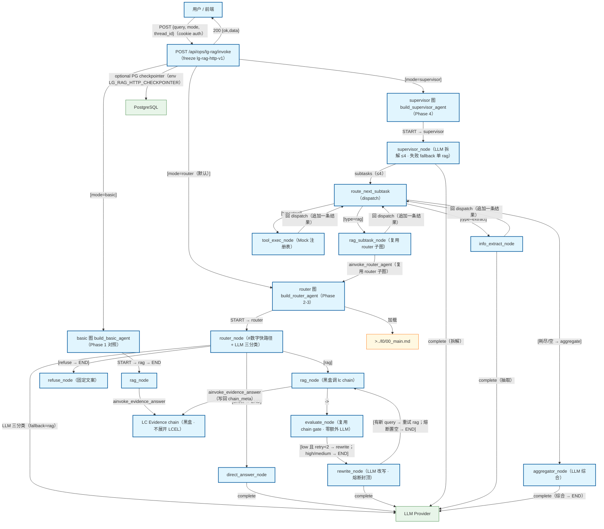

# LG RAG 旁路三模式流程（basic / router / supervisor）

POST /api/ops/lg-rag/invoke 按 mode 分派三图：basic（START→rag→END）/ router（三路 + evaluate⇄rewrite 回环 ≤2）/ supervisor（拆解→分派→聚合）。同图分节：节点 id 前缀 b_/r_/s_；rag 路径黑盒复用 lc_evidence_chain，不展开 LCEL；默认不进入 chat/graph。freeze lg-rag-http-v1。

## Mermaid

## Structured Data

### Nodes

| ID | Label | Kind |
|----|-------|------|
| client | 用户 / 前端 | external |
| lg_invoke | POST /api/ops/lg-rag/invoke（freeze lg-rag-http-v1） | flow |
| basic_graph | basic 图 build_basic_agent（Phase 1 对照） | struct |
| router_graph | router 图 build_router_agent（Phase 2-3） | struct |
| sup_graph | supervisor 图 build_supervisor_agent（Phase 4） | struct |
| b_rag | rag_node | flow |
| r_router | router_node（#数字快路径 + LLM 三分类） | flow |
| r_direct | direct_answer_node | flow |
| r_refuse | refuse_node（固定文案） | flow |
| r_rag | rag_node（黑盒调 lc chain） | flow |
| r_evaluate | evaluate_node（复用 chain gate · 零额外 LLM） | flow |
| r_rewrite | rewrite_node（LLM 改写 · 熔断封顶） | flow |
| s_supervisor | supervisor_node（LLM 拆解 ≤4 · 失败 fallback 单 rag） | flow |
| s_dispatch | route_next_subtask（dispatch） | flow |
| s_rag | rag_subtask_node（复用 router 子图） | flow |
| s_extract | info_extract_node | flow |
| s_tool | tool_exec_node（Mock 注册表） | flow |
| s_aggregator | aggregator_node（LLM 综合） | flow |
| lc_chain | LC Evidence chain（黑盒 · 不展开 LCEL） | external |
| llm | LLM Provider | external |
| db | PostgreSQL | external |
| main_doc | >../l0/00_main.md | external |

### Edges

| From | To | Mark | Type | Label | Anchors |
|------|----|------|------|-------|---------|
| client | lg_invoke | -> | depends_on | POST {query, mode, thread_id}（cookie auth） | 1 anchor(s) |
| lg_invoke | basic_graph | ?> | branches | [mode=basic] | 1 anchor(s) |
| lg_invoke | router_graph | ?> | branches | [mode=router（默认）] | 1 anchor(s) |
| lg_invoke | sup_graph | ?> | branches | [mode=supervisor] | 1 anchor(s) |
| lg_invoke | client | -> | depends_on | 200 {ok,data} | 1 anchor(s) |
| lg_invoke | db | -> | depends_on | optional PG checkpointer（env LG_RAG_HTTP_CHECKPOINTER） | 1 anchor(s) |
| basic_graph | b_rag | -> | depends_on | START → rag → END | 1 anchor(s) |
| b_rag | lc_chain | ::triggers | triggers | ainvoke_evidence_answer | 2 anchor(s) |
| router_graph | r_router | -> | depends_on | START → router | 1 anchor(s) |
| r_router | r_rag | ?> | branches | [rag] | 1 anchor(s) |
| r_router | r_direct | ?> | branches | [direct → END] | 1 anchor(s) |
| r_router | r_refuse | ?> | branches | [refuse → END] | 1 anchor(s) |
| r_router | llm | -> | depends_on | LLM 三分类（fallback=rag） | 1 anchor(s) |
| r_rag | r_evaluate | -> | depends_on | -> | 1 anchor(s) |
| r_rag | lc_chain | ::triggers | triggers | ainvoke_evidence_answer（写回 chain_meta） | 2 anchor(s) |
| r_evaluate | r_rewrite | ?> | branches | [low 且 retry<2 → rewrite；high/medium → END] | 2 anchor(s) |
| r_rewrite | r_rag | ?> | branches | [有新 query → 重试 rag；熔断置空 → END] | 2 anchor(s) |
| r_direct | llm | -> | depends_on | complete | 1 anchor(s) |
| r_rewrite | llm | -> | depends_on | complete | 1 anchor(s) |
| sup_graph | s_supervisor | -> | depends_on | START → supervisor | 1 anchor(s) |
| s_supervisor | s_dispatch | -> | depends_on | subtasks（≤4） | 1 anchor(s) |
| s_dispatch | s_rag | ?> | branches | [type=rag] | 2 anchor(s) |
| s_dispatch | s_extract | ?> | branches | [type=extract] | 2 anchor(s) |
| s_dispatch | s_tool | ?> | branches | [type=tool] | 2 anchor(s) |
| s_dispatch | s_aggregator | ?> | branches | [耗尽/空 → aggregate] | 2 anchor(s) |
| s_rag | s_dispatch | -> | depends_on | 回 dispatch（追加一条结果） | 1 anchor(s) |
| s_extract | s_dispatch | -> | depends_on | 回 dispatch（追加一条结果） | 1 anchor(s) |
| s_tool | s_dispatch | -> | depends_on | 回 dispatch（追加一条结果） | 1 anchor(s) |
| s_rag | router_graph | ::triggers | triggers | ainvoke_router_agent（复用 router 子图） | 2 anchor(s) |
| s_supervisor | llm | -> | depends_on | complete（拆解） | 1 anchor(s) |
| s_extract | llm | -> | depends_on | complete（抽取） | 1 anchor(s) |
| s_aggregator | llm | -> | depends_on | complete（综合 → END） | 1 anchor(s) |
| router_graph | main_doc | -> | depends_on | 加载 |  |
