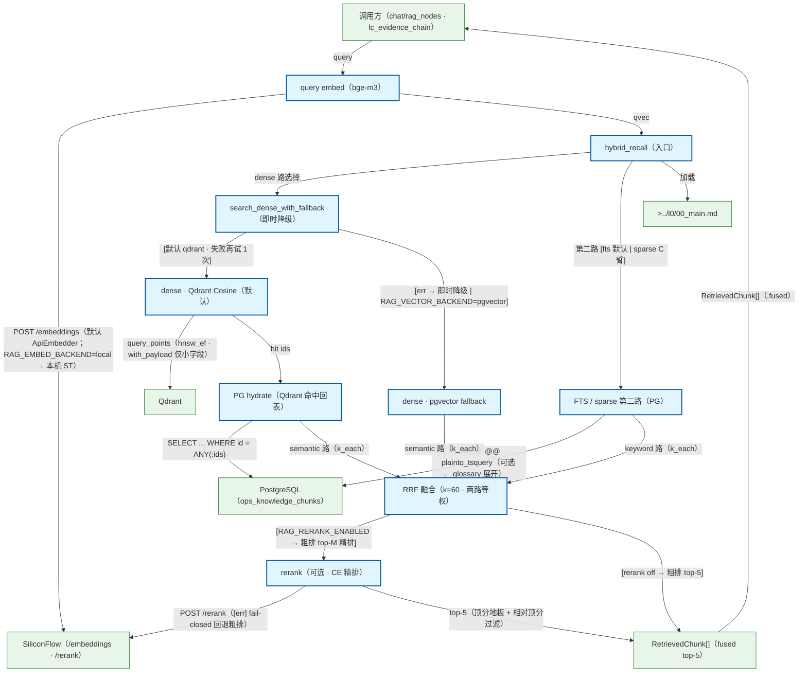

# RAG 混合检索摘要流程（hybrid_recall）

RAG 查询侧摘要流（选项 A 独立 flow · spec modules/rag.md §3 拍板）：query → embed（bge-m3）→ hybrid_recall → dense（Qdrant 默认 | pgvector 即时降级）/ FTS·sparse 第二路（PG）→ RRF k=60 融合 →（可选）CE rerank → RetrievedChunk[] top-5；Qdrant 命中经 PG hydrate 回表取正文。ingest 侧不展开（摘要粒度）。消费方：chat/rag_nodes.retrieve_node · lc_evidence_chain。

## Mermaid

## Structured Data

### Nodes

| ID | Label | Kind |
|----|-------|------|
| caller | 调用方（chat/rag_nodes · lc_evidence_chain） | external |
| embed_query | query embed（bge-m3） | flow |
| hybrid_recall | hybrid_recall（入口） | flow |
| backend_gate | search_dense_with_fallback（即时降级） | flow |
| dense_qdrant | dense · Qdrant Cosine（默认） | flow |
| dense_pgvector | dense · pgvector fallback | flow |
| fts_pg | FTS / sparse 第二路（PG） | flow |
| hydrate | PG hydrate（Qdrant 命中回表） | flow |
| rrf_fuse | RRF 融合（k=60 · 两路等权） | flow |
| rerank | rerank（可选 · CE 精排） | flow |
| result | RetrievedChunk[]（fused top-5） | external |
| siliconflow | SiliconFlow（/embeddings · /rerank） | external |
| qdrant | Qdrant | external |
| db | PostgreSQL（ops_knowledge_chunks） | external |
| main_doc | >../l0/00_main.md | external |

### Edges

| From | To | Mark | Type | Label | Anchors |
|------|----|------|------|-------|---------|
| caller | embed_query | -> | depends_on | query | 1 anchor(s) |
| embed_query | siliconflow | -> | depends_on | POST /embeddings（默认 ApiEmbedder；RAG_EMBED_BACKEND=local → 本机 ST） | 1 anchor(s) |
| embed_query | hybrid_recall | -> | depends_on | qvec | 1 anchor(s) |
| hybrid_recall | backend_gate | -> | depends_on | dense 路选择 | 2 anchor(s) |
| backend_gate | dense_qdrant | ?> | branches | [默认 qdrant · 失败再试 1 次] | 2 anchor(s) |
| backend_gate | dense_pgvector | ?> | branches | [err → 即时降级 \| RAG_VECTOR_BACKEND=pgvector] | 2 anchor(s) |
| dense_qdrant | qdrant | -> | depends_on | query_points（hnsw_ef · with_payload 仅小字段） | 1 anchor(s) |
| dense_qdrant | hydrate | -> | depends_on | hit ids | 1 anchor(s) |
| hydrate | db | -> | depends_on | SELECT ... WHERE id = ANY(:ids) | 1 anchor(s) |
| hybrid_recall | fts_pg | -> | depends_on | 第二路 [fts 默认 \| sparse C 臂] | 1 anchor(s) |
| fts_pg | db | -> | depends_on | tsvector @@ plainto_tsquery（可选 glossary 展开） | 1 anchor(s) |
| hydrate | rrf_fuse | -> | depends_on | semantic 路（k_each） | 1 anchor(s) |
| dense_pgvector | rrf_fuse | -> | depends_on | semantic 路（k_each） | 1 anchor(s) |
| fts_pg | rrf_fuse | -> | depends_on | keyword 路（k_each） | 1 anchor(s) |
| rrf_fuse | rerank | ?> | branches | [RAG_RERANK_ENABLED → 粗排 top-M 精排] | 1 anchor(s) |
| rrf_fuse | result | ?> | branches | [rerank off → 粗排 top-5] | 1 anchor(s) |
| rerank | siliconflow | -> | depends_on | POST /rerank（[err] fail-closed 回退粗排） | 2 anchor(s) |
| rerank | result | -> | depends_on | top-5（顶分地板 + 相对顶分过滤） | 2 anchor(s) |
| result | caller | -> | depends_on | RetrievedChunk[]（.fused） | 1 anchor(s) |
| hybrid_recall | main_doc | -> | depends_on | 加载 |  |
