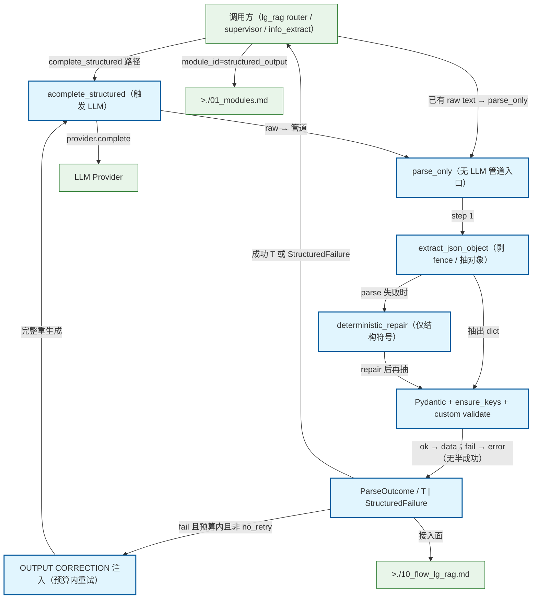

# Structured Output Gateway 管道

LLM 原始文本 → extract/parse →（可选）deterministic repair → Pydantic/ensure/validate → 失败则预算内 OUTPUT CORRECTION 重试。Host 权威；供 lg_rag 结构化节点复用。不是 Skill。

## Mermaid

## Structured Data

### Nodes

| ID | Label | Kind |
|----|-------|------|
| caller | 调用方（lg_rag router / supervisor / info_extract） | external |
| complete | acomplete_structured（触发 LLM） | flow |
| parse_only | parse_only（无 LLM 管道入口） | flow |
| extract | extract_json_object（剥 fence / 抽对象） | flow |
| repair | deterministic_repair（仅结构符号） | flow |
| validate | Pydantic + ensure_keys + custom validate | flow |
| outcome | ParseOutcome / T \| StructuredFailure | flow |
| correction | OUTPUT CORRECTION 注入（预算内重试） | flow |
| llm | LLM Provider | external |
| lg_rag_doc | >./10_flow_lg_rag.md | external |
| modules_doc | >./01_modules.md | external |

### Edges

| From | To | Mark | Type | Label | Anchors |
|------|----|------|------|-------|---------|
| caller | complete | -> | depends_on | complete_structured 路径 | 2 anchor(s) |
| caller | parse_only | -> | depends_on | 已有 raw text → parse_only | 1 anchor(s) |
| complete | llm | -> | depends_on | provider.complete | 1 anchor(s) |
| complete | parse_only | -> | depends_on | raw → 管道 | 1 anchor(s) |
| parse_only | extract | -> | depends_on | step 1 | 1 anchor(s) |
| extract | repair | ?> | branches | parse 失败时 | 1 anchor(s) |
| extract | validate | -> | depends_on | 抽出 dict | 1 anchor(s) |
| repair | validate | -> | depends_on | repair 后再抽 | 1 anchor(s) |
| validate | outcome | -> | depends_on | ok → data；fail → error（无半成功） | 1 anchor(s) |
| outcome | correction | ?> | branches | fail 且预算内且非 no_retry | 1 anchor(s) |
| correction | complete | ::triggers | triggers | 完整重生成 | 1 anchor(s) |
| outcome | caller | -> | depends_on | 成功 T 或 StructuredFailure | 1 anchor(s) |
| outcome | lg_rag_doc | -> | depends_on | 接入面 |  |
| caller | modules_doc | -> | depends_on | module_id=structured_output |  |
