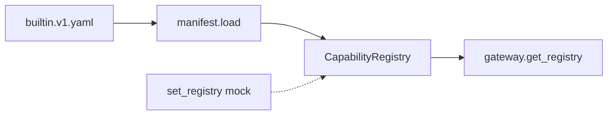

# M01 · 能力注册与同步

> **大纲编号**：#1 · **层**：控制面  
> **当前状态**：**部分落地 / 雏形**  
> **上游目标图**：[`../../2026-09-23_agent-host-full-framework-outline_v0.md`](../../2026-09-23_agent-host-full-framework-outline_v0.md) §2/§3  
> **总览**：[`../00_overview_current_vs_target_v1_zh.md`](../00_overview_current_vs_target_v1_zh.md)

---

## 1. 一句话

进程内 CapabilityRegistry（本地 dict 默认实现 RegistryReader/Writer）；manifest 显式 reload 注册；V1-E 接口化可替换，**无**跨进程注册中心。

## 2. 模块内架构

## 3. 代码 / 文档落点

**包路径**：`app/ops/capability/registry.py · gateway.get_registry/set_registry · manifests/`

- registry.py：Reader/Writer Protocol + 本地 dict
- gateway.py：单例 get/set_registry
- manifests/builtin.v1.yaml：存量能力
- defaults/probes/harness_cli：注册入口

## 4. 与相邻模块的边

- 见总览依赖图；本模块在目标图中的位置为大纲 **#1**。
- 图谱真值：`docs/_tech_graph/l1/01_modules.md`（物理 module_id 可能合并多个大纲号）。

## 5. 相对目标的残余缺口

跨进程注册中心 / 版本增量推送 / 紧急停用通道 → v2.0（multi-replica 触发）

## 6. 默认开关 / 安全默认（若适用）

- 多数治理增强：**默认 off / 观测**，enforce 需显式打开（承 Host v1.0 纪律）。
- 详 env 见各 task / `.env.example` / V1-E env 盘点文档。

---

*生成：2026-09-24 · 对照大纲 v0.2（2026-09-23）判定已刷新为 **v1.0 后（2026-09-24）**。*
