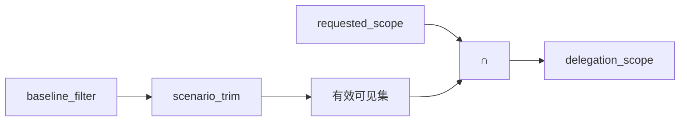

# M03 · 可见集裁剪 · 两阶段

> **大纲编号**：#3 · **层**：控制面  
> **当前状态**：**已落地**（机制在主线/可开关）  
> **上游目标图**：[`../../2026-09-23_agent-host-full-framework-outline_v0.md`](../../2026-09-23_agent-host-full-framework-outline_v0.md) §2/§3  
> **总览**：[`../00_overview_current_vs_target_v1_zh.md`](../00_overview_current_vs_target_v1_zh.md)

---

## 1. 一句话

V1-B：身份维 baseline → 场景维 scenario_trim → requested_scope 交集；安全默认（fallback/unknown→空集）；剔除台账 logger+span。三档 LG_RAG_VISIBILITY_SCENARIO_MODE 默认 off。

## 2. 模块内架构

## 3. 代码 / 文档落点

**包路径**：`app/ops/capability/baseline.py · strategy/builder.py · strategy/scenario.py`

- baseline.py：deny_high_risk/deny_write
- scenario.py：S1–S5 规则表
- builder.py：stage2 接线
- multi/nodes：scope 交集

## 4. 与相邻模块的边

- 见总览依赖图；本模块在目标图中的位置为大纲 **#3**。
- 图谱真值：`docs/_tech_graph/l1/01_modules.md`（物理 module_id 可能合并多个大纲号）。

## 5. 相对目标的残余缺口

会话上下文参与裁剪；HITL 三档执行侧体系（非本模块）

## 6. 默认开关 / 安全默认（若适用）

- 多数治理增强：**默认 off / 观测**，enforce 需显式打开（承 Host v1.0 纪律）。
- 详 env 见各 task / `.env.example` / V1-E env 盘点文档。

---

*生成：2026-09-24 · 对照大纲 v0.2（2026-09-23）判定已刷新为 **v1.0 后（2026-09-24）**。*
