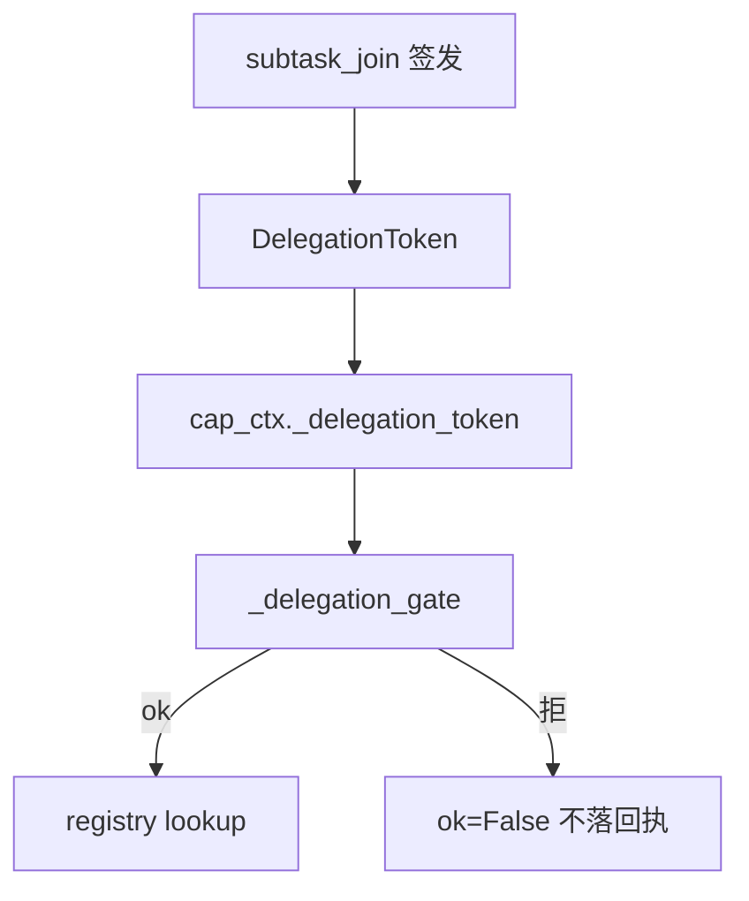

# M06 · 委派网关 · 令牌

> **大纲编号**：#6 · **层**：控制面  
> **当前状态**：**已落地**（机制在主线/可开关）  
> **上游目标图**：[`../../2026-09-23_agent-host-full-framework-outline_v0.md`](../../2026-09-23_agent-host-full-framework-outline_v0.md) §2/§3  
> **总览**：[`../00_overview_current_vs_target_v1_zh.md`](../00_overview_current_vs_target_v1_zh.md)  
> **一次调用走读**：[testing.write.echo 与委派令牌](../../2026-10-19_testing-write-echo-and-delegation_v1_zh.md)（对照总图 §1.2「委派令牌」）

---

## 1. 一句话

V1-A：六字段令牌 HMAC；subtask_join 签发；tool_exec 携令；验签在 lookup 前；只读自动/写 HITL；三档默认 off。图内化，非跨服务 JWT。

## 2. 模块内架构

## 3. 代码 / 文档落点

**包路径**：`app/ops/capability/delegation.py · gateway._delegation_gate · multi 签发`

- delegation.py：模型/签名/nonce
- gateway：验签门
- multi/nodes：签发与注入
- strategy：requested_scope∩

## 4. 与相邻模块的边

- 见总览依赖图；本模块在目标图中的位置为大纲 **#6**。
- 图谱真值：`docs/_tech_graph/l1/01_modules.md`（物理 module_id 可能合并多个大纲号）。

## 5. 相对目标的残余缺口

跨服务验签；跨进程 nonce（现 process-local）

## 6. 默认开关 / 安全默认（若适用）

- 多数治理增强：**默认 off / 观测**，enforce 需显式打开（承 Host v1.0 纪律）。
- 详 env 见各 task / `.env.example` / V1-E env 盘点文档。

---

*生成：2026-09-24 · 对照大纲 v0.2（2026-09-23）判定已刷新为 **v1.0 后（2026-09-24）**。*
