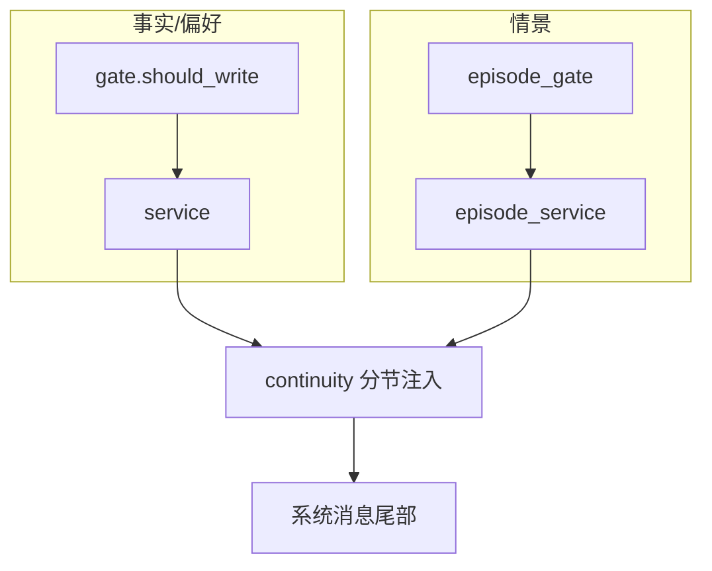

# M09 · 记忆管理 · 分层

> **大纲编号**：#9 · **层**：控制面  
> **当前状态**：**部分落地 / 雏形**  
> **上游目标图**：[`../../2026-09-23_agent-host-full-framework-outline_v0.md`](../../2026-09-23_agent-host-full-framework-outline_v0.md) §2/§3  
> **总览**：[`../00_overview_current_vs_target_v1_zh.md`](../00_overview_current_vs_target_v1_zh.md)

---

## 1. 一句话

事实/偏好（闸+状态机+向量）+ 会话摘要 + **情景 episode（V1-D 独立闸/库）**；默认关。跨进程记忆总线 / D3 同步未建。

## 2. 模块内架构

## 3. 代码 / 文档落点

**包路径**：`app/ops/memory/** · lg_rag/continuity · session/summary`

- memory/gate|service|episode_*
- continuity.py 分节
- ops_memory_facts / ops_memory_episodes

## 4. 与相邻模块的边

- 见总览依赖图；本模块在目标图中的位置为大纲 **#9**。
- 图谱真值：`docs/_tech_graph/l1/01_modules.md`（物理 module_id 可能合并多个大纲号）。

## 5. 相对目标的残余缺口

跨进程同步（事件溯源/CRDT/乐观锁）；共享总线

## 6. 默认开关 / 安全默认（若适用）

- 多数治理增强：**默认 off / 观测**，enforce 需显式打开（承 Host v1.0 纪律）。
- 详 env 见各 task / `.env.example` / V1-E env 盘点文档。

---

*生成：2026-09-24 · 对照大纲 v0.2（2026-09-23）判定已刷新为 **v1.0 后（2026-09-24）**。*
