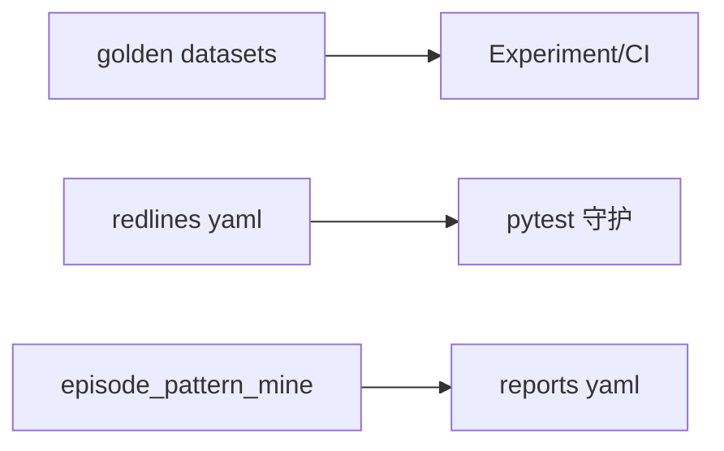

# M10 · 评估与验证

> **大纲编号**：#10 · **层**：控制面  
> **当前状态**：**部分落地 / 雏形**  
> **上游目标图**：[`../../2026-09-23_agent-host-full-framework-outline_v0.md`](../../2026-09-23_agent-host-full-framework-outline_v0.md) §2/§3  
> **总览**：[`../00_overview_current_vs_target_v1_zh.md`](../00_overview_current_vs_target_v1_zh.md)

---

## 1. 一句话

红线 R0–R15、金标/Experiment 轨（Eval E2–E4）、memory 金样；V1-D 失败模式聚类脚本；运行时任务完成率等仍偏文档/聚合样例。

## 2. 模块内架构

## 3. 代码 / 文档落点

**包路径**：`evals/agent/** · redlines · memory golden · episode_pattern_mine`

- evals/agent/redlines
- scripts/episode_pattern_mine.py
- eval ROADMAP

## 4. 与相邻模块的边

- 见总览依赖图；本模块在目标图中的位置为大纲 **#10**。
- 图谱真值：`docs/_tech_graph/l1/01_modules.md`（物理 module_id 可能合并多个大纲号）。

## 5. 相对目标的残余缺口

运行时完成率热路径；聚类→规则自动生效（刻意不做）

## 6. 默认开关 / 安全默认（若适用）

- 多数治理增强：**默认 off / 观测**，enforce 需显式打开（承 Host v1.0 纪律）。
- 详 env 见各 task / `.env.example` / V1-E env 盘点文档。

---

*生成：2026-09-24 · 对照大纲 v0.2（2026-09-23）判定已刷新为 **v1.0 后（2026-09-24）**。*
