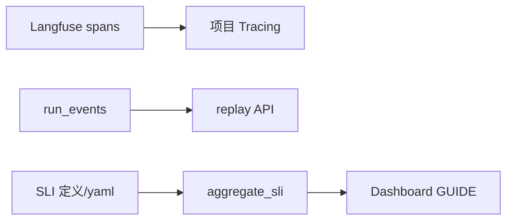

# M11 · 可观测性

> **大纲编号**：#11 · **层**：控制面  
> **当前状态**：**部分落地 / 雏形**  
> **上游目标图**：[`../../2026-09-23_agent-host-full-framework-outline_v0.md`](../../2026-09-23_agent-host-full-framework-outline_v0.md) §2/§3  
> **总览**：[`../00_overview_current_vs_target_v1_zh.md`](../00_overview_current_vs_target_v1_zh.md)

---

## 1. 一句话

Langfuse tracing；admin 观测；run_events/replay；出口 G1：四项 SLI 定义+聚合样例+Langfuse GUIDE（#193）。审计台账仍分散 logger 面。

## 2. 模块内架构

## 3. 代码 / 文档落点

**包路径**：`app/ops/tracing.py · capability metrics/visibility · run_events · SLI 四项`

- tracing.py
- event_store/sse_replay
- docs/spec/.../SLI_host_v1_four_metrics_v1.md

## 4. 与相邻模块的边

- 见总览依赖图；本模块在目标图中的位置为大纲 **#11**。
- 图谱真值：`docs/_tech_graph/l1/01_modules.md`（物理 module_id 可能合并多个大纲号）。

## 5. 相对目标的残余缺口

统一审计台账产品面；线上四项自动看板运维固化

## 6. 默认开关 / 安全默认（若适用）

- 多数治理增强：**默认 off / 观测**，enforce 需显式打开（承 Host v1.0 纪律）。
- 详 env 见各 task / `.env.example` / V1-E env 盘点文档。

---

*生成：2026-09-24 · 对照大纲 v0.2（2026-09-23）判定已刷新为 **v1.0 后（2026-09-24）**。*
