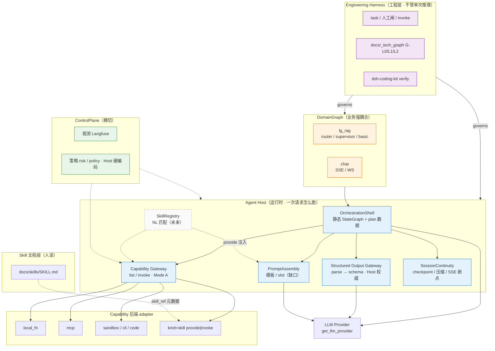
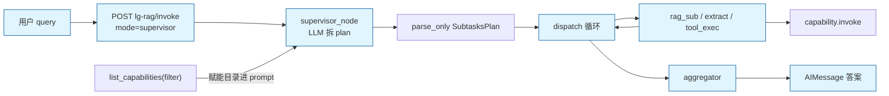

# Agent Host 架构 · 阶段性讨论总结

> **日期**：2026-08-26  
> **状态**：讨论稿（非 freeze 契约）  
> **范围**：Agent = Host + LLM 分层、Host 模块边界、Capability/SO/Session/编排/本体论、升级顺序与 00 统筹  
> **前置讨论**：[2026-08-26_lg-rag-agent-capability-architecture.md](./2026-08-26_lg-rag-agent-capability-architecture.md)  
> **已落盘 SPEC/ROADMAP**：[`docs/spec/agent-infra/`](../spec/agent-infra/)

---

## 0. 本阶段结论一句话

**Agent ≈ Agent Host（运行时模块容器）+ LLM Provider + 领域图；工程 Harness（task/闸/图谱）与运行时 Host 分层。**  
Host 内核以 **Capability（Mode A）**、**Structured Output（Host 权威）**、**静态图 + 动态 plan** 为已钉死方向；agent-infra 升级轨（portable / schema 卫生 / MCP）已 **stable**；下一补全优先 **supervisor ↔ 赋能列表闭环**（见 §4.2）。

---

## 1. 架构总览图例

> 读图顺序：自上而下 = 工程治理 → 运行时 Host → 推理 → 业务图；虚线 = 横切或未来轨。



**Supervisor 主路径（静态图 + 动态 plan · 一图看懂调用链）：**



| 图例元素 | 含义 |
|---|---|
| 实线框 | 已有或已钉死模块 |
| 虚线框 / 虚线边 | 未来或横切（SkillRegistry、ControlPlane、人读 Skill） |
| Host 内六块 | 运行时内核；**编排**居中接 LLM 与各网关 |
| Capability 后端 | 统一 `invoke`；bash/code/MCP 同一权限门 |
| Harness → Domain | 工程图谱与 task 管「怎么改」，不参与推理 |

---

## 2. 分层模型

```text
Engineering Harness          task / 人工闸 / CI / docs/_tech_graph 维护
        │ governs
        ▼
Agent Host（运行时）         模块装配 · 调 LLM · invoke 能力 · 会话 · 编排解释
        │
        ├── OrchestrationShell      静态 StateGraph + plan 数据
        ├── PromptAssembly          模板 / slot / 版本（缺口大）
        ├── StructuredOutputGateway parse/repair/schema/纠偏（Host 权威）
        ├── CapabilityGateway       register/list/invoke（含 bash/code/MCP）
        ├── SessionContinuity       checkpoint / 压缩 / SSE 断点衔接
        └── ControlPlane            观测 + 策略（横切，实现可分包）
        │
        ▼
LLM Provider                 get_llm_provider（薄 · 非能力网关）
        │
        ▼
DomainGraph                  lg_rag / chat 等业务节点（强耦合）
```

| 层 | 职责 | 本仓近似 |
|---|---|---|
| Harness | 怎么合法改仓、验收、图谱 | dsh-coding-kit · task/invoke |
| Agent Host | 一次请求怎么跑 | 散落在 lg_rag 图 + capability/structured_output 包 |
| LLM | 推理 | `app/llm/` |
| 领域图 | 业务语义 | `app/ops/lg_rag/` · `app/ops/chat/` |

---

## 3. Host 模块规则（讨论钉死）

### 3.1 Capability / Tool

| 结论 | 说明 |
|---|---|
| **纳入 bash / 自主跑代码** | `kind=cli` / `sandbox` / `code.exec` 统一走 Capability；与 tool/MCP 同一权限门 |
| **高危硬编码兜底** | `risk_level` + Host-only policy；禁止模型 plan 写入策略键 |
| **默认 Mode A** | `register` + `list(filter)` + `invoke`；**非** LangGraph `ToolNode` 主路径 |
| **可迁移** | 内核零 `langgraph` 依赖；FC/ToolNode 桥仅 extras |
| **与 LLM Gateway 正交** | 不路由模型供应商 |

Agently `@func` / Action ≈ **Registry + 节点 invoke**；LangGraph 图在 compile 前接线，不是往已 compile 图热插装饰器。

### 3.2 Skill

| 层 | 路径/符号 | 与 Capability |
|---|---|---|
| 人读 Skill | `docs/skills/*/SKILL.md` | 文档层，不经 Gateway 执行 |
| 运行时 `kind=skill` | `provide` / `invoke` | Capability 下一种 kind（P3 stub） |
| 产品「Skill 包」 | Prompt + 工具 + 流程 | = Prompt 片段 ± capability 子集的组合 |

**Capability = 统一执行/注入门面**；Skill = 打包与发现层，不是第五网关。

### 3.3 Structured Output

| 结论 | 说明 |
|---|---|
| **≠ Prompt 工程** | Prompt 管「怎么说」；SO 管 Host「认不认、失败怎么纠偏」 |
| **Agently slot** | slot ≈ Prompt 装配；output-control DataFlow ≈ SO 运行时 |
| **禁止可选 tool** | 有契约节点必须走 Host 管道，不能做成模型可跳过的 Capability/MCP |
| **lg_rag 现状** | 节点 `complete` 一次 + `parse_only`；失败走业务 fallback，**未**走 CORRECTION 二次 LLM |
| **JSON 为主** | 路由/plan/tool args 以 JSON + Pydantic 为主流；其它格式（JSONL/YAML/grammar）后置研究轨 |

两条 API：

- `parse_only` — 无 LLM，纯 Host 校验  
- `acomplete_structured` — LLM + 预算内 OUTPUT CORRECTION 完整重生成  

### 3.4 Session / 记忆

| 能力 | 归属 |
|---|---|
| 多轮 messages + checkpoint | Session **核心** |
| 窗口压缩（如 >10 轮分组摘要） | Session **Memory 策略** |
| 过长 → 动态 RAG | **编排触发** + rag Capability（检索非 session 内核） |
| SSE 持久化 / 断点续传 | **会话连续性**产品面；可与 Session 同边界（thread_id + event 游标 + replay） |

本阶段尚未单独做多轮对话产品；checkpointer 已有薄实现。

### 3.5 编排 Orchestration

| 结论 | 说明 |
|---|---|
| **强耦合业务** | 拓扑与节点语义属领域；Host 只沉淀少数骨架 |
| **推荐骨架** | 线性 / Router 分流 / Supervisor(plan→dispatch) /（可选）ReAct |
| **静态图 + 动态 plan** | plan = state 内数据；**默认不**每请求动态 compile 新图 |
| **supervisor 现状** | Planner–Worker–Aggregator；`subtasks` / `subtask_results` 即轻量「通信契约」 |

### 3.6 多 Agent 通信

| 场景 | 方案 | 本阶段 |
|---|---|---|
| 同图子 Agent | 共享 State 字段契约 | **够用**（supervisor） |
| 同进程多图 | 函数调用 + 共享 trace/thread | 已有（rag_sub 调 router） |
| 跨服务 A2A | 正式信封 + schema + correlation_id | **P2 占位**，不实现 |

### 3.7 Prompt 工程

缺口：节点内硬编码 system → 应抽 **模板库 + slot 装配 + 版本**。  
参考路径（不只 Agently）：Agently slot、LangSmith Hub、LangChain messages、SO+Host 校验、DSPy（研究向）。

### 3.8 观测与策略（Control Plane）

| 子面 | 内容 | 本仓 |
|---|---|---|
| **观测** | span、延迟、错误、token | Langfuse（`app/ops/tracing.py`） |
| **策略** | 谁能调、高危拦否、预算、人闸 | Host 硬编码/配置；capability `risk_level` 占位 |

同列因均为横切控制面；**实现应分包**。LangSmith 比纯观测宽（Hub/评估），仍非完整 Policy 引擎。

### 3.9 工程部署

| 阶段 | 布置 |
|---|---|
| 现在 | 单体 FastAPI；模块 = Python 包；PG checkpoint |
| 并发上升 | 队列卸 LLM/RAG、水平扩副本、SSE 与慢任务分离 |
| 真要拆服务 | 按资源边界：inference / retrieval / agent-runtime / stream-store |

**高并发 ≠ 先拆微服务**；Capability/SO 优先进程内库，MCP/sandbox 可边车再服务化。

---

## 4. 与 Agently / LangGraph 对照（摘要）

| 主题 | LangGraph / 本仓现状 | 方向 |
|---|---|---|
| 工具 | `ToolNode` + FC | Capability Gateway Mode A |
| 结构化输出 | `with_structured_output` 可选 | SO Gateway Host 强制（有契约节点） |
| Prompt | 各节点自写 system | 抽 PromptAssembly（P1） |
| Agent 实例 | `StateGraph.compile()` | ≈ 编排壳，非 Agently Agent 1:1 |
| Action 注册 | — | `capability.register` ≈ `@func` |

---

## 5. 实现状态与升级顺序（已写入 SPEC）

### 5.1 已落地（v0 P0–P3 + 升级轨）

| 域 | 状态 | 包路径 |
|---|---|---|
| Capability + portable + MCP | PR #59/#66/#68 · stable | `app/ops/capability/` |
| SO + schema 卫生 | PR #58/#67 · stable | `app/ops/structured_output/` · `app/ops/lg_rag/schemas/` |
| lg_rag 接入 | router/supervisor/extract + tool_exec | `app/ops/lg_rag/` |

### 5.2 下一补全（架构 flesh · 已落 SPEC 规划）

真值：[`docs/spec/agent-infra/02_agent_host_plan_v0.md`](../spec/agent-infra/02_agent_host_plan_v0.md)（**draft** · HG-SPEC-SIGNOFF pending）

| 序 | 波次 | 内容 | ROADMAP |
|---|---|---|---|
| **H1** | `host-orchestration-catalog` | supervisor ↔ Capability 目录 | [`orchestration/ROADMAP_supervisor_capability_catalog_v0.md`](../spec/agent-infra/orchestration/ROADMAP_supervisor_capability_catalog_v0.md) |
| **H2** | `host-capability-policy` | Policy + sandbox/cli | [`capability/ROADMAP_policy_and_sandbox_v0.md`](../spec/agent-infra/capability/ROADMAP_policy_and_sandbox_v0.md) |
| **H3** | `host-session-continuity` | Chat 多轮/压缩/SSE | [`session/ROADMAP_chat_continuity_v0.md`](../spec/agent-infra/session/ROADMAP_chat_continuity_v0.md) |
| **H4** | `host-prompt-assembly` | Prompt 模板/slot | [`prompt/ROADMAP_prompt_assembly_v0.md`](../spec/agent-infra/prompt/ROADMAP_prompt_assembly_v0.md) |
| **H5** | `host-skill-registry` | NL 匹配 + provide | [`skill/ROADMAP_skill_registry_v0.md`](../spec/agent-infra/skill/ROADMAP_skill_registry_v0.md) |

Gateway 升级轨见 [`01_upgrade_roadmap.md`](../spec/agent-infra/01_upgrade_roadmap.md)（**stable**）。  
00 Prompt：[`PROMPT_00_agent-host-plan.md`](../harness/invokes/by-task/_prompts/PROMPT_00_agent-host-plan.md)

### 5.3 00 统筹（已收官轨）

全程 00 Prompt（过程闸代签授权 · 不 30 改码）：  
[`docs/harness/invokes/by-task/_prompts/PROMPT_00_agent-infra-upgrade.md`](../harness/invokes/by-task/_prompts/PROMPT_00_agent-infra-upgrade.md)

---

## 6. 本体论视角（讨论结论 · 未落 OWL）

### 6.1 两层本体

| 本体 | 管什么 | 与 graph engineer 关系 |
|---|---|---|
| **Agent 运行时本体** | Host 模块、Capability、Session、Policy | 语义架构（what exists） |
| **Harness / Graph 本体** | Module、Flow、Task、HumanGate | 工程图谱 + 过程（how we build） |

**Harness 工程本体大体来自 graph engineering**（本仓 `docs/_tech_graph/` G-L0/L1/L2 + task 闸）；与 Agent 运行时本体通过 `module_id` / `flow` / `capability_id` 对齐，**不合成一张万能描述**。

### 6.2 最小 TBox 草图（概念）

```text
Agent → RuntimeHost → {Orchestration, PromptAssembly, SO, Capability, Session, ControlPlane}
Capability → hasKind, hasRiskLevel
StructuredContract → validatedBy SO Gateway
EngineeringHarness → governs DomainGraph → {Module, Flow}
```

### 6.3 若用 OWL 落地需备知识（摘要）

- OWL 2 / RDF(Turtle) / TBox vs ABox / 模块化 import  
- SHACL（更适合 Host 策略与 API 封闭校验）  
- Protégé · robot · pyshacl；可选 SPARQL  
- **本仓特有**：G-L 图谱语义、Harness 过程本体、LangGraph↔Module 映射  
- **不必先做**：Prompt 全文进 OWL、每次 LLM 输出进 TBox  

建议路径：文字本体（本文 + `00_architecture`）→ 图谱 id 对齐 → 轻量 `.ttl` TBox → SHACL 约束注册表/高危 invoke。

---

## 7. 阅读与代码路线图（本阶段产出）

| 产物 | 路径 |
|---|---|
| lg_rag 代码阅读 canvas | `~/.cursor/projects/.../canvases/lg-rag-reading-roadmap.canvas.tsx` |
| Structured Output 详解 canvas | `.../structured-output-guide.canvas.tsx` |
| Agent Host 架构 canvas | `.../agent-host-architecture.canvas.tsx` |
| 九点 FAQ canvas | `.../agent-host-faq.canvas.tsx` |

---

## 8. 明确非目标（本阶段）

- freeze 新 HTTP 契约（除已有 lg-rag-http-v1）  
- 改 `app/ops/chat/graph.py` 拓扑  
- 引入 Agently 运行时依赖  
- 默认动态 StateGraph compile  
- 模型可选「校验 tool」  
- 完整 Skill 执行引擎 / 生产 sandbox / 真外网 MCP（属后续 ROADMAP）  
- OWL 文件入库（仅讨论知识储备与路径）

---

## 9. 关联入口

| 类型 | 路径 |
|---|---|
| 初版架构对照 | [2026-08-26_lg-rag-agent-capability-architecture.md](./2026-08-26_lg-rag-agent-capability-architecture.md) |
| Agent Infra L0 | [docs/spec/agent-infra/README.md](../spec/agent-infra/README.md) |
| **Host flesh 规划** | [02_agent_host_plan_v0.md](../spec/agent-infra/02_agent_host_plan_v0.md) |
| 架构边界 | [00_architecture_and_boundaries.md](../spec/agent-infra/00_architecture_and_boundaries.md) |
| 升级总表 | [01_upgrade_roadmap.md](../spec/agent-infra/01_upgrade_roadmap.md) |
| Capability SPEC / ROADMAP | [capability/](../spec/agent-infra/capability/) |
| SO SPEC / ROADMAP | [structured-output/](../spec/agent-infra/structured-output/) |
| SO 与原生 API 并存 | [DESIGN_structured-output-gateway-coexistence_v0.md](../guides/DESIGN_structured-output-gateway-coexistence_v0.md) |
| Skill 划界 | [GUIDE_capability-gateway-p3-skill-boundary_v0.md](../guides/GUIDE_capability-gateway-p3-skill-boundary_v0.md) |
| 00 升级轨 Prompt | [PROMPT_00_agent-infra-upgrade.md](../harness/invokes/by-task/_prompts/PROMPT_00_agent-infra-upgrade.md) |
| 实现 | `app/ops/capability/` · `app/ops/structured_output/` · `app/ops/lg_rag/` |

---

## 10. 修订记录

| 日期 | 说明 |
|---|---|
| 2026-08-26 | 阶段性总结：Host 模块规则、升级顺序、本体论路径、九点 FAQ 并入 |
| 2026-08-27 | 新增 §1 架构总览 Mermaid 图例；同步升级轨 stable 与下一补全顺序 |
| 2026-08-27 | §5.2 指向 `02_agent_host_plan_v0` 与 H1–H5 ROADMAP |
