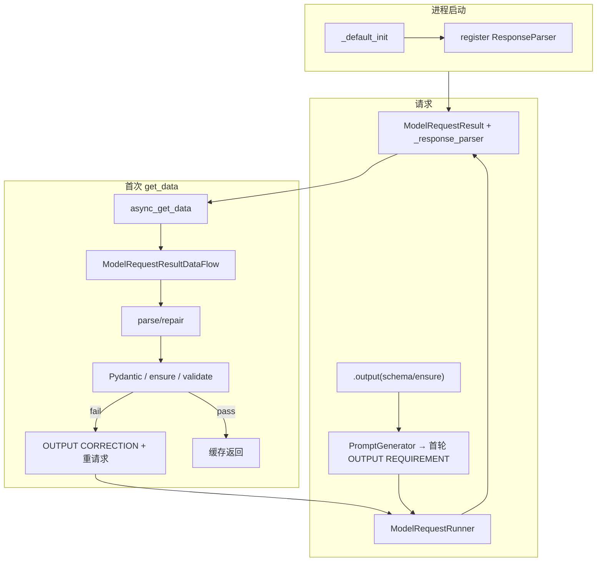

# lg_rag · 多智能体 · 能力网关 · output-control 讨论小结

> **日期**：2026-08-26  
> **状态**：讨论稿（非 freeze 契约）  
> **范围**：ops-desk-api `lg_rag` 旁路图 + 与 Agently 架构对照

---

## 1. evaluate 质量如何确认

`evaluate_node` **不做二次 LLM 打分**，只做确定性映射：

| `chain_meta` 条件 | `quality` | 路由 |
|---|---|---|
| 缺失 | `high` | END（防误 rewrite） |
| `gate_action == answer_partial` | `medium` | END |
| `gate_action == refuse` 或 `kept_count == 0` | `low` | `retry_count < MAX_RETRIES` → rewrite |
| 其他（含 `answer`） | `high` | END |

真值在 evidence chain 内 grader：`exact` / `relevant` / `weak` → `gate_action`（`answer` / `answer_partial` / `refuse`）。

**代码入口**：`app/ops/lg_rag/nodes.py` · `_judge_quality` / `evaluate_node` / `route_by_quality`

---

## 2. 多智能体（supervisor）入口与触发

| 层 | 入口 |
|---|---|
| HTTP | `POST /api/ops/lg-rag/invoke`，`mode: "supervisor"` |
| Python | `ainvoke_supervisor_agent` · `app/ops/lg_rag/multi/graph.py` |

- **默认** `mode="router"`，**不会**因问题内容自动进多智能体。
- 主 Chat（SSE/WS）**未挂** supervisor 图。
- `supervisor_node`：一次性 LLM 拆 ≤4 子任务 → 顺序 fan-out → `aggregator`。
- 架构：**Planner–Worker–Aggregator**，**不是** ReAct（无 Thought→Action→Observation 交织回环）。
- `tool` 子任务：`MOCK_TOOLS` 注册表直调，**非** function call 协议。

---

## 3. ToolManager / Action / 能力网关 / LLM Gateway

### 3.1 Agently 命名

- 旧 `ToolManager` / `action_manager` / `tool_manager` → **deprecated**，指向同一 `Action` 门面。
- 现一等公民：**Action** = `ActionRegistry` + `ActionDispatcher` + `ActionRuntime` + `ActionExecutor`。
- 概念上可称 **Action Gateway**；Agently 无此产品名。

### 3.2 与 ops-desk「能力网关」诉求对齐

| 能力 | Agently | ops-desk 现状 |
|---|---|---|
| FC / MCP / sandbox / CLI 统一入口 | `ActionExecutor` 多后端 | `MOCK_TOOLS` + `app/tools/` 草稿 |
| 筛选 / 挂载 | `use_actions` / tags / policy | plan 内 `tool` 字段 |
| 轻编排 | `ActionRuntime` 多轮 plan | supervisor 拆 plan |
| Skill | `use_skills` / SkillLibrary | 未接 |

**建议**：应用层自建 **Capability Gateway**（Registry · Filter · Invoke · 可选轻编排）；LangGraph `ToolNode` 仅覆盖 FC 协议，不是完整网关。

### 3.3 LLM Gateway（业界常指）

夹在 **应用 ↔ 模型供应商**：路由、failover、限流、计费、多厂商 API 统一、guardrails。

| 产品 | 角色 |
|---|---|
| LiteLLM | 自建 OpenAI 兼容 proxy |
| Portkey | 企业控制面 + guardrails |
| OpenRouter | 托管多模型市场 |

**不是**能力网关；本仓 `get_llm_provider` + fallback 更接近薄 LLM Gateway。

---

## 4. output-control（Agently）

### 4.1 不是 Skill

- **Skill**：`use_skills` 可插拔业务能力包。
- **output-control**：`ResponseParser` + `ModelRequestResultDataFlow`，进程默认注册，**消费 `get_data()` 时**跑完整约束流。

### 4.2 管道（host 权威）

```text
parse/repair → Pydantic → strict output → ensure_keys → custom validate
  → pass 返回 | fail 同一 max_retries 预算内重试（默认 3）
```

- `DataLocator.repair_json_fragment`：**仅 parse 失败后**确定性修 JSON 结构。
- 重试注入 `OUTPUT CORRECTION` 块（`ModelRequestResultDataFlow.retry_get_data`）。

### 4.3 挂载链

```text
_default_init → register(ResponseParser)
ModelRequestResult.__init__ → get_plugin + _response_parser + _data_flow
async_get_data() → ModelRequestResultDataFlow.async_get_data()
```

### 4.4 Mermaid



---

## 5. LangGraph 对照（方向）

| 主题 | LangGraph | ops-desk 建议 |
|---|---|---|
| 结构化输出 | `create_react_agent(..., response_format=schema)` 用 `with_structured_output`；**无** Agently 级 repair/ensure/retry 管道 | 节点出口接 **StructuredOutputGateway**（仿 DataFlow） |
| 工具 | `ToolNode` + `tools_condition`；无 ToolsManager | Capability Gateway + 可选 ToolNode adapter |
| 功能性 Prompt | **无**统一 slot 系统；`create_react_agent(prompt=...)` 仅可选 system；各节点自写 | 保持节点内 `_ROUTER_SYSTEM` 等；公共契约可抽 `app/ops/prompts/` |

---

## 6. 待落地项（讨论 → SPEC → task）

长期 SPEC 已立（初版 · 持续迭代 · **未**授权 30）：

| 项 | SPEC |
|---|---|
| **Capability Gateway** | [`docs/spec/agent-infra/capability/SPEC-capability-gateway_v0.md`](../spec/agent-infra/capability/SPEC-capability-gateway_v0.md) · [ROADMAP portable](../spec/agent-infra/capability/ROADMAP_portable_core_v0.md) |
| **Structured Output Gateway** | [`docs/spec/agent-infra/structured-output/SPEC-structured-output-gateway_v0.md`](../spec/agent-infra/structured-output/SPEC-structured-output-gateway_v0.md) · [ROADMAP hygiene](../spec/agent-infra/structured-output/ROADMAP_kernel_hygiene_v0.md) |
| 索引 / 升级总表 | [`docs/spec/agent-infra/README.md`](../spec/agent-infra/README.md) · [`01_upgrade_roadmap.md`](../spec/agent-infra/01_upgrade_roadmap.md) |

开 task 前须 SPEC `HG-SPEC-SIGNOFF`。命名：勿与业界 **LLM Gateway** 混淆。

---

## 关联入口

| 类型 | 路径 |
|---|---|
| lg_rag router 图 | `app/ops/lg_rag/graph.py` |
| supervisor 图 | `app/ops/lg_rag/multi/graph.py` |
| HTTP 旁路 | `app/ops/lg_rag/router.py` |
| Phase 4 设计 | `docs/guides/DESIGN_langgraph-lg-rag-phase4-multiagent_v1.md` |
| Agent infra SPEC | `docs/spec/agent-infra/` |
| Agently output-control | `Agently/docs/en/requests/output-control.md` |
| Agently Action | `Agently/docs/en/actions/action-runtime.md` |
