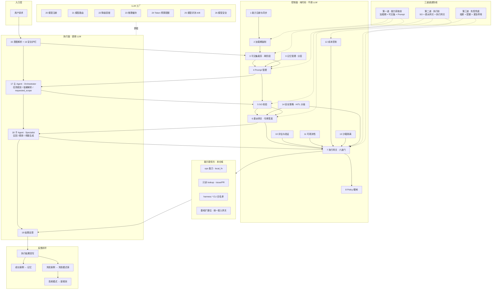

# 2026-09-23 · Agent Host 完整框架大纲（复杂 Agent 进化 · 大模块对照 v0.1）

> **状态**：讨论稿 v0.1（三方测评六点补强）· **非 freeze 契约**；落地以 `docs/spec/` + `docs/tasks/active/` 为准。  
> **立项**：维护者令 2026-09-23「当前主线已经不再是简单的 rag agent，而是在向着一个复杂 Agent 进化」。  
> **范围排除**：**旧业务（admin sync → data 只读面）与系统报警业务场景先不考虑**——原 mermaid 中「旧系统层 / Jev 报警分类 / 根因分析」链路整体不在本大纲内。  
> **上游素材**：维护者所给 mermaid + 《Agent Host 完整模块清单》（五层 34 模块）。  
> **既有轨关系**：本大纲**不替代** `docs/spec/agent-infra/` 既有 SPEC（02 Agent Host Plan H1–H5 已 CLOSE），是其**下一阶段全景参照**——既有 SPEC 解决「把散落的节点收敛成装配面」，本大纲对齐「完整 Agent Host 应该长什么样」。

---

## 1. 主线判断

| 阶段 | 形态 | 现状 |
|---|---|---|
| 旧主线 | `chat` StateGraph RAG 问答（简单 RAG agent） | **legacy**：`/chat/stream` 已 410（T6 · 2026-08-31）；代码/图/表保留作历史拓扑；WS/models/sessions.latest 仍服务 |
| 现主线 | `lg_rag` supervisor 复杂 Agent（静态图 + 动态 plan + 治理闸链） | **活跃主线**：SSE stream/replay/threads/run_events、SO 结构化、Capability 六道闸、HITL 真挂起恢复、memory 注入 |
| 目标形态 | **Agent Host**：控制面（纯代码治理）+ 执行面（LLM 决策）+ LLM 工厂 + 能力提供方 + 反馈闭环 | 本大纲对照对象（34 模块） |

关键判断：本仓**不是从零建 Agent Host**——控制面与执行面的多个核心机制已具雏形（执行网关六道闸与本仓 `_prepare_call` 闸链顺序几乎一致），差距集中在**委派授权、可见集两阶段裁剪、LLM 工厂闭环（预算/缓存/评测）、记忆分层扩展、反馈闭环**五处。

---

## 2. 目标架构总览（裁剪版 · 已剔除旧系统/报警链路）

---

## 3. 大模块对照表（34 模块 → 本仓映射）

判定口径：**已有**=机制落地且主线在用；**雏形**=机制存在但未体系化/默认关；**缺失**=无对应物；**不适用**=单进程/本域下暂不成立（注明触发条件）。

### 3.1 控制面（纯代码 · 不调 LLM）

| # | 目标模块 | 本仓落点 | 判定 | 差距（大模块级） |
|---|---|---|---|---|
| 1 | 能力注册与同步 | `capability`：进程内注册表 + manifest YAML/JSON 显式 register | 雏形 | 单进程够用；**跨进程**才需注册中心写侧/版本号/增量推送/轮询兜底/紧急停用通道——触发条件=多副本或多 Host（`multi-replica-verify` SPEC 已在队列） |
| 2 | 加载期强制 | manifest register 显式加载（禁每请求）+ Policy 默认 blocked | 雏形 | 缺 CI/CD 静态校验面（工程红线缺失→拒绝加载）；缺「安全策略缺失→默认 HITL」的声明式兜底分级 |
| 3 | 可见集裁剪（策略 Builder） | `strategy/builder.py` allowlist（Registry∩Policy · S1）+ 阶段 T 租户谓词 | 雏形 | 已有≈身份维单阶段；缺**场景维**（按请求意图/风险二次裁剪）两阶段管线与「宁可退化成无工具」安全默认的显式承诺 |
| 4 | Prompt 管理 | `prompts/`：packs（pack=comms）+ slots 槽位 + 模板资产化（`memory.extract.system`）| 雏形 | 缺版本灰度/回滚、Token 预算裁剪的体系化、装配审计（版本+变量记录）；H4 已收官但仅 p1 |
| 5 | SO 校验 | `structured_output`：parse/repair/validate/预算纠偏 + `lg_rag/schemas` 域 schema | **已有** | 差距在深度：语义校验（ID/参数/依赖）与通过率审计面 |
| 6 | 委派网关 | supervisor→工人分发 + `subtask_join` step_contract 闸（consumes/produces · prefix_touch_required→hitl_required）| 雏形 | 缺**授权令牌签发**（能力集/TTL/一次性/参数绑定/主体绑定）——当前委派是图内分发，无独立授权产物 |
| 7 | 执行网关（六道门） | `capability/_prepare_call` 闸链：lookup→enabled→Policy→熔断→配额/kill switch→args_schema | **已有** | 顺序与目标六道门几乎一致（熔断先于配额、参数最后）；Policy 拒不计配额已落实 |
| 8 | Policy 硬闸 | capability Policy 门：高危/sandbox/cli 默认 blocked · Host-only 策略键 · `tenant_scoped` · args_schema 形态校验 | 雏形 | 缺「危险程度→副作用→危险形态→输入完整性」四维判定的体系化与可撤销性维度 |
| 9 | 记忆管理（分层） | `memory`（事实/偏好 · 确定性∪向量融合 · 离线抽取 · 状态机）+ `session/`（历史/真摘要）+ threads/turns | 雏形 | 已有≈语义记忆+会话记忆两层；缺**情景记忆**（成功/失败模式沉淀）与共享记忆总线（Pub/Sub · 跨进程时议 · 同步机制见 §6 D3） |
| 10 | 评估与验证 | `evals/agent/redlines/capability_v1.yaml`（行为红线 R0–R15）+ memory 金样校准循环 | 雏形 | 缺 Golden Test Set 作为一级资产、运行时任务完成率指标、失败模式聚类管线 |
| 11 | 可观测性 | `tracing.py`（Langfuse）+ capability `metrics.py`/`visibility.py` + admin 观测端点 + run_events 落盘/replay | 雏形 | 缺四大黄金信号与 SLI/SLO 的显式定义；审计日志分散（logger 面）未成台账——**审计台账应含**：能力调用 / HITL 审批 / 紧急停用 / Policy 拦截 / 可见集裁剪剔除项；**SLI/SLO 候选**：端到端延迟 P99 / 任务完成率 / 能力命中率 / Cost per Successful Task |
| 12 | 成本控制 | `ops_llm_usage` 账本（run 级聚合 · task_type 归因）+ 任务分档路由 | 雏形 | **记账有、闸门无**：缺会话/任务级预算硬闸与预算耗尽降级链（→规则引擎/缓存） |
| 13 | 沙箱隔离 | Policy 中 sandbox/cli 类默认 blocked（H2 标记位） | 不适用→缺失 | 单进程内以 Policy 默认 blocked 替代（够用）；触发条件=执行不可信代码或跨进程部署；跨进程时 microVM 隔离 + 网络策略默认拒绝（仅允许访问网关） |
| 14 | 安全策略（HITL 分级） | `hitl`：interrupt 真挂起 + `Command(resume)` 真恢复 + HMAC/管理员双口径 + step_contract→hitl_required | 雏形 | 已有单档 HITL_REQUIRED 等价物；缺 PRE_AUTHORIZED / HITL_EXEMPT 分级与 `max_reversal_latency` 可撤销性声明 |

### 3.2 执行面（调用 LLM）

| # | 目标模块 | 本仓落点 | 判定 | 差距 |
|---|---|---|---|---|
| 15 | 意图解析 | `strategy/intent.py` intent_node（IntentV1 · acomplete_structured · S2） | **已有** | 走中大 LLM 结构化；目标是小模型/专项分类器（100-200ms）——降档依赖 LLM 工厂路由 |
| 16 | 安全护栏检测 | `prompts/slots` 输入隔离（rag_evidence/user_query/tool_result 槽 · 默认关 · off 态逐字节） | 雏形 | 槽位隔离≠注入检测；缺专项护栏分类器（可与意图解析合并档位） |
| 17 | 主 Agent（Orchestrator） | lg_rag supervisor：planner 拆解 + critic 条件边 + ReAct 收口（≤2 轮）+ observe 执行层收口 + 总步预算 32 | **已有** | 缺显式 `requested_scope` 声明（当前 scope=Builder allowlist 隐式表达） |
| 18 | 子 Agent（Specialist） | 工人节点：`rag_subtask`（复用 router 子图）/ `info_extract` / `tool_exec`（走 capability）+ 并发归并 | **已有** | 精排缺独立小模型档（`rag-reranker-p0` SPEC 在队列）；召回纯代码（hybrid dense+FTS）已符合 |
| 19 | 结果反馈 | aggregator LLM 综合 + answer 多帧 delta/终帧（token sink 桥 · 降级整段） | **已有** | 模板化小 LLM 档可后议 |

### 3.3 LLM 工厂（基础组件）

| # | 目标模块 | 本仓落点 | 判定 | 差距 |
|---|---|---|---|---|
| 20 | 模型注册与版本 | `llm/model_catalog.py`（TASK_TIER_MODELS · answer/grader/extract/structured/summary 档） | 雏形 | 缺能力标签（推理/分类/Embedding）元数据与版本号管理 |
| 21 | 模型路由 | 任务分档路由 + `OPS_LLM_TIER_*` env 覆盖 | 雏形 | 路由规则已纯代码；缺按能力标签的声明式路由 |
| 22 | 降级与容错 | `BaseProviderImpl`：指数退避+jitter 重试 + provider 级熔断（pybreaker · open 零出网）；capability `fallback.py` 降级链（声明才降级 · 必带 `degraded` 标记） | **已有** | 缺「大模型→小模型→规则引擎」跨档降级的显式链（当前是同档重试+熔断） |
| 23 | 推理缓存 | — | **缺失** | 缓存对象=高频意图 plan 模板 + 高频能力参数模板；命中→跳过 LLM 直接返回（缓存键=intent/capability+参数哈希 · 失效随模型/prompt 版本 bump） |
| 24 | Token 预算与配额 | `ops_llm_usage` 账本 + capability 会话配额/kill switch | 雏形 | usage 是账本不是预算；缺预算硬闸与耗尽降级闭环（路径：小模型档→规则引擎/缓存）与 Cost per Successful Task 指标 |
| 25 | 模型评测 A/B | memory 抽取校准循环（version bump 归因 · 金样 50）局部成立 | 雏形 | 缺全任务面 Golden Test Set 与模型更新回归机制 |
| 26 | 模型安全 | slots 输入隔离（雏形）· grader 故障 refuse | 雏形 | 缺输出侧敏感信息过滤——应入 LLM 工厂统一出口（与安全护栏检测联动 · 非各调用点自管） |

### 3.4 能力提供方（本仓域）

| # | 目标模块 | 本仓落点 | 判定 |
|---|---|---|---|
| 27-29 | 垂域服务（车控/座舱/导航） | 本仓为 ops 域，无车控垂域 | 不适用（域差异） |
| 30 | 其他垂域统一接入 | capability：local_fn（真实函数）+ mock 探针 + skill stub + 本库 issue/PR 只读 lookup（tenant 谓词必带）+ `harness.*` CLI 白名单（禁 shell · 双键策略）+ `task_writer` 受控写盘 | **已有**（本域等价物） |

### 3.5 反馈闭环

| # | 目标模块 | 本仓落点 | 判定 | 差距 |
|---|---|---|---|---|
| 31 | 结果回写 | `ops_lg_rag_run_events` 事件落盘 + replay cursor | **已有** | — |
| 32 | 成功案例→记忆 | memory 离线候选抽取（run 后触发 · 全过 `should_write` 闸 · 可一键 revoke） | 雏形 | 当前抽取目标是事实/偏好，非「成功模式」 |
| 33 | 失败案例→失败模式库 | — | **缺失** | 失败聚类分析管线 |
| 34 | 高频模式→新规则 | redlines R0–R15 为人工沉淀 | 雏形 | 缺「聚类→规则」自动/半自动回写 |

---

## 4. 三道防线 → 本仓机制映射

| 防线 | 目标构成 | 本仓现状 |
|---|---|---|
| **D1 能力获取前** | 加载期强制 + 可见集裁剪 + Prompt 管理 | manifest 显式 register + Policy 默认 blocked（加载期）· Builder allowlist Registry∩Policy（裁剪单阶段）· prompts packs/slots（装配）——**骨架已立，缺场景维与静态校验面** |
| **D2 执行前** | SO 校验 + 委派网关 + 执行网关 | structured_output 网关 ✓ · step_contract 闸 + hitl_required（委派雏形）· `_prepare_call` 六道闸 ✓——**最强的一道** |
| **D3 失控兜底** | 熔断 + 配额 + 紧急停用 | capability circuit（pybreaker）+ 会话配额/kill switch + llm provider 熔断 + 总步预算 32/墙钟 ✓——缺**紧急停用高优先级通道**（当前停用=改 manifest + reload） |

---

## 5. 废弃 / 休眠 / 非主线清单（「不针对性读取则不默认考虑」约定）

> 约定：以下面在 `_tech_graph` 双层标注（读序层 README + 模块表层 01_modules），**代码/节点/边/indexes 一律不删**（承 T6 先例）；Agent 默认上下文不纳入，仅在明确涉及（如维护 WS 兼容、查历史拓扑）时针对性读取。

| 面 | 标记 | 理由 | 仍服务的部分 |
|---|---|---|---|
| `chat` 流式面（graph/nodes/service/streaming/sse） | **legacy** | T6 `/chat/stream` 410 下线 · 简单 RAG agent 旧主线 | `WS /chat/ws` · `GET /chat/models` · `GET /chat/sessions/latest`（iOS/演示消费）|
| lg_rag `basic` / `router` 模式 | **对照/降级轨** | supervisor 为默认主线（stream 默认 mode=supervisor） | invoke 显式 mode 可调；作 supervisor 退化对照 |
| `lc_evidence_chain` | **内部依赖面** | 被 lg_rag 黑盒复用（`ainvoke_evidence_answer`）；非独立演进面 | HTTP `/lc-evidence/invoke` 仍在 freeze（lc-evidence-http-v1）|
| `skill_registry`（H5 stub） | **dormant** | 无运行时消费方（仅 `tests/test_skill_registry.py` 自引用）；Skill NL 匹配属远期 | — |
| `data`（overview/issues/pulls/graph 只读） | **旧业务面** | admin sync 消费链 · 非 Agent 主线 | 只读查询继续服务 Chat/iOS |
| `rag` 直接面 | **内部依赖面** | 经 lc_evidence_chain / memory 间接消费 · 不独立对 Agent 暴露 | ingest/hybrid 召回持续演进（qdrant-migration / reranker 在队列）|

---

## 6. 大模块级后续方向（**只思考不落地** · 落地另起 SPEC/task）

按「缺口价值 × 与主线距离」分组排序，均不超出现有包边界哲学（能入既有模块就不开新一级模块）：

### 组 A · 委派与授权（距主线最近）
- **A1 委派令牌**：step_contract 闸之后补「授权产物」——令牌内容：**能力集 / TTL / 一次性 / 参数约束 / 主体绑定 / 签名**；**签发本身是高危操作，必须走 HITL 或安全域审批**；先图内（subtask_id 绑定）后跨进程。
- **A2 requested_scope 显式化**：supervisor plan 输出携带声明式 scope，Builder 从「隐式 allowlist」升级为「声明∩裁剪」。

### 组 B · 可见集与安全策略
- **B1 场景维裁剪**：意图/风险级别驱动的第二阶段裁剪，安全默认「宁可退化成无工具」。
- **B2 HITL 分级**：HITL_REQUIRED / PRE_AUTHORIZED / HITL_EXEMPT 三档声明式兜底 + **可撤销性声明进 manifest**：`reversible: true/false` · `execution_type: instant/target/process` · `max_reversal_latency` · `requires_stop_support`——这些字段直接决定预授权模型与撤销窗口。

### 组 C · LLM 工厂闭环
- **C1 预算硬闸**：usage 账本 → 会话/任务级预算 → 耗尽降级（小模型档→规则/缓存）；Cost per Successful Task 指标。
- **C2 推理缓存**：高频意图 plan 模板 + 高频能力参数模板（命中跳过 LLM）。
- **C3 跨档降级链**：大模型超时→小模型档→规则引擎的显式路由（当前同档重试+熔断之上）；**路由层声明式降级策略**——档级 fallback 声明进模型目录（`model_catalog`），不散落在调用点。

### 组 D · 记忆与反馈
- **D1 情景记忆**：成功/失败模式沉淀（与事实记忆分库分闸）。
- **D2 失败模式库 → 规则回写**：聚类管线 + 高频模式沉淀 redlines/manifest 的半自动回路。
- **D3 记忆跨进程同步**（触发条件与 `multi-replica-verify` 对齐）：多 Agent 共享记忆的冲突底座三件套——**事件溯源**（仅追加日志 + 确定性投影）· **CRDT**（G-Counter / OR-Set / LWW-Register 按数据形态选型）· **乐观锁**（版本号检测 + 冲突重试）；单进程期不建，多副本实证后立项。

### 组 E · 跨进程（触发条件驱动，当前不适用）
- 注册中心同步/紧急停用通道/microVM 沙箱：以 `multi-replica-verify` 结论为前置；单进程期一律不建。

### 显式不做（承 02 轨非目标）
- 动态 StateGraph compile；模型可选「校验 tool」（SO/Policy 必须 Host 权威）；完整 Skill 执行引擎；生产级无限制 sandbox。

---

## 修订记录

| 日期 | 版本 | 内容 |
|---|---|---|
| 2026-09-23 | v0 | 初版（维护者令 · 五层 34 模块对照） |
| 2026-09-23 | v0.1 | 三方测评补强六点：① 组 D 增 **D3 记忆跨进程同步**（事件溯源 + CRDT + 乐观锁 · 触发条件对齐 multi-replica-verify）· ② LLM 工厂细化（#23 缓存对象与命中机制 · #24 耗尽降级路径 · #26 输出侧过滤入统一出口 · C3 声明式降级策略）· ③ #11 审计台账内容清单 + SLI/SLO 候选 · ④ B2 可撤销性四字段进 manifest（reversible / execution_type / max_reversal_latency / requires_stop_support）· ⑤ A1 令牌六字段 + 签发走高危审批 · ⑥ #13 沙箱单进程替代与跨进程形态写清 |

## 7. 关联

- 图谱：`docs/_tech_graph/l1/01_modules.md`（主线/legacy 标记真值）· `docs/_tech_graph/README.md`（读序约定）
- 既有 SPEC 轨：`docs/spec/agent-infra/`（00 架构边界 · 02 Agent Host Plan H1–H5 CLOSE · 03 strategy/intent · 04 eval/obs · 05 transport/session · 06 host_comms）
- 相关讨论：`2026-08-26_lg-rag-agent-capability-architecture.md` · `2026-08-26_agent-host-architecture-phase-summary.md`
- 本 task：`docs/tasks/active/task_agent_host_framework_alignment.md`
- 代码入口：`app/ops/lg_rag/multi/`（supervisor）· `app/ops/capability/`（执行网关）· `app/ops/strategy/`（Builder/Intent/Critic）· `app/llm/`（LLM 工厂雏形）
