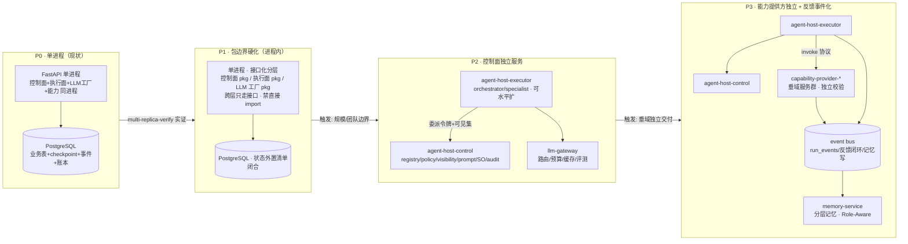

# 2026-09-23 · Agent Host 工程架构升级方案（进程内 → 多服务 · 企业 Harness 基础模板 v0）

> **状态**：讨论稿 v0 · **非 freeze 契约**；落地以 `docs/spec/` + `docs/tasks/active/` 为准。  
> **立项**：维护者令 2026-09-23「后续关注 Agent Host 架构升级，当前方案可以落地在进程内，但需要考虑后续分不同服务项目的工程架构升级方案，作为企业可用 harness 的基础模板来落地」。  
> **与昨日大纲的分工**：`2026-09-23_agent-host-full-framework-outline_v0.md` 回答**功能面**「完整 Agent Host 长什么样」（五层 34 模块对照）；本文回答**工程面**「怎么从单进程长到多服务」+「哪些沉淀为企业可复用模板」。  
> **直接上游**：`docs/spec/multi-replica-verify/SPEC-multi-replica-verify_v1.md`（**signed** · 单实例→多实例验证轨 · 产出「进程内状态边界清单」= 本文 P1 的实证输入）· `docs/spec/agent-infra/06_host_comms_boundary_spec_v0.md`（Host 沟通边界）。

---

## 1. 定位：一条主线，两个时间尺度

| 时间尺度 | 形态 | 判据 |
|---|---|---|
| **现在（近期落地）** | **进程内 Agent Host**：单 FastAPI 进程，控制面/执行面/LLM 工厂/能力提供方同进程 | 功能面缺口（昨日大纲组 A–D）全部可以在进程内闭环，**不提前分布式** |
| **未来（工程升级）** | **多服务项目**：按五层天然边界拆服务，本仓沉淀为**企业可用 Harness 基础模板** | 触发条件 = 多副本实证结论 + 真实规模压力（租户数/并发/团队边界），不为拆而拆 |

核心论点：**进程内落地期与多服务期不是两版架构，而是同一套边界的两种部署形态**。差别只在「边界上是函数调用还是网络调用」。因此现在的每一行进程内代码都要按「未来可拆」写——本文 §4 的可拆性约束就是保证「拆的时候只换传输层，不改业务语义」。

---

## 2. 部署形态演进总览

| 阶段 | 一句话 | 出口标准 |
|---|---|---|
| **P0 单进程** | 现状：全部同进程，PG 承载状态 | 已在 |
| **P1 包边界硬化** | 进程不动，**接口动**：跨层调用全部接口化；进程内状态边界清单闭合 | multi-replica-verify 报告全绿；双进程共享 PG 无语义错误 |
| **P2 控制面独立** | 控制面（纯代码无 GPU 依赖）先拆为独立服务；执行面 worker 化可水平扩 | 委派令牌跨服务验签；可见集裁剪 <10ms p99；executor 无状态（状态全在 PG/bus） |
| **P3 提供方独立 + 事件化** | 垂域能力独立交付；run_events/反馈闭环走 event bus；记忆独立服务 | 提供方独立发版不影响 Host；反馈闭环 consumer 可插拔 |

---

## 3. 拆分原则

1. **按五层天然边界拆，不按代码量拆**：控制面（纯代码 · 无 GPU · 高可用治理面）/ 执行面（LLM 密集 · 水平扩）/ LLM 工厂（模型供给 · 独立伸缩与计费）/ 能力提供方（垂域 · 独立交付节奏）/ 反馈闭环（异步 · 事件驱动）。昨日大纲的 34 模块表即服务归属表的种子。
2. **控制面先拆**：它无 LLM 依赖、无状态（注册表读侧缓存 + PG），是天然的第一个独立服务；也是企业模板里「最通用」的部分（任何业务域都需要治理面）。
3. **状态只在一个地方**：PG（强一致：registry/checkpoint/审批/账本）→ event bus（流：run_events/反馈）→ 对象/向量存储（记忆/语料）。executor 永远无状态。
4. **契约先行**：所有跨服务接口 = 已有 freeze 契约的网络化（lg-rag-sse-v1 / capability invoke / SO schema / HITL callback），契约测试从「进程内 freeze 测试」平移为「服务间契约测试」。
5. **tenant 全程贯穿**：阶段 T 的租户谓词纪律（ContextVar → SQL 谓词 → capability `tenant_scoped`）是多服务期的硬前提，跨服务调用令牌必须绑 tenant。

---

## 4. 进程内落地期必须遵守的可拆性约束（P0/P1 就写对）

> 这七条是「现在写进程内代码时就遵守，未来拆分零语义改动」的清单。每条给出本仓现状锚点——多数已有雏形，缺的是把它升为**纪律**。

| # | 约束 | 本仓现状锚点 | 差距 |
|---|---|---|---|
| C1 | **注册表读写分离接口**：读侧永远走本地缓存抽象，写侧抽象为「注册中心客户端」接口 | capability 进程内 registry + manifest 显式 register | 读写已分但接口未抽象成可替换实现（本地 dict ↔ 远程 client）；P1 补接口层 |
| C2 | **委派必带授权产物**：任何主→子委派都签发令牌（能力集/TTL/一次性/参数绑定/主体绑定），即使图内分发 | step_contract 闸 + hitl_required 已有「校验点」 | 令牌本身缺失（昨日大纲组 A1）；**先在图内签发，未来天然跨服务验签** |
| C3 | **一切结果事件化**：执行结果/审批/降级先写事件流再消费，不允许「内存直通」 | `ops_lg_rag_run_events` 落盘 + replay cursor + persist 后台不阻塞 yield | 事件已落 PG 表；P3 时表→bus 只是换 sink（event sourcing 语义已具备） |
| C4 | **能力调用协议化**：invoke 请求/响应是 wire-friendly 契约（幂等键/回执/输出契约/降级标记），不依赖进程内对象 | capability `idempotency.py`/`receipts.py`/`result_contract.py`/`fallback.py`（`degraded` 标记跟数据走） | **最成熟的一条**；P3 时 protocol buffer/JSON-RPC 化仅是序列化层 |
| C5 | **跨层禁直接 import**：模块表依赖出边 = 未来服务边界；控制面任何模块不得 import LLM provider | `01_modules.md` 依赖方向列 + ruff 可机查 | 缺机械闸（import-linter 类 CI 规则）——低成本高杠杆，P1 第一件事 |
| C6 | **租户上下文全程 ContextVar**，跨进程边界处显式序列化进令牌/消息头 | 阶段 T：`X-Ops-Tenant-Id` vs session 403 + ContextVar 注入 + lookup SQL 必带 tenant 谓词 | 已有；多服务期扩为「tenant 进委派令牌声明」（C2 联动） |
| C7 | **配置/策略即代码**：Policy/可见集规则/预算阈值全部声明式可版本化，禁散落环境变量 | Policy 键 Host-only + `OPS_LLM_TIER_*` env + manifest YAML | env 仍偏多；企业模板期收敛为「策略包」（版本化 + 灰度 + 审计，承 prompts 资产化先例） |

---

## 5. 目标多服务拓扑（P3 稳态）

| 服务 | 职责（34 模块映射） | 通信 | 数据 ownership | 伸缩特征 |
|---|---|---|---|---|
| **agent-host-control** | 控制面 #1-8, #14：registry/policy/visibility/prompt 管理/SO schema/委派令牌签发/审计 | 对 executor 暴露：可见集查询、令牌签发/验签、SO schema 下发（REST/gRPC · 读多写少 + 本地缓存） | registry 表、policy 声明、audit 日志 | 无状态 · 多副本 · 读侧重缓存 |
| **agent-host-executor** | 执行面 #15-19：意图/护栏/orchestrator/specialist/反馈生成 | 调 control（裁剪/令牌）、llm-gateway（推理）、provider（invoke）、bus（事件） | 无（checkpoint/thread 在 PG） | LLM 密集 · 按并发水平扩 |
| **llm-gateway** | LLM 工厂 #20-26：模型注册/路由/降级/推理缓存/预算/评测/过滤 | 对 executor 暴露 unified complete/stream（OpenAI-compatible 超集） | 模型目录、usage 账本、缓存 | 按 token 吞吐扩 · 独立计费 |
| **capability-provider-*** | #27-30 垂域服务群 | invoke 协议（C4 契约网络化）· 各自独立校验 | 各自垂域数据 | 按垂域独立交付/扩缩 |
| **memory-service** | #9 分层记忆 + #32 成功案例沉淀 | bus consumer（异步写）+ 召回查询 API | 记忆库（PG+向量）· **写冲突三层：事件溯源=底座 · CRDT=合并层 · 乐观锁=闸门**（Tier 1/2/3 见功能面大纲 §6 D3 详述） | 写走 bus · 读可缓存 |
| **event-bus** | #31-34 反馈闭环载体：run_events/失败模式/规则回写 | Kafka/NATS 等 | 事件流 | 基础设施 |
| **企业侧既有** | SSO/tenant 网关、可观测栈（Langfuse→OTel）、CI/CD | — | — | 复用企业平台 |

**关键链路（一次请求）**：executor 收请求 → control 裁可见集+签发委派令牌 → executor 经 llm-gateway 规划 → 子任务携令牌 invoke provider（provider 独立验签+校验）→ 结果写 bus → memory-service 消费沉淀 → control 审计闭环。全链路 run_id/tenant 贯穿（C6）。

---

## 6. 企业 Harness 基础模板：什么进模板、什么留业务

本仓要沉淀的「企业可用 harness 基础模板」= **把治理面与工程纪律产品化**，业务域（ops-desk）只是模板的第一个实例。

| 层 | 进模板（domain-agnostic） | 留业务（domain-specific） |
|---|---|---|
| 控制面 | registry/policy 四判/可见集两阶段/委派令牌/SO 内核/HITL 分级/审计 schema | Policy 规则集、可见集规则、垂域 schema（`lg_rag/schemas` 先例：域 schema 本就不在内核） |
| 执行面 | orchestrator/specialist 骨架（静态图+动态 plan）、SO 管道、并发归并 | 领域 prompt pack、领域工人节点（rag_subtask 等） |
| LLM 工厂 | 分档路由/熔断重试/usage 账本/预算闸/评测框架 | 模型目录与档位配置 |
| 能力面 | invoke 协议（幂等/回执/输出契约/降级标记）、manifest 格式、加载期强制 | 具体 capability 实现 |
| 工程纪律 | **spec-wave 过程轨**（task/闸/verify/review）、_tech_graph 分层（G-L0/L1/L2）、freeze 契约测试、CI 机械闸、FEEDBACK 回路 | 具体图谱内容 |
| 部署 | helm/k8s 参考（P2/P3 拓扑）、状态外置 checklist、双副本验证 runbook | 实际环境参数 |

模板交付形态建议：**一个治理内核包 + 一个参考实现仓**（本仓即参考实现）+ 一份采纳 runbook（从「单进程最小落地」到「P3 全拆」的阶梯）。企业采纳者最小起步 = 单进程 P0 + 七条可拆性约束 + spec-wave 过程轨，按需上楼。

---

## 7. 分阶段路线（每阶段都有「不上楼也能停」的稳态）

| 阶段 | 内容 | 前置 | 出口标准 | 对应既有轨 |
|---|---|---|---|---|
| **M0** | 功能面缺口补齐（昨日大纲组 A-D：委派令牌图内化 · 场景维裁剪 · 预算闸 · 情景记忆）——**全在进程内** | — | 组 A/B 落地 | 新 SPEC（待立） |
| **M1** | 可拆性硬化：C5 import 机械闸 + C1 registry 接口抽象 + C7 策略收敛 + 状态边界清单闭合 | **multi-replica-verify 报告** | 双进程共享 PG 全绿 + import-linter CI 绿 | `multi-replica-verify`（signed · 待实施） |
| **M2** | llm-gateway 先独立（最成熟 · C4 同款协议化思路 · 账本已在 PG） | M1 | executor 经 gateway 推理 · 业务零感知 | 新 SPEC（待立） |
| **M3** | control 独立服务 + executor worker 化（委派令牌跨服务验签） | M2 | 可见集 p99 <10ms · executor 无状态 | — |
| **M4** | provider 独立 + bus 事件化 + memory-service（事件 sink 从 PG 表换 bus） | M3 | provider 独立发版 · 反馈闭环 consumer 可插拔 | — |
| **M5** | 模板化打包：治理内核包抽离 + 采纳 runbook + 参考部署 | M3 稳态即可开始 | 第二个业务域按 runbook 复刻成功 | — |

**顺序纪律**（承 02 轨「顺序钉死」先例）：M1 不过不开 M2；M5 可与 M3 并行但不先于。每阶段结束都是可用稳态，不强求上楼。

---

## 8. 与既有资产的关系

| 资产 | 关系 |
|---|---|
| `multi-replica-verify` SPEC（signed） | **M1 的直接前置**：其「进程内状态边界清单」+ 双进程验证 = C3/C5/C6 的实证基线 |
| `06_host_comms_boundary_spec`（signed） | Host 间沟通边界（comms vs product）——多 Host 企业部署时的话术/产物边界已定 |
| 昨日大纲（功能面 34 模块） | 服务归属表的种子（§3 原则 1）；M0 即其组 A-D |
| FEEDBACK F-2（图谱漂移闸）/ F-3（pins 保鲜） | 多仓时代更刚需：模板化后 _tech_graph 与钉版纪律跨仓复制，机械闸价值放大 |
| `harness.*` capability（harness_cli） | 模板中「agent 调用过程轨」的先例——企业模板里 process kernel 也是一等能力 |

---

## 9. 显式不做 / 风险

**显式不做**：不为拆而拆（P0→P1 全靠触发条件）；不引入服务网格/复杂中间件（P2 用 REST/gRPC 直白调用）；不重写已 stable 的 Gateway 内核（承 02 轨非目标）；模板不做「万能框架」——只做治理内核 + 参考实现。

**风险与对冲**：

| 风险 | 对冲 |
|---|---|
| 提前抽象（P0 期过度设计接口） | 七条约束只有 C5（import 闸）是立即动作，其余随 M1 实证补——「先纪律后抽象」 |
| 跨服务令牌验签性能 | 令牌自包含签名（JWT 类）· 验签零回调 control |
| 事件化后一致性口径 | run_events 已「落盘 + cursor replay」语义；换 bus 保同一 cursor 契约 |
| 模板化分散业务迭代精力 | M5 设在 M3 稳态后；模板抽离以「复制→泛化」而非「重写」方式做 |

---

## 10. 关联

- 功能面大纲：`2026-09-23_agent-host-full-framework-outline_v0.md`（34 模块对照 · 三道防线 · 废弃清单）
- SPEC：`docs/spec/multi-replica-verify/`（signed · M1 前置）· `docs/spec/agent-infra/`（00/02/06 · H1–H5 CLOSE）
- 图谱：`docs/_tech_graph/l1/01_modules.md`（模块依赖出边 = 未来服务边界真值）
- 反馈：`docs/harness/evidence/FEEDBACK_spec_wave_3_0_1_from_ops_desk_api_20260923.md`（F-2/F-3 多仓放大）
