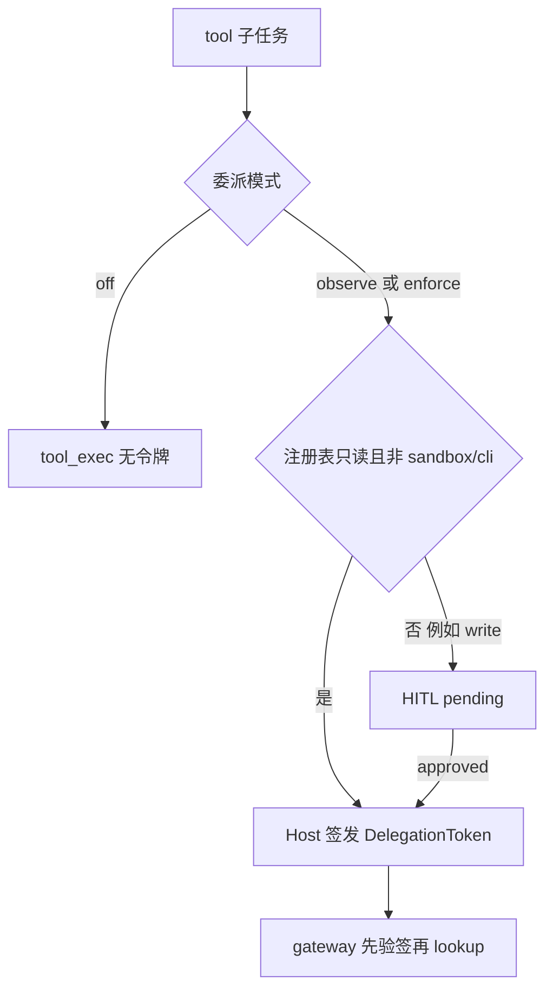
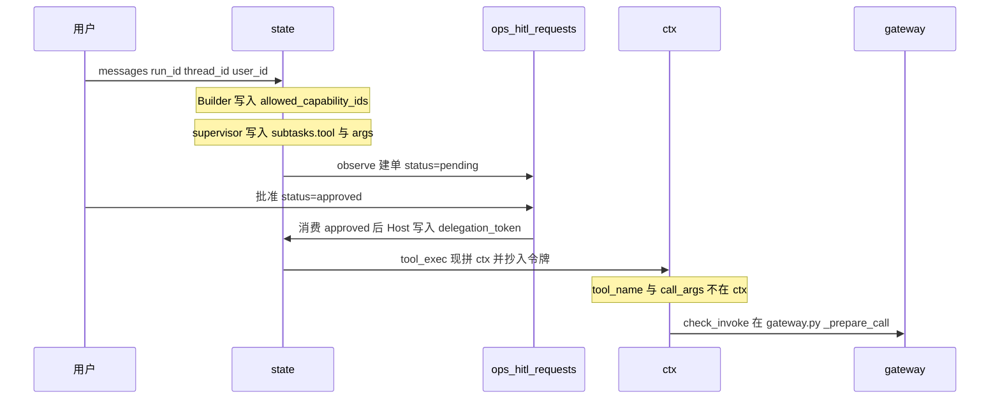

# 2026-10-19 · testing.write.echo 一次调用与委派令牌

> **状态**：讨论记录 · **非 freeze** · 不改代码命名  
> **架构总图**：[`2026-09-24_agent-host_current_architecture_v1_zh.md`](./2026-09-24_agent-host_current_architecture_v1_zh.md) §1.2（控制面节点「委派令牌」= 大纲 **#6**）  
> **模块详页**：[`agent-host-current-architecture/modules/M06_delegation-gateway.md`](./agent-host-current-architecture/modules/M06_delegation-gateway.md)  
> **浏览器**：架构浏览器 `#/host/6`（crosswalk `host_id: 6` 的 sources 含本文）  
> **能力清单**：`app/ops/capability/manifests/testing.v1.yaml` · id `testing.write.echo`  
> **代码**：`app/ops/capability/delegation.py` · `gateway.py` `_prepare_call` / `_delegation_gate` · `app/ops/lg_rag/multi/nodes.py`

本文只解释现网。supervisor 图「意图后置 / 规划失败即失败」见 `docs/spec/supervisor-first-fail-closed/`，不改变下面的令牌与写闸。

---

## 1. 命名（讨论，不改名）

`DelegationToken` 作为**那张票**是准的：HMAC、能力集、主体、过期、nonce、参数约束，都是凭据上的字段。

感觉「超过单纯校验」来自**模块**而不来自**类型名**。`delegation.py` 同时做了三件不同的事：

| 片 | 实际职责 | 更贴的叫法（仅讨论） |
|----|----------|----------------------|
| `DelegationToken` + `issue_token` / `verify_serialized` | 自包含通行证 | 保持 DelegationToken |
| `auto_approve_ok` | 签发前决定：只读自动发，还是先 HITL | 签发策略 IssuancePolicy |
| `_delegation_gate` | 执行前验票，失败则不 lookup | 验签门，属于执行网关第一道 |

总图把整块收成控制面 **#6 委派网关**，没有把令牌画成独立一层，因为验签发生在执行网关内部，签发发生在 `subtask_join`，中间还夹着 HITL。票不是一层运行时。

---

## 2. 委派何时存在

`LG_RAG_DELEGATION_TOKEN_MODE`：

| 值 | 行为 |
|----|------|
| `off`（默认） | 不签发、不验签 |
| `observe` | 该签发照签，验签失败只记日志仍继续 |
| `enforce` | 验签失败拒绝执行 |

打开之后**不是**只有 HITL 才有令牌。

只读工具在分发时直接签发。`testing.write.echo` 的 `side_effect=write`，所以先建单、人批、再签发。

令牌能力（`delegation.py` 模块头纪律）：

- 能力集：调用的 id 必须在票内，否则 `out_of_set`
- 主体：`tenant_id` / `user_id` / `run_id` / `subtask_id`，否则 `subject_mismatch`
- 参数约束：`enum` / `max_len` / `pattern`，否则 `param_violation`；未知约束类型拒绝签发
- 墙钟 TTL，默认 600 秒；HITL 挂起不续期；过期 `expired`
- 默认一次性 nonce；重放 `nonce_reused`；同一步重签发作废旧 nonce
- HMAC，密钥 `LG_RAG_DELEGATION_TOKEN_SECRET`，模型不可见
- 验签在 `gateway._prepare_call` 的 lookup **之前**；失败不落回执
- 审计只记动作和 id，不记参数原文
- nonce 登记在进程内；跨进程防重放不在本波

`allow_write` 不是令牌字段。写闸在 Policy，读环境变量 `OPS_CAPABILITY_ALLOW_WRITE` 或 `ctx["_host_policy"]["allow_write"]`。主路径 ctx 不放 `_host_policy`。

---

## 3. 一次 `testing.write.echo`（须显式打开）

清单默认不加载。走通这条链的环境变量：

- `OPS_CAPABILITY_EXTRA_MANIFESTS` 指向 `testing.v1.yaml`
- `OPS_CAPABILITY_ALLOW_WRITE_TAGS=testing`（只豁免 `deny_write`，不豁免 high）
- `OPS_STRATEGY_EXTRA_CANDIDATE_CAPABILITY_IDS=testing.write.echo`
- `LG_RAG_DELEGATION_TOKEN_MODE=enforce`
- `OPS_CAPABILITY_ALLOW_WRITE=1`（否则人批且令牌有效仍会 `write_not_confirmed`）

能力本身：`kind=local_fn`，`risk_level=medium`，`side_effect=write`，`hitl.required=true`，语义 mock，无真实写。

用户问：「帮我记一条测试备注 note=hello」。

| 时刻 | state | store | ctx |
|------|--------|--------|-----|
| 入口 | `messages` `run_id` `thread_id` `user_id` | 无单 | 不存在 |
| Builder | `allowed_capability_ids` 含该 id | 无单 | 不存在 |
| 规划 | `subtasks[].tool=testing.write.echo`，`args={note:hello}` | 无单 | 不存在 |
| 签发被拦 | 该步结果 `blocked_by=delegation_issue_hitl_required`，尚无令牌 | `pending`，`payload.capability_id` | 不存在 |
| 人批 | 图停在 interrupt | `approved` + `decision_by` / `decided_at` | 不存在 |
| 恢复签发 | `delegation_token`、`hitl_unlocked_ids` | 仍无 `allow_write` | 不存在 |
| tool_exec | 令牌留在 state | 不读 allow_write | `tenant_id` `run_id` `subtask_id` `user_id` `_delegation_required` `_delegation_token` |

`tool_name`、`call_args` 是 `tool_exec_node` 的局部变量，来自子任务，和 ctx 并列传给 `ainvoke`。`SubtaskItem` 为 `extra=ignore`，模型写在子任务顶层的 `allow_write` 不会进入 state。写在 `args` 里会当成业务参数传给适配器，Policy 与验签都不读它。

Gateway：`_delegation_gate` 先验 `ctx["_delegation_token"]`，通过后 lookup，再到 `check_invoke`（`gateway.py` 的 `_prepare_call`）。写闸只看环境变量与 `_host_policy`。store 列是 `id/run_id/thread_id/checkpoint_id/tenant_id/subtask_id/blocked_by/unlock_subtask_id/reason/detail/payload/status` 以及人批字段，没有 `allow_write`，也没有令牌原文。

模型可以在菜单里选 tool 和填业务 args。模型不能签发令牌、不能把 store 改成 approved、不能用顶层或 args 里的 `allow_write` 打开 Policy。

---

## 4. 和总架构图的对应

总图（上文「架构总图」§1.2）里：

- **#6 委派令牌**：本文 §2 的签发与验签
- **#7 执行网关**：验签之后的 lookup、Policy、熔断、配额、schema
- **#8 Policy**：`allow_write` / `allow_high_risk`，与令牌分开
- **#14 HITL**：写能力在签发前的挂起；只读自动签发不经过这里

五层概念图不把令牌单列成层，因为它是控制面 #6 的机制，画在「执行面工人 → 执行网关」那条边上。
