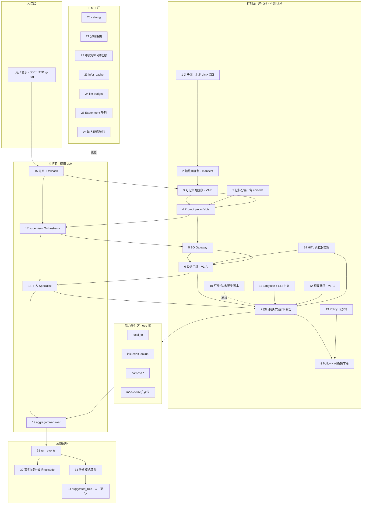

# 2026-09-24 · Agent Host 当前总架构（对照大纲目标）与缺口

> **状态**：讨论/对照稿 v1 · **非 freeze**  
> **目标真值**：[2026-09-23_agent-host-full-framework-outline_v0.md](../2026-09-23_agent-host-full-framework-outline_v0.md)（§2 目标总架构 · §3 三十四模块）  
> **工程真值**：[2026-09-23_agent-host-multi-service-engineering-architecture_v0.md](../2026-09-23_agent-host-multi-service-engineering-architecture_v0.md)（P0–P3）  
> **出口证据**：[host_v1_exit_review 报告](../../reports/host_v1_exit_review/REPORT_host_v1_exit_review_20260924_v1_zh.md) · V1-A~E + SLI G1 CLOSE  
> **分模块详构索引**：[README.md](./README.md)（M01–M34 各一文件）  
> **图谱**：[docs/_tech_graph/l1/01_modules.md](../../_tech_graph/l1/01_modules.md)

---

## 0. 读法

| 问 | 读 |
|---|---|
| 目标长什么样？ | 大纲 §2 mermaid（五层 + 三道防线） |
| **现在**长什么样？ | 本文 §1 |
| 差在哪？ | 本文 §2（总缺口）+ §3（34 行刷新表） |
| 某一大纲模块内部怎么接？ | `agent-host-current-architecture/modules/Mxx_*.md` |

判定口径（相对大纲）：**已落地** / **部分** / **缺失** / **不适用**。已按 **Host v1.0（2026-09-24）** 刷新，**不再**沿用大纲落笔当日的「雏形/缺失」字面。

---

## 1. 当前总架构（进程内 Agent Host · P0/P1）

### 1.1 一句话

**单 FastAPI 进程**内：控制面（纯代码闸链）与执行面（`lg_rag` supervisor）同驻；LLM 工厂与 capability 提供方同进程；状态主要在 **PostgreSQL**（业务表 + checkpoint + run_events + usage + 记忆表）。主线入口 = `POST /api/ops/lg-rag/stream`（SSE）。`chat` = legacy。

### 1.2 当前总图（对照大纲 §2 同构画法）

### 1.3 与目标图的结构差（不是「没连 SO/HITL」）

| 维度 | 目标（大纲） | 当前 |
|---|---|---|
| 部署 | 同边界可升多服务 | **进程内**；V1-E 仅硬化 import/接口 |
| 委派 | 独立授权产物 | **已有**图内令牌（默认 off） |
| 可见集 | 两阶段 | **已有**（默认 off） |
| LLM 闭环 | 预算/缓存/跨档降级 | **已有**（默认 off） |
| 情景记忆/失败库 | 要建 | **已有**（默认 off；规则回写仅建议） |
| 沙箱 | microVM（触发后） | **Policy 阻断替代** |
| 垂域 27–29 | 车控等 | **不适用** |
| HITL | 三档 + 可撤销 | **单档回路 + 四字段**；缺 PRE_AUTHORIZED/EXEMPT |
| 观测 SLI | 四项有定义有数有看板 | **定义+样例+GUIDE 已补**（G1）；运维看板未产品化 |

SO（#5）与 HITL（#14）**已接线**：`lg_rag → structured_output → llm`；`lg_rag interrupt ↔ hitl ↔ checkpoint`。详见 [M05](./modules/M05_so-gateway.md) / [M14](./modules/M14_hitl-security.md)。

### 1.4 物理包 ↔ 大纲层

| 物理包 / module_id | 主要覆盖大纲 # |
|---|---|
| `capability` | 1–2, 6–8, 13, 30,（部分 12） |
| `lg_rag` + `strategy` + `prompts` | 3–4, 15–19, 31 |
| `structured_output` | 5 |
| `hitl` | 14 |
| `memory` + session | 9, 32–34 |
| `llm` | 12, 20–26 |
| `evals` / tracing | 10–11, 25 |
| `chat` | legacy · 不在目标主图 |

---

## 2. 缺失与部分落地总表（优先级感）

### 2.1 仍缺或明显不足（相对目标完整 Host）

| 优先级 | 缺口 | 大纲 # | 建议去向 |
|---|---|---|---|
| P1 | HITL **三档**（PRE_AUTHORIZED / EXEMPT）与撤销执行器 | 14 | 后续 SPEC |
| P1 | 审计**统一台账**产品面（调用/HITL/停用/Policy/剔除） | 11 | obs 轨 |
| P1 | 输出侧**敏感过滤**入 LLM 统一出口 | 26 | LLM 工厂 |
| P2 | Prompt 版本灰度/回滚/装配审计 | 4 | prompt 轨 |
| P2 | SO 语义校验 + 通过率审计 | 5 | SO 深化 |
| P2 | 模型能力标签 + 声明式路由 | 20–21 | catalog |
| P2 | 护栏分类器（≠ slots） | 16 | 安全轨 |
| P2 | 成功「模式」级资产；半自动规则工作流 | 32, 34 | 记忆/反馈 |
| P2 | dualproc REGRESSION 报告回写（文档 G2） | 工程 | docs |
| P3 | 跨进程注册中心 / nonce·budget·cache 外置 | 1, 6, 23–24 | **v2.0** |
| P3 | 记忆跨进程 D3（事件溯源/CRDT/乐观锁） | 9 | **v2.0** |
| P3 | microVM 沙箱 | 13 | 触发条件 |
| — | 车控/座舱/导航垂域 | 27–29 | 不适用 |

### 2.2 v1.0 已闭合的大纲原缺口（避免按旧表误判）

| 原大纲判定 | 现态 | 波次 |
|---|---|---|
| #3 缺场景维 | **已落地** | V1-B |
| #6 缺令牌 | **已落地**（图内） | V1-A |
| #9 缺情景记忆 | **已落地**（跨进程仍缺） | V1-D |
| #12/#23/#24 预算缓存跨档 | **已落地** | V1-C |
| #17 缺 requested_scope | **已落地** | V1-A |
| #33 失败模式库 | **已落地**（离线聚类） | V1-D |
| #11 SLI 四项 | **定义/样例/GUIDE** | G1 #193 |

---

## 3. 三十四模块状态刷新表

| # | 模块 | 状态 | 详构 |
|---|---|---|---|
| 1 | 能力注册与同步 | 部分 | [M01](./modules/M01_capability-registry.md) |
| 2 | 加载期强制 | 部分 | [M02](./modules/M02_load-time-enforce.md) |
| 3 | 可见集两阶段 | **已落地** | [M03](./modules/M03_visibility-trim.md) |
| 4 | Prompt 管理 | 部分 | [M04](./modules/M04_prompt-mgmt.md) |
| 5 | SO 校验 | **已落地** | [M05](./modules/M05_so-gateway.md) |
| 6 | 委派网关 | **已落地** | [M06](./modules/M06_delegation-gateway.md) |
| 7 | 执行网关 | **已落地** | [M07](./modules/M07_exec-gateway.md) |
| 8 | Policy 硬闸 | 部分 | [M08](./modules/M08_policy-gate.md) |
| 9 | 记忆分层 | 部分 | [M09](./modules/M09_memory-layered.md) |
| 10 | 评估与验证 | 部分 | [M10](./modules/M10_eval-verify.md) |
| 11 | 可观测性 | 部分 | [M11](./modules/M11_observability.md) |
| 12 | 成本控制 | **已落地** | [M12](./modules/M12_cost-control.md) |
| 13 | 沙箱隔离 | 不适用 | [M13](./modules/M13_sandbox.md) |
| 14 | HITL 安全策略 | 部分 | [M14](./modules/M14_hitl-security.md) |
| 15 | 意图解析 | **已落地** | [M15](./modules/M15_intent.md) |
| 16 | 安全护栏 | 部分 | [M16](./modules/M16_safety-guard.md) |
| 17 | 主 Agent | **已落地** | [M17](./modules/M17_orchestrator.md) |
| 18 | 子 Agent | **已落地** | [M18](./modules/M18_specialist.md) |
| 19 | 结果反馈 | **已落地** | [M19](./modules/M19_result-feedback-llm.md) |
| 20 | 模型注册 | 部分 | [M20](./modules/M20_model-registry.md) |
| 21 | 模型路由 | 部分 | [M21](./modules/M21_model-routing.md) |
| 22 | 降级容错 | **已落地** | [M22](./modules/M22_degrade-resilience.md) |
| 23 | 推理缓存 | **已落地** | [M23](./modules/M23_infer-cache.md) |
| 24 | Token 预算 | **已落地** | [M24](./modules/M24_token-budget.md) |
| 25 | 模型评测 A/B | 部分 | [M25](./modules/M25_model-eval-ab.md) |
| 26 | 模型安全 | 部分 | [M26](./modules/M26_model-safety.md) |
| 27–29 | 车控/座舱/导航 | 不适用 | [M27](./modules/M27_domain-vehicle.md) 等 |
| 30 | 本域能力接入 | **已落地** | [M30](./modules/M30_capability-providers.md) |
| 31 | 结果回写 | **已落地** | [M31](./modules/M31_result-persist.md) |
| 32 | 成功→记忆 | 部分 | [M32](./modules/M32_success-to-memory.md) |
| 33 | 失败模式库 | **已落地** | [M33](./modules/M33_failure-patterns.md) |
| 34 | 模式→规则 | 部分 | [M34](./modules/M34_pattern-to-rules.md) |

**统计**：已落地 **15** · 部分 **15** · 缺失 **0** · 不适用 **4**（相对「可在本仓成立的目标」，主缺口已转为「部分深化 / v2.0」而非空白模块）。

---

## 4. 三道防线 · 当前映射

| 防线 | 当前强度 | 要点 |
|---|---|---|
| D1 获取前 | 中→强 | 加载期 + **两阶段可见集** + Prompt；缺静态红线 CI 产品面 |
| D2 执行前 | **强** | SO + **令牌验签** + 六道门 |
| D3 失控兜底 | 中 | 熔断/配额/kill/步预算/LLM 预算；缺紧急停用高优先级通道 |

---

## 5. 关联

- 大纲目标：[2026-09-23_agent-host-full-framework-outline_v0.md](../2026-09-23_agent-host-full-framework-outline_v0.md)
- 分模块详构：[本目录](./)
- **扩展策略**：[../2026-09-24_agent-host_extension_strategy_v1_zh.md](../2026-09-24_agent-host_extension_strategy_v1_zh.md)
- 规划落地：[docs/spec/agent-infra/07_host_v1_landing_plan_v0.md](../../spec/agent-infra/07_host_v1_landing_plan_v0.md)
- 出口复核：[REPORT_host_v1_exit_review_20260924_v1_zh.md](../../reports/host_v1_exit_review/REPORT_host_v1_exit_review_20260924_v1_zh.md)

---

## 修订

| 日期 | 说明 |
|---|---|
| 2026-09-24 | 初版：当前总图 + 缺口 + 34 模块状态刷新；详构落盘 modules/M01–M34 |
