# V3 人工项材料：kit 1.6.1 emit（无 normalize）vs 本仓现 normalize 产物

> 日期：2026-08-25 · 生成：graph 命令面切换 probe（/tmp/cmd-switch-probe）
> 人工核对点：IDE（Cursor）预览每图是否有边、非单行孤岛；emit 风格差异见各图注记。

## 00_main

### kit 1.6.1 emit（切换后形态）

```mermaid
flowchart TB
    client["用户 / 前端"]
    health["GET /health"]
    app["FastAPI App"]
    ops_router["/api/ops Router"]
    auth["Auth 路由"]
    overview["Overview 路由"]
    issues["Issues 路由"]
    pulls["Pulls 路由"]
    graph["Graph 快照路由"]
    admin_sync["Admin Sync 路由"]
    chat_router["Chat 路由（SSE + WS）"]
    lc_evidence_router["LC Evidence 路由"]
    lg_rag_router["LG RAG 路由"]
    chat_flow[">../l1/10_flow_chat.md"]
    lc_evidence_flow[">../l1/10_flow_lc_evidence.md"]
    lg_rag_flow[">../l1/10_flow_lg_rag.md"]
    llm["LLM Provider"]
    db["PostgreSQL"]
    struct_doc[">../l1/01_modules.md"]

    client -->|"GET"| health
    client -->|"HTTP / SSE"| app
    health -->|"mounted_on"| app
    app -->|"include_router"| ops_router
    %% → app/main.py#L33
    %% → app/ops/router.py#L15
    ops_router -->|"routes"| auth
    %% → app/ops/router.py#L17
    ops_router -->|"routes"| overview
    %% → app/ops/router.py#L18
    ops_router -->|"routes"| issues
    %% → app/ops/router.py#L19
    ops_router -->|"routes"| pulls
    %% → app/ops/router.py#L20
    ops_router -->|"routes"| graph
    %% → app/ops/router.py#L21
    ops_router -->|"routes"| admin_sync
    %% → app/ops/router.py#L22
    ops_router -->|"routes"| chat_router
    %% → app/ops/router.py#L23
    %% → app/ops/router.py#L24
    ops_router -->|"routes"| lc_evidence_router
    %% → app/ops/router.py#L25
    ops_router -->|"routes"| lg_rag_router
    %% → app/ops/router.py#L26
    chat_router -->|"::triggers"| chat_flow
    %% → app/ops/chat/router.py#L33
    lc_evidence_router -->|"::triggers"| lc_evidence_flow
    %% → app/ops/lc_evidence_chain/router.py#L117
    lg_rag_router -->|"::triggers"| lg_rag_flow
    %% → app/ops/lg_rag/router.py#L130
    chat_flow -->|"calls"| llm
    chat_flow -->|"persists"| db
    auth -->|"validates / creates"| db
    overview -->|"queries"| db
    issues -->|"queries"| db
    pulls -->|"queries"| db
    graph -->|"queries"| db
    admin_sync -->|"upserts"| db
    lc_evidence_router -->|"session / query"| db
    lg_rag_router -->|"optional checkpointer"| db
    app -->|"加载"| struct_doc
    app -->|"depends_on"| db

    classDef phase fill:#e1f5fe,stroke:#01579b,stroke-width:2px
    classDef doc fill:#fff8e1,stroke:#ff6f00,stroke-width:1px
    classDef infra fill:#e8f5e9,stroke:#2e7d32,stroke-width:1px
    class health,auth,overview,issues,pulls,graph,admin_sync,chat_router,lc_evidence_router,lg_rag_router phase
    class app,ops_router doc
    class client,chat_flow,lc_evidence_flow,lg_rag_flow,llm,db,struct_doc infra
```

### 本仓现产物（harness emit + normalize）

```mermaid
flowchart TB
    client["用户 / 前端"]
    health["GET /health"]
    app["FastAPI App"]
    ops_router["/api/ops Router"]
    auth["Auth 路由"]
    overview["Overview 路由"]
    issues["Issues 路由"]
    pulls["Pulls 路由"]
    graph["Graph 快照路由"]
    admin_sync["Admin Sync 路由"]
    chat_router["Chat 路由（SSE + WS）"]
    lc_evidence_router["LC Evidence 路由"]
    lg_rag_router["LG RAG 路由"]
    chat_flow[">../l1/10_flow_chat.md"]
    lc_evidence_flow[">../l1/10_flow_lc_evidence.md"]
    lg_rag_flow[">../l1/10_flow_lg_rag.md"]
    llm["LLM Provider"]
    db[PostgreSQL]
    struct_doc[">../l1/01_modules.md"]

    client -->|"GET"| health
    client -->|"HTTP / SSE"| app
    health -->|"mounted_on"| app
    app -->|"include_router"| ops_router
    %% → app/main.py#L33
    %% → app/ops/router.py#L15
    ops_router -->|"routes"| auth
    %% → app/ops/router.py#L17
    ops_router -->|"routes"| overview
    %% → app/ops/router.py#L18
    ops_router -->|"routes"| issues
    %% → app/ops/router.py#L19
    ops_router -->|"routes"| pulls
    %% → app/ops/router.py#L20
    ops_router -->|"routes"| graph
    %% → app/ops/router.py#L21
    ops_router -->|"routes"| admin_sync
    %% → app/ops/router.py#L22
    ops_router -->|"routes"| chat_router
    %% → app/ops/router.py#L23
    %% → app/ops/router.py#L24
    ops_router -->|"routes"| lc_evidence_router
    %% → app/ops/router.py#L25
    ops_router -->|"routes"| lg_rag_router
    %% → app/ops/router.py#L26
    chat_router -->|"::triggers"| chat_flow
    %% → app/ops/chat/router.py#L33
    lc_evidence_router -->|"::triggers"| lc_evidence_flow
    %% → app/ops/lc_evidence_chain/router.py#L117
    lg_rag_router -->|"::triggers"| lg_rag_flow
    %% → app/ops/lg_rag/router.py#L130
    chat_flow -->|"calls"| llm
    chat_flow -->|"persists"| db
    auth -->|"validates / creates"| db
    overview -->|"queries"| db
    issues -->|"queries"| db
    pulls -->|"queries"| db
    graph -->|"queries"| db
    admin_sync -->|"upserts"| db
    lc_evidence_router -->|"session / query"| db
    lg_rag_router -->|"optional checkpointer"| db
    app -->|"加载"| struct_doc
    app -->|"depends_on"| db

    classDef phase fill:#e1f5fe,stroke:#01579b,stroke-width:2px
    classDef doc fill:#fff8e1,stroke:#ff6f00,stroke-width:1px
    classDef infra fill:#e8f5e9,stroke:#2e7d32,stroke-width:1px

    class client,health,app,ops_router,auth,overview,issues,pulls,graph,admin_sync,chat_router,lc_evidence_router,lg_rag_router phase
    class chat_flow,lc_evidence_flow,lg_rag_flow,struct_doc doc
    class llm,db infra
```

---

## 10_flow_auth

### kit 1.6.1 emit（切换后形态）

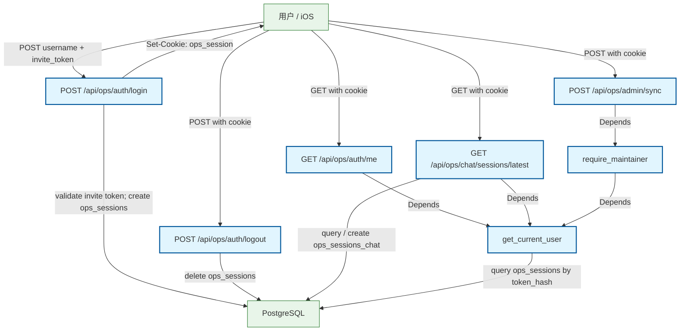

### 本仓现产物（harness emit + normalize）

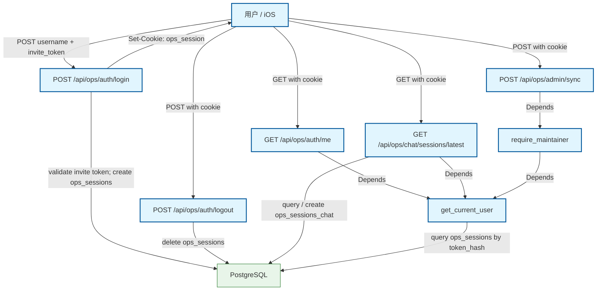

---

## 10_flow_chat

### kit 1.6.1 emit（切换后形态）

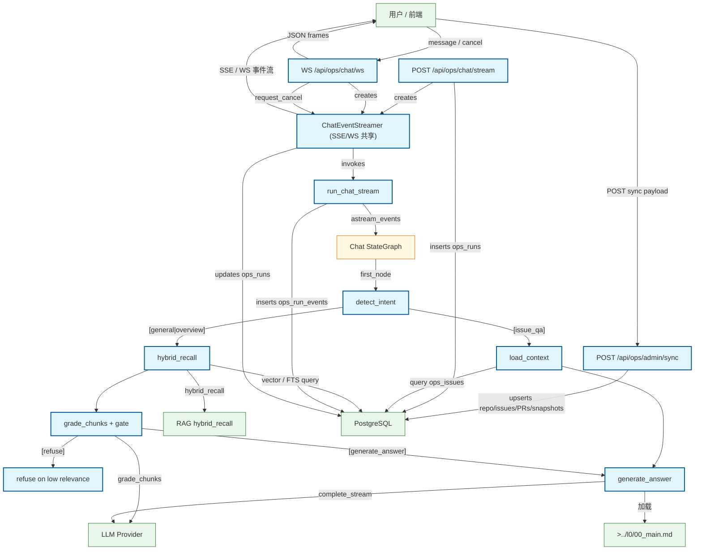

### 本仓现产物（harness emit + normalize）

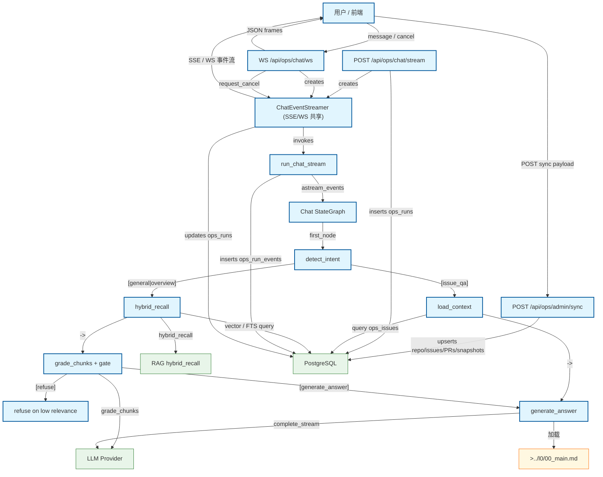

---

## 10_flow_lc_evidence

### kit 1.6.1 emit（切换后形态）

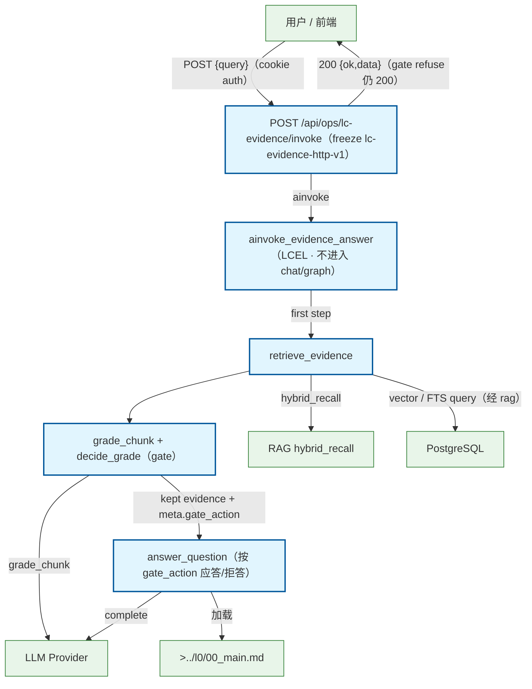

### 本仓现产物（harness emit + normalize）

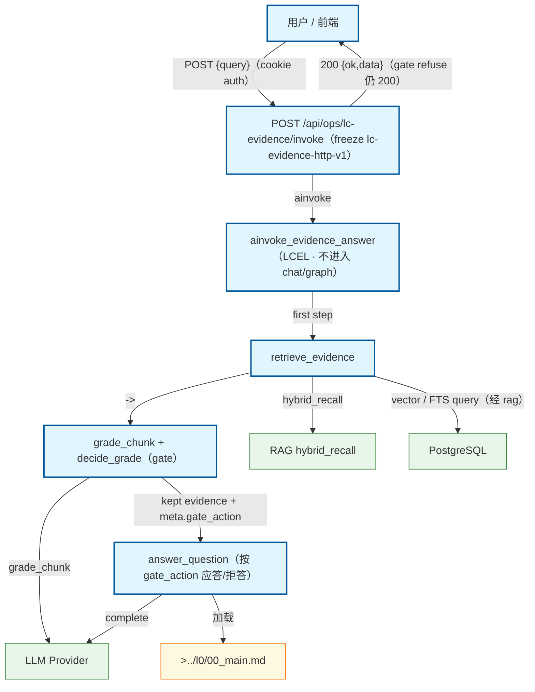

---

## 10_flow_lg_rag

### kit 1.6.1 emit（切换后形态）

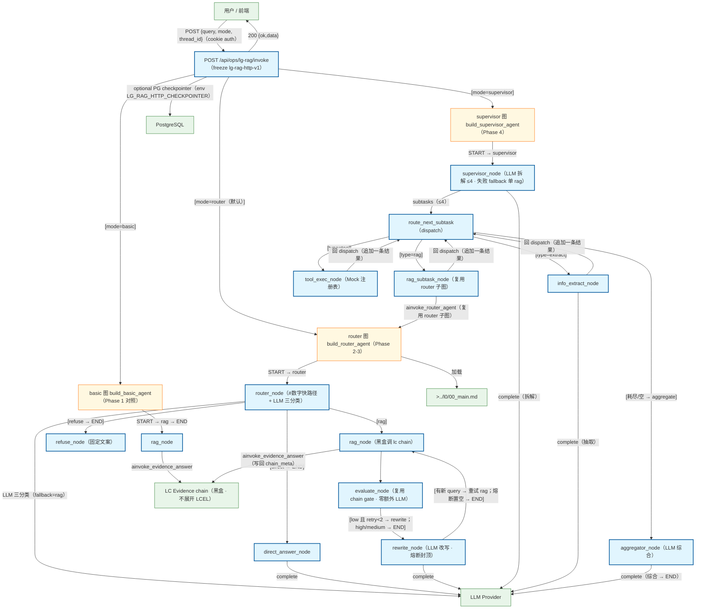

### 本仓现产物（harness emit + normalize）

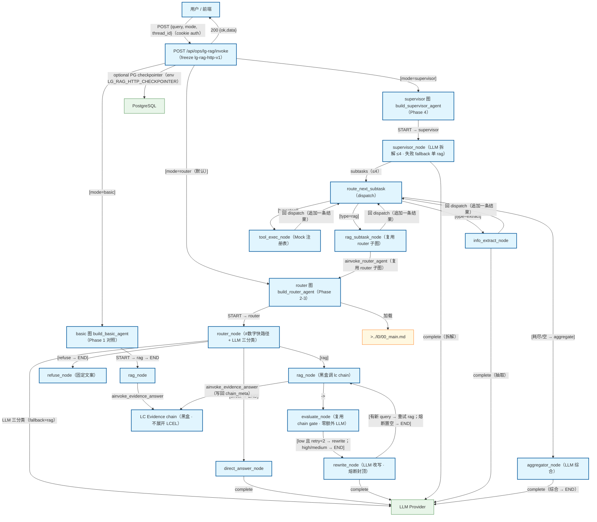

---

## 10_flow_rag

### kit 1.6.1 emit（切换后形态）

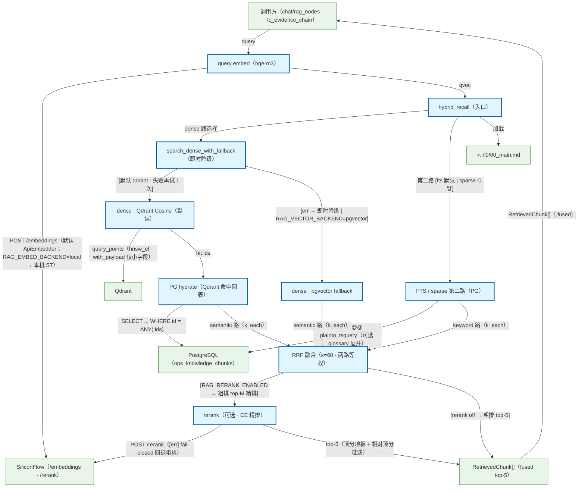

### 本仓现产物（harness emit + normalize）

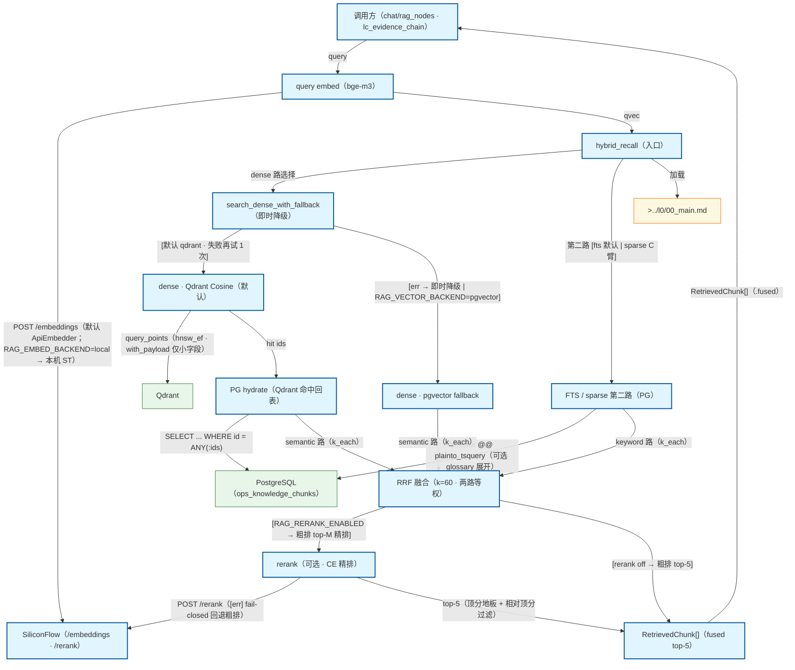

---

## 11_flow_sync_to_chat

### kit 1.6.1 emit（切换后形态）

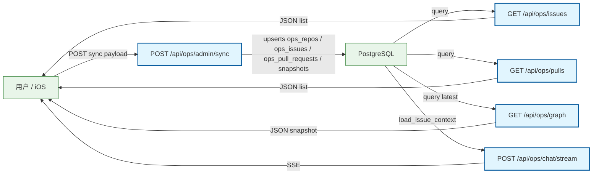

### 本仓现产物（harness emit + normalize）

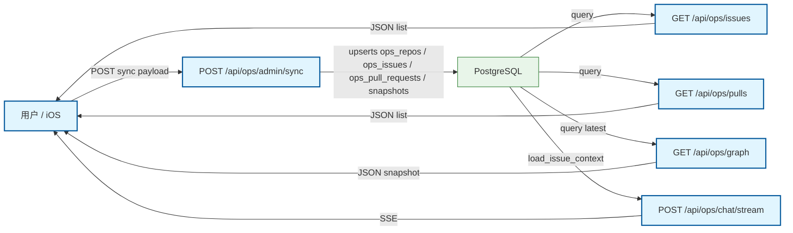

---

