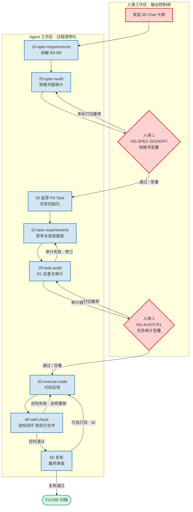

# harness/prompts

从本目录向用户仓 **`docs/harness/prompts/`** 复制 **Starter 子集**。

## 标准流程（V2）

```text
人 + 00 chat 大纲
  → 10-spec R0–R9
  → 20-spec-audit + HG-SPEC-SIGNOFF（人签 · 可多轮）
  → 00 起草 P0 task
  → 10-task → 20-task-audit R1（↺ 10-task）→ HG-AUDIT-R1
  → 30 → 40（同 Agent · 自修重跑直至通过）
  → 50（↺ 30 · 可选）→ CLOSE
```

流程图源文件：[`DAG.md`](./DAG.md)



详述：[`../docs/methodology/product/SDD_HAT_FLOW_v2_zh.md`](../docs/methodology/product/SDD_HAT_FLOW_v2_zh.md)

| 10 | 20 | 人闸 |
|----|-----|------|
| 10-spec | 20-spec-audit | HG-SPEC-SIGNOFF |
| 10-task | 20-task-audit | HG-AUDIT-R1 |

## Starter（本目录）

| 文件 | hat_id | 说明 |
|------|--------|------|
| [`10-task-requirements.md`](./10-task-requirements.md) | 10-task | task 思考 · 验收/failure_paths |
| [`10-spec-requirements.md`](./10-spec-requirements.md) | 10-spec | SPEC 思考 · R0–R5 |
| [`20-task-audit.md`](./20-task-audit.md) | 20-task-audit | reviews/ · HG-AUDIT-R1 |
| [`20-spec-audit.md`](./20-spec-audit.md) | 20-spec-audit | SPEC 书面审 · HG-SPEC-SIGNOFF |
| [`30-execute-code.md`](./30-execute-code.md) | 30 | 实现 · **含 40 自检闭环** |
| [`40-self-check.md`](./40-self-check.md) | 40 | 与 30 同 Agent · 规则分文件 |
| [`TEMPLATE_30_gate_stop.md`](./TEMPLATE_30_gate_stop.md) | — | 30 拒开工 |

Extended（00 / 50 / handoff / 链式 PROMPT）：工作区 `docs/harness/prompts/` · 见 [`SDD_HAT_FLOW_v2_zh.md`](../docs/methodology/product/SDD_HAT_FLOW_v2_zh.md) §4。

> **V2 改名（v2.4.0）**：`10-requirements.md` → `10-task-requirements.md`（+新增 `10-spec-requirements.md`）；`22-task-audit.md` → `20-task-audit.md`（+新增 `20-spec-audit.md`）。旧文件已删除；业务仓升级时 sync 会对残留旧帽 warn 提示人工删除。

## 修订记录

| 日期 | 摘要 |
|------|------|
| 2026-06-21 | V2 标准流程 · 30→40 同 Agent · 50/CLOSE 打回 |
| 2026-07-24 | V2 拆分收编：10→10-task/10-spec · 22→20-task-audit/20-spec-audit · 旧文件删除 |
| 2026-08-12 | 标准流程嵌入可渲染 Mermaid DAG（修围栏 / END 保留字 / 边标签引号） |
