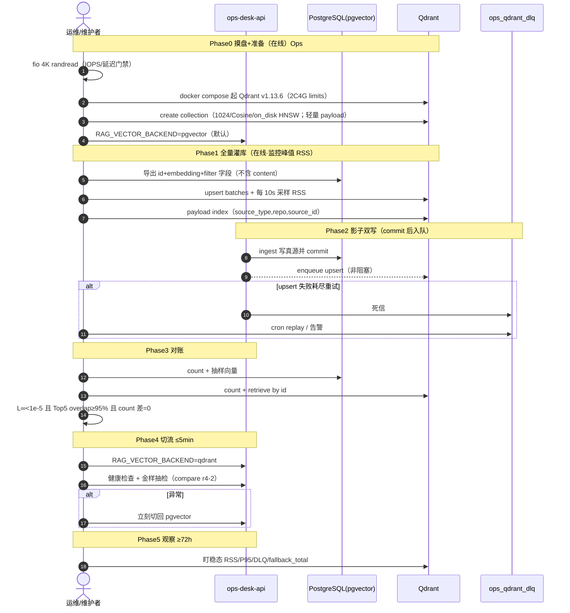

# SPEC：Qdrant Migration —— pgvector → Qdrant（稠密向量主路）（v1.1）

> **状态**：`draft`（HG-SPEC-SIGNOFF=pending · **禁止 00/30 改码**）  
> **track**：`infra`（向量存储迁移 · 架构解耦）  
> **上游**：现网 `ops_knowledge_chunks`（pgvector 0.8.5 · BGE-M3@1024 · N≈8,574）  
> **下游**：人签 SPEC → 00 出 task → **fio 摸盘** → 实验/压测 → 影子双写 → 切流 → 回滚演练  
> **Open Folder（实现）**：`ops-desk-api/`  
> **Bounded Context**：排除 Kafka CDC；排除 GPU 加速索引；FTS / sparse 第二路本期仍留 PG；**Qdrant 不存 content/metadata/images**。  
> **修订**：v1.1（2026-08-13）吸收三方审 + 20-audit：硬件 IOPS 硬门禁、Payload 回查 PG、构建期 mem-gate、即时降级、对账门禁纠错、影子写非阻塞、bench 双臂。

---

## Harness 元信息

| 字段 | 值 |
| --- | --- |
| **spec_slug** | `qdrant-migration` |
| **invoke_slug** | `qdrant-migration`（task 阶段） |
| **test_strategy** | `required` |
| **test_strategy_note** | fio 磁盘门禁；向量 L∞ + Top-k 重叠；构建期/稳态 `docker stats`；Flag 回滚；金样 vs **锁死** `reports/r4-2.yaml`（关 rerank） |
| **Open Folder（实现）** | `ops-desk-api/` |
| **默认分支** | `task/qdrant-migration`（自 `master` 新开） |
| **graph_change_layer（建议）** | `G-L1`（检索后端存储切换）+ `G-L2` 运维文档 |
| **compare_with（金样）** | `reports/r4-2.yaml`（pgvector 基线；评测时 `RAG_RERANK_ENABLED=false`） |

### 人工闸（SPEC 阶段）

| human_gate_id | status | 说明 |
| --- | --- | --- |
| **HG-SPEC-SIGNOFF** | pending | 维护者签收本 SPEC（含 v1.1 增量）后方可 00 出 task / 30 改码 |

---

## REASONING（多轮强制自纠）

### Round 1 · 目标重定义

**Assumption**  
「迁移成功」= 换成 Qdrant 本身，且主要为面试熟悉企业向量库方案。

**Risks**  
- 现网 N=8,574、2C4G、读多写少：pgvector HNSW 已能支撑当前负载；盲目迁移引入第二套存储的运维债，ROI 为负。  
- 若目标仅是「会 CRUD」，则 SPEC 无法解释 Index 选型与 80 万级内存墙。  
- 若目标是「架构解耦 / 独立扩缩 / 可观测检索延迟」，则必须把成功标准量化到延迟、内存、召回、回滚四条，而不是「已上 Qdrant」。

**Mitigation · 成功标准（可验收）**  
1. **主目标（生产）**：稠密向量主路从 PG 解耦到 Qdrant；80 万点下 Top-10（标量过滤）**Qdrant search P95 < 150ms**；端到端（含 PG 主键 hydrate）不得使 chat 路径明显劣化；Qdrant **稳态** RSS < 3.2GB。  
2. **辅目标（能力建设）**：深度掌握 Qdrant **HNSW** 与 **on_disk/mmap**（**非 DiskANN**），能讲清 `m` / `ef_construct` / `ef` 权衡。  
3. **非目标**：不把 FTS/sparse 搬进 Qdrant；不做 Kafka CDC；不追求 GPU ANN；不在 Qdrant 存大文本 payload。  
4. **否决条件**：磁盘 IOPS/延迟不达标，或 2C4G + on_disk 无法稳定 P95&lt;150ms → **停止切流**，保留 pgvector。

---

### Round 2 · 架构降维打击（索引与内存）

**Assumption**  
2C4G 应开「DiskANN」以降内存；或反过来，默认 HNSW 全内存以换速度。

**Risks**  
- **幻觉纠正**：Qdrant **没有原生 DiskANN**。磁盘友好路径是 **HNSW + `vectors.on_disk=true` + `hnsw_config.on_disk=true`（mmap）**。  
- 全内存 HNSW 在 80 万 × 1024d 上会撑爆 4G。  
- 全 on_disk 可塞进内存预算，但延迟强烈依赖磁盘随机读 IOPS；低配云盘/HDD → P95 可达数百 ms～数秒。  
- 若把 `content`/`images` 等大字段放进 on_disk payload 并 `with_payload=True`，Top-k 会叠加多次 payload 随机读，P95 易翻倍。

**Mitigation · 数学估算（80 万点 · float32 · Cosine）**

| 组件 | 公式（近似） | 80 万 @ m=16 |
| --- | --- | --- |
| 向量本体（float32） | \(N \cdot D \cdot 4\) | \(8e5 \times 1024 \times 4 \approx \mathbf{3.28\,GiB}\) |
| HNSW 边表（量级） | \(N \cdot m \cdot 8 \cdot \alpha\)（\(\alpha\sim 1.5\sim 2\)） | \(\approx 0.15\sim 0.25\,GiB\) |
| Payload（**仅过滤字段**） | 倒排索引 | \(\sim 50\sim 200\,MiB\) |
| RocksDB / page cache | 运行时 | 数百 MiB+ |

| 模式 | 预估常驻 | 2C4G 可行性 | 延迟预期 |
| --- | --- | --- | --- |
| HNSW 全内存 | ≥ 3.5–4.0 GiB | **不可行** | 最快 |
| HNSW + on_disk（**须 NVMe/高 IOPS**） | 数百 MiB～1.5 GiB | **可行（首选）** | 依赖盘；冷启动慢 |
| on_disk + SQ int8 | 更低 | **P95 保险** | 略损召回 |

**决策**：索引 = **HNSW**；存储 = **on_disk 向量 + on_disk HNSW**；**Payload 策略 A（强制）**：Qdrant 只存过滤用标量（`source_type`/`repo`/`source_id`/`chunk_index`），**不存** `content`/`metadata`/`images`；命中后按 point id **回查 PG**。预留 scalar quantization 作为 P95 不达标时的唯一允许算法降级（无 GPU）。全内存与「低 IOPS 硬上 on_disk」一律否决上架。

---

### Round 3 · 一致性黑洞（双写 / DLQ）

**Assumption**  
5 分钟维护窗足够停机全量迁移；或双写可同步 `await` 而不伤主路径。

**Risks**  
- 全量灌库远超 5 分钟；5 分钟窗只适合切读。  
- 现网 `ingest()` 为 **同步 `Session`**；若在事务内同步写 Qdrant，抖动会拖慢/拖垮写真源。  
- 无幂等与 DLQ → 静默漂移。

**Mitigation · 影子写 + DLQ**

1. **Phase 0**：fio 摸盘 + 起 Qdrant；业务仍读 PG。  
2. **Phase 1**：在线全量 upsert（监控**构建期 RSS**）。  
3. **Phase 2**：`ingest` **PG commit 成功之后** 入队影子写（线程池 / 后台 worker）；失败进 DLQ；**异常不得回滚 PG、不得阻塞 commit**。  
4. **Phase 3**：对账通过后再切读。  
5. **Phase 4**：≤5 分钟仅 Flag 翻转。

```text
write_pg + commit
  → enqueue(qdrant_upsert_job)   # fire-and-forget；永不抛回 ingest
  → worker: points.upsert(wait=true)
  → fail → retry backoff → ops_qdrant_dlq → cron replay
```

**幂等性**：`points.upsert` 按 point id 幂等。  
**Point ID**：`ops_knowledge_chunks.id`。  
**一致性**：最终一致；删除/整组替换须同步删 Qdrant 对应 id（同样非阻塞入队）。

---

### Round 4 · 回滚按钮

**Assumption**  
进程内「连挂 3 次」计数可跨 worker 生效。

**Risks**  
- 多 uvicorn/gunicorn worker 下 `_qdrant_fail_streak` 不可靠。  
- 硬编码 Qdrant 无降级 → 可用性违约。

**Mitigation**

1. **Feature Flag（主）**：`RAG_VECTOR_BACKEND=pgvector|qdrant`（默认 `pgvector`）。  
2. **Nginx（辅）**：仅当未来拆检索服务时用；校验 `$upstream_addr`。  
3. **即时降级（首版强制）**：单次请求对 Qdrant **最多重试 1 次**；仍失败 → **本请求立刻走 PG**，打 `rag_vector_backend_fallback_total`；**禁止**进程内全局 streak 作为唯一熔断。  
4. 回滚不删 Qdrant 数据；停影子写即可。

---

## 3.1 人类可读输出

### ADR-001：稠密向量主路引入 Qdrant（HNSW on_disk）

#### Context

- 源端：PostgreSQL + pgvector 0.8.5，表 `ops_knowledge_chunks`，`embedding vector(1024)`（BGE-M3，`normalize_embeddings=True`），查询算子 **`<=>`（cosine distance）**。  
- 规模：当前 8,574；峰值预估 80 万～150 万。  
- 硬件：目标机 **2C4G、无 GPU**；磁盘必须满足下表硬门禁。  
- 业务：读多写少；计划维护 ≤5 分钟；硬不可用 ≤30 分钟。  
- 只迁 dense 主路；FTS/sparse 留 PG。

#### Decision

| 项 | 选择 |
| --- | --- |
| 引擎 | **Qdrant v1.13.6**（`qdrant/qdrant:v1.13.6`） |
| 距离 | Cosine（对齐 pgvector `<=>` + 归一化嵌入） |
| 索引 | **HNSW**；否决 DiskANN；否决 GPU；否决全内存上架 |
| 存储 | `vectors.on_disk=true`，`hnsw_config.on_disk=true` |
| Payload | **仅** `source_type` / `repo` / `source_id` / `chunk_index`；`on_disk_payload=true`；**禁止**存 `content`/`metadata`/`images` |
| Hydrate | Top-k id → `SELECT … FROM ops_knowledge_chunks WHERE id = ANY(:ids)` 回填 `RetrievedChunk` |
| 参数起步 | `m=16`，`ef_construct=100`（构建峰值超限可降到 64），查询 `ef=64` |
| 优化器建议 | `indexing_threshold` / `max_segment_size` 控制段积压（实现时按 Qdrant 1.13 文档微调，避免一次积压过大） |
| 真源 | **PostgreSQL**；Qdrant = dense 检索副本 |
| 切流 | `RAG_VECTOR_BACKEND`；默认 `pgvector` |
| 同步 | 全量 + **commit 后**影子双写 + DLQ；无 Kafka CDC |
| 金样对照 | **锁死** `reports/r4-2.yaml` |

#### Consequences

**收益**：OLTP 与 ANN 隔离；upsert 幂等；可讲清 HNSW/mmap 运维。

**代价 / 运维债**：第二套存储与监控（RSS、盘、P95、DLQ、RocksDB/段合并）；跨库混合召回；最终一致窗口；hydrate 多一次 PG 主键读（可接受）。

**回滚**：Flag 秒切 `pgvector`；PG 不依赖 Qdrant。

#### 硬性增量（v1.1 · 签署前必锁）

```yaml
hardware_prerequisite:
  storage: "本地 NVMe SSD，或预配随机读 IOPS ≥ 5000 的云盘"
  fio_gate: "Phase0 必须 fio 4K randread；若 p95 延迟 > 1ms 或 IOPS < 3000 → 禁止本方案上架/切流"
  note: "低 IOPS 不得改回全内存 HNSW（2C4G 会 OOM）；等价于否决迁移"

payload_strategy:
  decision: "Qdrant 只存 filter 字段 + point_id；content/metadata/images 回查 PG"
  rationale: "避免 on_disk_payload 随机读放大 P95；PG 已是真源"

index_build_guard:
  steady_rss_limit_mb: 3200
  peak_rss_limit_mb: 3800   # 构建期允许临时峰值，持续建议 < 10min
  sample_interval_sec: 10   # bulk-upsert 期间 docker stats 采样
  fallback_action: "峰值超限 → 停灌、降 ef_construct 至 64 重建；仍超限则否决上架"

fallback_policy:
  mode: "per_request_retry_once_then_pg"
  forbid: "跨 worker 进程内全局 fail_streak 作为唯一熔断"

shadow_write:
  semantics: "PG commit 成功后入队；异常只进 DLQ/日志；不得阻塞或回滚 ingest"
```

---

### 性能压测基线表（2C4G · 理论/仿真预估，非实测）

> **合入前必须以实测替换**。假设：已通过 fio 门禁、单副本、Top-10、含 `source_type` filter、warmup、**无大字段 payload**、无 GPU。  
> 压测必须 **同机同查询集** 对照 pgvector（见 `bench-params --baseline pgvector`）。

| 配置 ID | N | m | ef_construct | ef_search | 存储 | 预估 QPS（并发 4） | 预估 Recall@10 vs 精确 | 预估 P95（Qdrant search） | 预估稳态 RSS |
| --- | --- | --- | --- | --- | --- | --- | --- | --- | --- |
| A0 | 80万 | 16 | 100 | 32 | on_disk | 25–40 | 0.90–0.94 | 120–220ms | 0.8–1.6GiB |
| A1（推荐起点） | 80万 | 16 | 100 | 64 | on_disk | 18–30 | 0.94–0.97 | 90–160ms | 0.9–1.8GiB |
| A2 | 80万 | 16 | 200 | 128 | on_disk | 10–18 | 0.97–0.99 | 140–280ms | 1.0–2.0GiB |
| B1 | 80万 | 32 | 100 | 64 | on_disk | 15–25 | 0.96–0.98 | 100–180ms | 1.2–2.2GiB |
| C0 | 80万 | 16 | 100 | 64 | **全内存** | — | — | — | **≥3.5GiB → 否决** |
| D1 | 80万 | 16 | 100 | 64 | on_disk + SQ int8 | 22–35 | 0.92–0.96 | 70–140ms | 0.7–1.4GiB |

**选型**：先 A1；P95 超标 → D1 或升 `ef`；RSS 顶满 → 降 `m`；C0 否决。构建峰值超 3.8GB → 降 `ef_construct`。

---

### 迁移流程时序图



| 阶段 | 操作人 | 预估耗时 | 业务影响 |
| --- | --- | --- | --- |
| Phase0 | 运维 | 0.5–1h（含 fio） | 无 |
| Phase1 | 运维+脚本 | 0.5–3h | 无（读仍 PG） |
| Phase2 | 开发 | 持续 | 无（读仍 PG） |
| Phase3 | 运维 | 0.5–1.5h | 无 |
| Phase4 | 运维 | **≤5min** | 读切换；可秒级回滚 |
| Phase5 | 运维 | ≥72h | 可随时 Flag 回滚 |

---

## 3.2 机器可执行输出

### `taskfile.yaml`（Agent 任务清单）

```yaml
version: "3"
# 用法示意：task -t docs/spec/artifacts/qdrant-migration/taskfile.yaml <name>
# 真路径以实现 task 落地为准；本块为 SPEC 契约。

vars:
  COLLECTION: ops_knowledge
  QDRANT_URL: http://127.0.0.1:6333
  EXPORT_PATH: /tmp/ops_knowledge_points.jsonl
  PG_DSN:
    sh: 'echo ${DATABASE_URL}'
  COMPARE_WITH: reports/r4-2.yaml

tasks:
  fio-disk-gate:
    desc: Phase0 磁盘 4K 随机读门禁（不过则禁止后续灌库/切流）
    cmds:
      - bash scripts/qdrant_migrate/fio_randread_gate.sh
    retries: 0

  export-pgvector:
    desc: 导出 id+embedding+filter 字段（不含 content/metadata/images）
    cmds:
      - python scripts/qdrant_migrate/export_vectors.py --chunk-size 1000 --out {{.EXPORT_PATH}} --payload-fields source_type,repo,source_id,chunk_index
    generates: ["{{.EXPORT_PATH}}"]
    retries: 2

  create-collection:
    desc: Cosine/1024 + on_disk HNSW；轻量 on_disk_payload
    cmds:
      - >-
        python scripts/qdrant_migrate/create_collection.py
        --url {{.QDRANT_URL}}
        --name {{.COLLECTION}}
        --dim 1024
        --metric Cosine
        --m 16
        --ef-construct 100
        --on-disk-vectors
        --on-disk-hnsw
        --on-disk-payload
        --indexing-threshold 10000
        --max-segment-size 20000
    retries: 2

  bulk-upsert:
    desc: 全量灌入（幂等）；构建期 RSS 采样门禁
    deps: [fio-disk-gate, export-pgvector, create-collection]
    cmds:
      - >-
        python scripts/qdrant_migrate/bulk_upsert.py
        --url {{.QDRANT_URL}}
        --collection {{.COLLECTION}}
        --in {{.EXPORT_PATH}}
        --batch-size 256
        --wait
        --rss-sample-sec 10
        --rss-peak-limit-mb 3800
        --ef-construct-fallback 64
    retries: 1

  payload-indexes:
    desc: 仅为过滤字段建 payload index
    cmds:
      - python scripts/qdrant_migrate/ensure_payload_indexes.py --collection {{.COLLECTION}} --fields source_type,repo,source_id

  enable-shadow-write:
    desc: 打开 commit 后非阻塞影子写 + DLQ
    cmds:
      - echo "Set RAG_QDRANT_SHADOW_WRITE=true"
      - python scripts/qdrant_migrate/check_dlq_schema.py

  reconcile:
    desc: count + 向量 L∞ + Top-k 重叠对账
    cmds:
      - >-
        python scripts/qdrant_migrate/reconcile.py
        --pg-dsn "{{.PG_DSN}}"
        --qdrant-url {{.QDRANT_URL}}
        --collection {{.COLLECTION}}
        --sample 500
        --max-l-inf-err 1e-5
        --min-topk-overlap 0.95
        --topk 5
    retries: 1

  cutover-read:
    desc: 维护窗内切读到 Qdrant（≤5min）
    cmds:
      - echo "Set RAG_VECTOR_BACKEND=qdrant"
      - python scripts/qdrant_migrate/smoke_search.py --top-k 10 --p95-budget-ms 150
    retries: 0

  rollback-read:
    desc: 读流量回退 pgvector
    cmds:
      - echo "Set RAG_VECTOR_BACKEND=pgvector"
      - python scripts/qdrant_migrate/smoke_search.py --backend pgvector

  mem-gate-steady:
    desc: 稳态 RSS 门禁
    cmds:
      - bash scripts/qdrant_migrate/assert_rss_under.sh qdrant 3200

  bench-params:
    desc: 同机对照 pgvector 与 Qdrant（替换仿真表）
    cmds:
      - >-
        python scripts/qdrant_migrate/bench_hnsw.py
        --n-queries 200
        --baseline pgvector
        --compare-with {{.COMPARE_WITH}}
        --outs reports/qdrant_bench.yaml
```

### 附录 A · Feature Flag / 即时降级 / Nginx

```python
# app/ops/rag/backend.py（拟定 · 未落地）
from __future__ import annotations

import logging
import os
from enum import Enum

logger = logging.getLogger(__name__)


class VectorBackend(str, Enum):
    PGVECTOR = "pgvector"
    QDRANT = "qdrant"


def vector_backend() -> VectorBackend:
    raw = (os.getenv("RAG_VECTOR_BACKEND") or "pgvector").strip().lower()
    if raw not in ("pgvector", "qdrant"):
        return VectorBackend.PGVECTOR
    return VectorBackend(raw)


async def search_dense_with_fallback(qdrant_search, pg_search, *args, **kwargs):
    """首版：Qdrant 最多再试 1 次；失败立刻 PG，不依赖跨进程 streak。"""
    if vector_backend() != VectorBackend.QDRANT:
        return await pg_search(*args, **kwargs)
    last_exc: Exception | None = None
    for attempt in range(2):
        try:
            return await qdrant_search(*args, **kwargs)
        except Exception as exc:  # 实现时收窄异常类型
            last_exc = exc
            logger.warning("qdrant search failed attempt=%s err=%s", attempt + 1, exc)
    logger.error("qdrant fallback to pgvector: %s", last_exc)
    # metric: rag_vector_backend_fallback_total += 1
    return await pg_search(*args, **kwargs)
```

**Nginx（仅当未来拆出独立 retrieval upstream 时）**：

```nginx
# /etc/nginx/conf.d/ops-retrieval.conf（拟定）
upstream retrieval_pg {
    server 127.0.0.1:8000;
}
upstream retrieval_qdrant {
    server 127.0.0.1:8001;
}

map $cookie_rag_backend $retrieval_upstream {
    default     retrieval_pg;
    qdrant      retrieval_qdrant;
}

server {
    listen 8080;
    location /ops/chat/ {
        proxy_pass http://$retrieval_upstream;
        access_log /var/log/nginx/retrieval_upstream.log upstream_diag;
    }
}
```

### 附录 B · `QdrantRetriever` + hydrate + 影子写

> 现状仓内 **无** `BaseRetriever`；实现时新增 ABC。Qdrant 只返回 id（+ filter payload 可选），**必须**经 PG hydrate 得到 `content`。

```python
# app/ops/rag/retrievers/qdrant_retriever.py（拟定）
from __future__ import annotations

import asyncio
import logging
import random
from typing import Any

from qdrant_client import AsyncQdrantClient
from qdrant_client.http import models as qm
from qdrant_client.http.exceptions import UnexpectedResponse
from sqlalchemy import text
from sqlalchemy.ext.asyncio import AsyncSession

from app.ops.rag.retrieve import RetrievedChunk
from app.ops.rag.retrievers.base import BaseRetriever

logger = logging.getLogger(__name__)

_HYDRATE_SQL = text(
    "SELECT id, repo, source_type, source_id, chunk_index, content, metadata, images "
    "FROM ops_knowledge_chunks WHERE id = ANY(:ids)"
)


class QdrantRetriever(BaseRetriever):
    def __init__(
        self,
        url: str,
        session: AsyncSession,
        collection: str = "ops_knowledge",
        *,
        api_key: str | None = None,
        ef: int = 64,
    ) -> None:
        self._url = url
        self._session = session
        self._collection = collection
        self._api_key = api_key
        self._ef = ef
        self._client: AsyncQdrantClient | None = None

    def _get_client(self) -> AsyncQdrantClient:
        if self._client is None:
            self._client = AsyncQdrantClient(url=self._url, api_key=self._api_key)
        return self._client

    async def _reconnect(self) -> None:
        if self._client is not None:
            await self._client.close()
        self._client = None
        self._get_client()

    def _build_filter(self, filters: dict[str, Any] | None) -> qm.Filter | None:
        if not filters:
            return None
        must = [
            qm.FieldCondition(key=k, match=qm.MatchValue(value=v))
            for k, v in filters.items()
        ]
        return qm.Filter(must=must)

    async def search(
        self,
        query_vector: list[float],
        *,
        k: int = 10,
        filters: dict[str, Any] | None = None,
    ) -> list[RetrievedChunk]:
        query_filter = self._build_filter(filters)
        client = self._get_client()
        try:
            hits = await client.search(
                collection_name=self._collection,
                query_vector=query_vector,
                query_filter=query_filter,
                limit=k,
                with_payload=True,  # 仅含 filter 小字段
                search_params=qm.SearchParams(hnsw_ef=self._ef),
            )
        except (ConnectionRefusedError, OSError, UnexpectedResponse):
            await self._reconnect()
            hits = await client.search(
                collection_name=self._collection,
                query_vector=query_vector,
                query_filter=query_filter,
                limit=k,
                with_payload=True,
                search_params=qm.SearchParams(hnsw_ef=self._ef),
            )

        ids = [int(h.id) for h in hits]
        if not ids:
            return []
        rows = (await self._session.execute(_HYDRATE_SQL, {"ids": ids})).all()
        by_id = {r.id: r for r in rows}
        out: list[RetrievedChunk] = []
        for hid in ids:
            r = by_id.get(hid)
            if r is None:
                continue
            out.append(
                RetrievedChunk(
                    id=r.id,
                    repo=r.repo,
                    source_type=r.source_type,
                    source_id=r.source_id,
                    chunk_index=r.chunk_index,
                    content=r.content,
                    metadata=r.metadata or {},
                    images=r.images or [],
                )
            )
        return out
```

**影子写（对齐同步 ingest · 拟定）**：

```python
# 现网 ingest(session: Session, ...) 为同步；禁止在事务内 await Qdrant。
def enqueue_shadow_upsert(row_id: int, vector: list[float], payload: dict) -> None:
    """PG commit 之后调用：入队/线程池；吞掉所有异常 → DLQ。"""
    try:
        _SHADOW_EXECUTOR.submit(_shadow_upsert_safe, row_id, vector, payload)
    except Exception:
        logger.exception("enqueue shadow upsert failed id=%s", row_id)
        # 写 DLQ；绝不抛回 ingest


def _shadow_upsert_safe(row_id: int, vector: list[float], payload: dict) -> None:
    # payload 仅 filter 字段；points.upsert 幂等
    ...
```

---

## 4. SMART Checklist（黄金验收）

| # | 验收项 | 度量 | 达标 |
| --- | --- | --- | --- |
| 0 | 磁盘门禁 | fio 4K randread：IOPS ≥ 3000 且 p95 ≤ 1ms；或已证明预配 IOPS ≥ 5000 | □ |
| 1 | 向量/召回对账 | 抽样 ≥500：\( \max_i \|v^{pg}_i - v^{q}_i\| < 10^{-5} \)；同 query Top-5 id **重叠率 ≥ 95%** | □ |
| 1b | 标量分（辅） | 同一归一化 query：PG `<=>`（cosine distance）与 Qdrant cosine distance **\|Δ\| < 1e-5**（不作唯一门禁） | □ |
| 2 | 内存门禁 | **稳态** RSS &lt; 3.2GB；**构建期**峰值 ≤ 3.8GB（采样） | □ |
| 3 | 延迟门禁 | Top-10 + filter，warmup 后 **Qdrant search P95 &lt; 150ms** | □ |
| 4 | 召回门禁 | 金样 vs **`reports/r4-2.yaml`**：recall@5 / best_relevance **不劣于**（允许并列）；`RAG_RERANK_ENABLED=false` | □ |
| 5 | 回滚演练 | Flag 切回后业务读恢复；若走 Nginx，`$upstream_addr` 显示 PG upstream | □ |
| 6 | DLQ / 非阻塞 | Qdrant 宕机时 PG ingest **仍成功**；影子写进 DLQ 可重放；重放幂等 | □ |
| 7 | 维护窗 | Phase4 ≤5 分钟；全程无 &gt;30 分钟不可用 | □ |
| 8 | Bounded | 无 Kafka CDC；无 GPU；FTS/sparse 在 PG；Qdrant **无** content 大字段 | □ |
| 9 | 双臂压测 | `bench-params --baseline pgvector` 产出对照报告 | □ |

**对账说明**：本仓 pgvector 用 **`<=>` = cosine distance**（不是 `<->` L2）。嵌入已 L2 归一化。主门禁是 **向量逐元素误差 + Top-k 重叠**；标量分差仅辅证。报告落 `reports/qdrant_reconcile_*.yaml`（含 PG `EXPLAIN (ANALYZE, BUFFERS)` for `<=>` 与 Qdrant 延迟直方图）。

---

## 5. 反幻觉与边界声明（Bounded Context）

| 排除项 | 理由 |
| --- | --- |
| Qdrant ↔ Kafka CDC | 双写 + DLQ 足够 |
| GPU / CUDA ANN | 2C4G 无 GPU |
| Qdrant 原生 DiskANN | 产品无此索引；用 HNSW + on_disk |
| Qdrant 存 content/metadata/images | P95 风险；改 hydrate PG |
| 低 IOPS 上改全内存 HNSW | 2C4G OOM；直接否决上架 |
| 迁移 FTS / sparse | 留 PG |
| 跨库强一致事务 | 仅最终一致 |
| 进程内全局 fail_streak 作唯一熔断 | 多 worker 不可靠；改即时降级 |

---

## 6. 建议的下一步（人签后）

1. 维护者签 `HG-SPEC-SIGNOFF=approved`（确认接受 v1.1 硬性增量）。  
2. 00 出 `docs/tasks/active/task_qdrant_migration.md`（含 failure_paths、compare_with=`reports/r4-2.yaml`）。  
3. **Phase0**：fio 摸盘；不过则关闭 track。  
4. 过盘后再灌 80 万压测（构建期+稳态 mem-gate + `--baseline pgvector`）；用实测替换仿真表。  
5. 压测过门禁再影子双写与切流；不过则保留 pgvector。

---

## 7. 修订记录

| 版本 | 日期 | 说明 |
| --- | --- | --- |
| v1 | 2026-08-12 | 初稿：ADR + 自纠 + taskfile + 骨架 |
| v1.1 | 2026-08-13 | 三方审吸收：硬件/fio 硬门禁、Payload 回查 PG、构建期 RSS、即时降级、对账纠错（`<=>`）、影子写非阻塞、bench 双臂、compare_with 锁死 |
