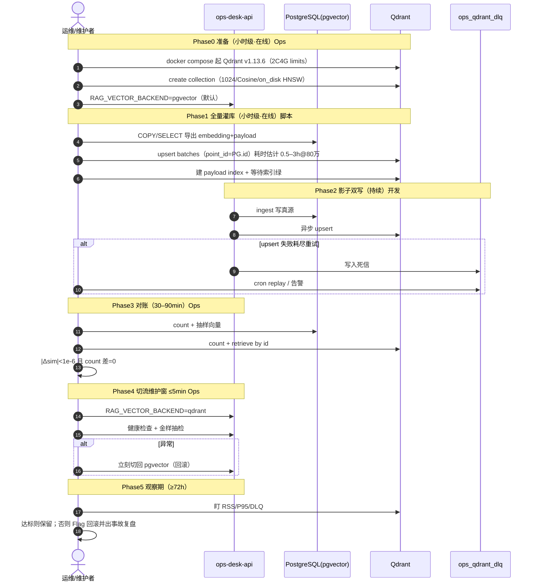

# SPEC：Qdrant Migration —— pgvector → Qdrant（稠密向量主路）（v1）

> **状态**：`draft`（HG-SPEC-SIGNOFF=pending · **禁止 00/30 改码**）  
> **track**：`infra`（向量存储迁移 · 架构解耦）  
> **上游**：现网 `ops_knowledge_chunks`（pgvector 0.8.5 · BGE-M3@1024 · N≈8,574）  
> **下游**：人签 SPEC → 00 出 task → 实验/压测 → 影子双写 → 切流 → 回滚演练  
> **Open Folder（实现）**：`ops-desk-api/`  
> **Bounded Context**：排除 Kafka CDC；排除 GPU 加速索引；FTS / sparse 第二路本期仍留 PG。

---

## Harness 元信息

| 字段 | 值 |
| --- | --- |
| **spec_slug** | `qdrant-migration` |
| **invoke_slug** | `qdrant-migration`（task 阶段） |
| **test_strategy** | `required` |
| **test_strategy_note** | 向量数值对账误差；2C4G `docker stats`；Feature Flag / Nginx 回滚演练；金样 recall@5 不劣于 pgvector 基线 |
| **Open Folder（实现）** | `ops-desk-api/` |
| **默认分支** | `task/qdrant-migration`（自 `master` 新开；**勿**挂在 `task/rag-reranker-p0`） |
| **graph_change_layer（建议）** | `G-L1`（检索后端存储切换）+ `G-L2` 运维文档 |

### 人工闸（SPEC 阶段）

| human_gate_id | status | 说明 |
| --- | --- | --- |
| **HG-SPEC-SIGNOFF** | pending | 维护者签收本 SPEC 后方可 00 出 task / 30 改码 |

---

## REASONING（多轮强制自纠）

### Round 1 · 目标重定义

**Assumption**  
「迁移成功」= 换成 Qdrant 本身，且主要为面试熟悉企业向量库方案。

**Risks**  
- 现网 N=8,574、2C4G、读多写少：pgvector HNSW 已能支撑当前负载；盲目迁移引入第二套存储的运维债，ROI 为负。  
- 若目标仅是「会 CRUD」，则 SPEC 无法解释 Index 选型与 80 万级内存墙。  
- 若目标是「架构解耦 / 独立扩缩 / 可观测检索延迟」，则必须把成功标准量化到延迟、内存、召回、回滚四条，而不是「已上 Qdrant」。

**Mitigation · 成功标准（可验收）**  
1. **主目标（生产）**：稠密向量主路从 PG 解耦到 Qdrant；80 万点下 Top-10（payload 过滤）P95 < 150ms；Qdrant 容器 RSS < 3.2GB（2C4G 留 OS/API 余量）。  
2. **辅目标（能力建设）**：深度掌握 Qdrant **HNSW** 与 **on_disk/mmap**（**非 DiskANN**，见 Round 2），能讲清参数 `m` / `ef_construct` / `ef` 与召回-延迟权衡。  
3. **非目标**：不把 FTS/sparse 第二路搬进 Qdrant；不做 Kafka CDC；不追求 GPU ANN。  
4. **否决条件**：若压测证明 2C4G + on_disk 无法稳定 P95<150ms，则 **停止切流**，保留 pgvector，SPEC 降级为「实验报告 + 面试笔记」。

---

### Round 2 · 架构降维打击（索引与内存）

**Assumption**  
2C4G 应开「DiskANN」以降内存；或反过来，默认 HNSW 全内存以换速度。

**Risks**  
- **幻觉纠正**：Qdrant **没有原生 DiskANN**。磁盘友好路径是 **HNSW + `vectors.on_disk=true` + `hnsw_config.on_disk=true`（mmap）**，行为近似「磁盘 ANN」，但图结构仍是 HNSW。  
- 全内存 HNSW 在 80 万 × 1024d 上会撑爆 4G。  
- 全 on_disk 可塞进内存预算，但延迟强烈依赖磁盘 IOPS；HDD/慢盘会导致 P95 远超 150ms。

**Mitigation · 数学估算（80 万点 · float32 · Cosine）**

记：

- \(N = 8\times 10^5\)，\(D = 1024\)，\(m\) = HNSW 每层出边数（取 16），`ef_construct` 主要影响**建图质量/时间**，对常驻 RAM 的一阶近似贡献远小于「向量本体 + 边表」。  
- 用户给定经验式 \( \text{mem} \approx (D\cdot 4 + O)\cdot N\cdot(1+\textit{ef\_construct}/16) \) **会严重高估**（把构造期工作集当成常驻），仅作「上界警示」，不作选型真值。

**更可用的一阶模型**：

| 组件 | 公式（近似） | 80 万 @ m=16 |
| --- | --- | --- |
| 向量本体（float32） | \(N \cdot D \cdot 4\) | \(8e5 \times 1024 \times 4 \approx \mathbf{3.28\,GiB}\) |
| HNSW 边表（量级） | \(N \cdot m \cdot 8 \cdot \alpha\)（\(\alpha\sim 1.5\sim 2\) 多层） | \(\approx 0.15\sim 0.25\,GiB\) |
| Payload 过滤索引（`source_type`/`repo` 等） | 字段基数 × 倒排 | \(\sim 50\sim 200\,MiB\) |
| RocksDB / 缓冲 / OS page cache 压力 | 运行时 | 数百 MiB+ |

**结论**：

| 模式 | 预估常驻 | 2C4G 可行性 | 延迟预期 |
| --- | --- | --- | --- |
| HNSW 全内存 | ≥ 3.5–4.0 GiB（仅向量+图） | **不可行**（撞 3.2GiB 门禁） | 最快 |
| HNSW + vectors/hnsw `on_disk` | 工作集可压到数百 MiB～1.5 GiB（靠 mmap 冷热） | **可行（首选）** | 依赖 NVMe；冷启动慢 |
| on_disk + Scalar Quantization（int8） | 向量本体 ~0.82 GiB；可部分 cached | **推荐作为 P95 保险** | 略损召回，换稳定延迟 |

**决策**：索引 = **HNSW（非 DiskANN）**；存储 = **`on_disk` 向量 + `on_disk` HNSW**；过滤字段建 payload index；预留 **scalar quantization** 作为 P95 不达标时的唯一允许降级（无 GPU）。

---

### Round 3 · 一致性黑洞（双写 / DLQ）

**Assumption**  
5 分钟维护窗足够「停写 → 导出 → 导入 → 切流」；或双写天然一致。

**Risks**  
- 全量导出 80 万点 + 建 HNSW：远超 5 分钟（尤其 `ef_construct` 偏高时）。5 分钟窗只适合 **切流瞬间**，不适合全量灌库。  
- 停写 >30 分钟禁止；纯停机迁移失败。  
- 双写若无幂等主键与重试，会出现「PG 有、Qdrant 无」静默漂移。

**Mitigation · 影子写 + DLQ（推荐主路径）**

1. **Phase 0**：Qdrant 空跑；业务仍读 PG。  
2. **Phase 1 全量灌库**：在线导出 `ops_knowledge_chunks` → JSONL → `upsert`（可小时级，业务不停）。  
3. **Phase 2 影子双写**：`ingest` 成功写 PG 后异步 upsert Qdrant；失败进 DLQ。  
4. **Phase 3 追平**：对账脚本（count + 抽样向量 L∞/余弦）通过后，再开读切流。  
5. **Phase 4**：≤5 分钟计划窗仅用于 **读开关翻转 + 健康检查**（非全量迁移）。

**DLQ 设计（应用层，非 Kafka）**：

```text
write_pg → enqueue(qdrant_upsert_job)
         → worker: points.upsert(wait=true)
         → fail → retry exponential backoff (1s,2s,4s,8s, max 5)
         → still fail → table ops_qdrant_dlq (point_id, payload, err, attempts, next_at)
         → cron replayer → 告警 if lag > N
```

**幂等性**：Qdrant `points.upsert` **按 point id 幂等**——同 id 重复上传覆盖为最新点；官方文档明确 API 幂等，适合「至少一次」投递。  
**Point ID 约定**：使用 PG `ops_knowledge_chunks.id`（uint/int）作为 Qdrant point id，保证与 PG 主键一一对应，便于对账与回滚。

**一致性语义（本期）**：最终一致（秒～分钟级）；禁止宣称强一致跨库事务。删除/整组替换（ingest 现有 D3）必须先删 Qdrant 对应 id 再 upsert，或整组 upsert + 墓碑 delete。

---

### Round 4 · 回滚按钮

**Assumption**  
Qdrant 挂了靠「重启容器」即可；或切回 PG 需要数据回灌。

**Risks**  
- 读路径若硬编码 Qdrant client，故障时 API 500，超过可用性约束。  
- 双写阶段 PG 仍是真源：回滚应是 **读开关**，不是反向迁移。  
- 仅 Nginx 切 upstream 不够——当前检索在 FastAPI 进程内 SQL，不是独立检索微服务。

**Mitigation · 双层开关**

1. **应用 Feature Flag（主）**：`RAG_VECTOR_BACKEND=pgvector|qdrant`（默认 `pgvector`）。  
2. **Nginx / 蓝绿（辅，若未来拆检索服务）**：upstream 切换；切流日志校验 `$upstream_addr`。  
3. **自动降级**：Qdrant 连续失败 ≥3 → 强制读 PG 并打 metric `rag_vector_backend_fallback_total`。  
4. **数据**：回滚不删 Qdrant 数据；停影子写即可；PG 始终可服务。

（代码骨架见 §3.2 / §附录 B。）

---

## 3.1 人类可读输出

### ADR-001：稠密向量主路引入 Qdrant（HNSW on_disk）

#### Context

- 源端：PostgreSQL + pgvector 0.8.5，表 `ops_knowledge_chunks`，`embedding vector(1024)`（BGE-M3），标量字段 `source_type` / `source_id` / `repo` / `chunk_index` / `metadata`。  
- 当前规模 8,574；一年峰值预估 80 万～150 万。  
- 硬件硬约束：目标机 **2C4G、无 GPU**。  
- 业务：读多写少；计划维护 ≤5 分钟；硬不可用 ≤30 分钟。  
- 现网混合召回：dense（pgvector）+ FTS/sparse（PG）→ RRF；本 ADR **只迁移 dense 主路**。

迁移动机（按优先级）：

1. 将向量检索资源与 OLTP 隔离，避免 HNSW/向量 I/O 挤压业务库。  
2. 在可控运维债下验证企业常见向量库（Qdrant）的索引与 mmap 运维能力。  
3. **非**「为迁而迁」：若 2C4G 压测不过门禁，保留 pgvector。

#### Decision

| 项 | 选择 |
| --- | --- |
| 引擎 | **Qdrant v1.13.6**（Docker 镜像 `qdrant/qdrant:v1.13.6`） |
| 为何不是 v1.11.x | 1.11 偏旧；1.13.x 仍保守稳定，on_disk HNSW/payload 成熟，客户端生态常见 |
| 为何不追最新 1.19 | 迁移首版规避 gRPC/API 演进面；后续可滚动升级 |
| 距离 | Cosine（与现网 `<=>` / 归一化嵌入一致） |
| 索引 | **HNSW**；**否决 DiskANN（产品无此索引）**；**否决 GPU** |
| 存储 | `vectors.on_disk=true`，`hnsw_config.on_disk=true`，`on_disk_payload=true` |
| 建议参数起步 | `m=16`，`ef_construct=100`，查询 `ef=64`（再压测调） |
| 过滤 | payload index：`source_type`、`repo`；（可选）`source_id` |
| 真源 | **PostgreSQL 仍为写入真源**；Qdrant 为稠密检索副本 |
| 切流 | Feature Flag `RAG_VECTOR_BACKEND`；默认 `pgvector` |
| 同步 | 全量灌库 + 应用层影子双写 + DLQ；**不做 Kafka CDC** |

#### Consequences

**收益**

- OLTP 与 ANN 资源隔离；检索参数（`ef`/`m`）可独立调。  
- upsert 幂等便于至少一次投递。  
- 面试/架构叙事可落到真实 HNSW vs mmap 权衡，而非 CRUD demo。

**代价 / 运维债**

- 第二套存储：备份、磁盘、监控、版本升级。  
- 需监控：容器 RSS、磁盘、延迟直方图、DLQ 积压、collection 状态；关注 **RocksDB / 段合并与磁盘增长**（压缩与 segment 优化异常会导致盘满或尾延迟）。  
- 最终一致窗口内可能出现「新旧排序短暂不一致」。  
- FTS/sparse 仍在 PG → 混合召回跨两套系统，超时与降级逻辑变复杂。  
- 2C4G 上 on_disk 对 **NVMe** 敏感；共享 HDD 可能无法达成 P95 目标。

**回滚**

- 读路径 Flag 切回 `pgvector`（秒级）；PG 数据不依赖 Qdrant。

---

### 性能压测基线表（2C4G · 理论/仿真预估，非实测）

> 用途：选型与压测设计；**合入前必须以实测替换**。假设：NVMe、单副本、Top-10、含 `source_type` filter、warmup 后、无 GPU。

| 配置 ID | N | m | ef_construct | ef_search | 存储 | 预估 QPS（并发 4） | 预估 Recall@10 vs 精确 | 预估 P95 | 预估 RSS |
| --- | --- | --- | --- | --- | --- | --- | --- | --- | --- |
| A0 | 80万 | 16 | 100 | 32 | on_disk | 25–40 | 0.90–0.94 | 120–220ms | 0.8–1.6GiB |
| A1（推荐起点） | 80万 | 16 | 100 | 64 | on_disk | 18–30 | 0.94–0.97 | 90–160ms | 0.9–1.8GiB |
| A2 | 80万 | 16 | 200 | 128 | on_disk | 10–18 | 0.97–0.99 | 140–280ms | 1.0–2.0GiB |
| B1 | 80万 | 32 | 100 | 64 | on_disk | 15–25 | 0.96–0.98 | 100–180ms | 1.2–2.2GiB |
| C0 | 80万 | 16 | 100 | 64 | **全内存** | — | — | — | **≥3.5GiB → OOM 风险** |
| D1 | 80万 | 16 | 100 | 64 | on_disk + SQ int8 | 22–35 | 0.92–0.96 | 70–140ms | 0.7–1.4GiB |

**选型指引**：先 A1；P95 超标且 RSS 有余量 → 升 `ef` 或上 D1；RSS 顶满 → 降 `m` / 强制 payload on_disk / 量化；C0 直接否决。

---

### 迁移流程时序图



| 阶段 | 操作人 | 预估耗时 | 业务影响 |
| --- | --- | --- | --- |
| Phase0 | 运维 | 0.5–1h | 无 |
| Phase1 | 运维+脚本 | 0.5–3h（随 N） | 无（只读 PG） |
| Phase2 | 开发 | 持续 | 无（读仍 PG） |
| Phase3 | 运维 | 0.5–1.5h | 无 |
| Phase4 | 运维 | **≤5min** | 读切换；可秒级回滚 |
| Phase5 | 运维 | ≥72h | 可随时 Flag 回滚 |

---

## 3.2 机器可执行输出

### `taskfile.yaml`（Agent 任务清单）

```yaml
version: "3"
# 用法示意：task -t docs/spec/artifacts/qdrant-migration/taskfile.yaml <name>
# 真路径以实现 task 落地为准；本块为 SPEC 契约。

vars:
  COLLECTION: ops_knowledge
  QDRANT_URL: http://127.0.0.1:6333
  EXPORT_PATH: /tmp/ops_knowledge_points.jsonl
  PG_DSN:
    sh: 'echo ${DATABASE_URL}'

tasks:
  export-pgvector:
    desc: 导出 pgvector 数据为 JSONL（point_id=PG.id）
    cmds:
      - python scripts/qdrant_migrate/export_vectors.py --chunk-size 1000 --out {{.EXPORT_PATH}}
    generates: ["{{.EXPORT_PATH}}"]
    retries: 2

  create-collection:
    desc: 创建 Cosine/1024 + on_disk HNSW + on_disk_payload
    cmds:
      - >-
        python scripts/qdrant_migrate/create_collection.py
        --url {{.QDRANT_URL}}
        --name {{.COLLECTION}}
        --dim 1024
        --metric Cosine
        --m 16
        --ef-construct 100
        --on-disk-vectors
        --on-disk-hnsw
        --on-disk-payload
    retries: 2

  bulk-upsert:
    desc: 全量灌入 Qdrant（幂等 upsert）
    deps: [export-pgvector, create-collection]
    cmds:
      - >-
        python scripts/qdrant_migrate/bulk_upsert.py
        --url {{.QDRANT_URL}}
        --collection {{.COLLECTION}}
        --in {{.EXPORT_PATH}}
        --batch-size 256
        --wait
    retries: 2

  payload-indexes:
    desc: 为过滤字段建 payload index
    cmds:
      - python scripts/qdrant_migrate/ensure_payload_indexes.py --collection {{.COLLECTION}} --fields source_type,repo,source_id

  enable-shadow-write:
    desc: 打开影子双写（写 PG 后异步写 Qdrant）
    cmds:
      - echo "Set RAG_QDRANT_SHADOW_WRITE=true in runtime env / compose"
      - python scripts/qdrant_migrate/check_dlq_schema.py

  reconcile:
    desc: count + 抽样向量误差对账
    cmds:
      - >-
        python scripts/qdrant_migrate/reconcile.py
        --pg-dsn "{{.PG_DSN}}"
        --qdrant-url {{.QDRANT_URL}}
        --collection {{.COLLECTION}}
        --sample 500
        --max-abs-err 1e-6
    retries: 1

  cutover-read:
    desc: 维护窗内切读到 Qdrant（≤5min）
    cmds:
      - echo "Set RAG_VECTOR_BACKEND=qdrant"
      - python scripts/qdrant_migrate/smoke_search.py --top-k 10 --p95-budget-ms 150
    retries: 0

  rollback-read:
    desc: 读流量回退 pgvector
    cmds:
      - echo "Set RAG_VECTOR_BACKEND=pgvector"
      - python scripts/qdrant_migrate/smoke_search.py --backend pgvector

  mem-gate:
    desc: docker stats 内存门禁
    cmds:
      - bash scripts/qdrant_migrate/assert_rss_under.sh qdrant 3200

  bench-params:
    desc: 扫描 m/ef 基线表（替换仿真为实测）
    cmds:
      - python scripts/qdrant_migrate/bench_hnsw.py --n-queries 200 --outs reports/qdrant_bench.yaml
```

### 附录 A · Feature Flag / Nginx 回滚骨架

**应用层（主开关，对齐现网单进程检索）**：

```python
# app/ops/rag/backend.py（拟定 · 未落地）
from __future__ import annotations

import os
from enum import Enum


class VectorBackend(str, Enum):
    PGVECTOR = "pgvector"
    QDRANT = "qdrant"


def vector_backend() -> VectorBackend:
    raw = (os.getenv("RAG_VECTOR_BACKEND") or "pgvector").strip().lower()
    if raw not in ("pgvector", "qdrant"):
        return VectorBackend.PGVECTOR
    return VectorBackend(raw)


# 自动降级计数（进程内；生产可换 Redis）
_qdrant_fail_streak = 0


def mark_qdrant_failure() -> None:
    global _qdrant_fail_streak
    _qdrant_fail_streak += 1


def mark_qdrant_ok() -> None:
    global _qdrant_fail_streak
    _qdrant_fail_streak = 0


def effective_backend() -> VectorBackend:
    if vector_backend() != VectorBackend.QDRANT:
        return VectorBackend.PGVECTOR
    if _qdrant_fail_streak >= 3:
        return VectorBackend.PGVECTOR  # 强制回退
    return VectorBackend.QDRANT
```

**Nginx（仅当未来拆出独立 retrieval upstream 时）**：

```nginx
# /etc/nginx/conf.d/ops-retrieval.conf（拟定）
upstream retrieval_pg {
    server 127.0.0.1:8000;   # FastAPI · RAG_VECTOR_BACKEND=pgvector
}
upstream retrieval_qdrant {
    server 127.0.0.1:8001;   # FastAPI · RAG_VECTOR_BACKEND=qdrant
}

map $cookie_rag_backend $retrieval_upstream {
    default     retrieval_pg;
    qdrant      retrieval_qdrant;
}

server {
    listen 8080;
    location /ops/chat/ {
        proxy_pass http://$retrieval_upstream;
        # 回滚验收：access_log 必须能看到 $upstream_addr
        access_log /var/log/nginx/retrieval_upstream.log upstream_diag;
    }
}

# log_format upstream_diag '... upstream=$upstream_addr ...';
```

回滚操作：Cookie/Flag 改回 `pgvector`，或 `nginx -s reload` 把 `default` 指回 `retrieval_pg`；用日志确认 `$upstream_addr` 已切回。

### 附录 B · `QdrantRetriever` 代码骨架

> 现状仓内 **无** `BaseRetriever`；迁移实现时新增 ABC，使 `PgvectorRetriever` / `QdrantRetriever` 可互换。接口形状对齐现有 `RetrievedChunk`。

```python
# app/ops/rag/retrievers/base.py（拟定）
from __future__ import annotations

from abc import ABC, abstractmethod
from typing import Any

from app.ops.rag.retrieve import RetrievedChunk


class BaseRetriever(ABC):
    @abstractmethod
    async def search(
        self,
        query_vector: list[float],
        *,
        k: int = 10,
        filters: dict[str, Any] | None = None,
    ) -> list[RetrievedChunk]:
        """稠密向量 Top-k；filters 例：{"source_type": "issue", "repo": "..."}。"""


# app/ops/rag/retrievers/qdrant_retriever.py（拟定）
from __future__ import annotations

import asyncio
import logging
import random
from typing import Any

from qdrant_client import AsyncQdrantClient
from qdrant_client.http import models as qm
from qdrant_client.http.exceptions import UnexpectedResponse

from app.ops.rag.retrieve import RetrievedChunk
from app.ops.rag.retrievers.base import BaseRetriever

logger = logging.getLogger(__name__)


class QdrantRetriever(BaseRetriever):
    def __init__(
        self,
        url: str,
        collection: str = "ops_knowledge",
        *,
        api_key: str | None = None,
        ef: int = 64,
        max_retries: int = 5,
    ) -> None:
        self._url = url
        self._collection = collection
        self._api_key = api_key
        self._ef = ef
        self._max_retries = max_retries
        self._client: AsyncQdrantClient | None = None

    def _get_client(self) -> AsyncQdrantClient:
        if self._client is None:
            self._client = AsyncQdrantClient(url=self._url, api_key=self._api_key)
        return self._client

    async def _reconnect(self) -> None:
        if self._client is not None:
            await self._client.close()
        self._client = None
        self._get_client()

    async def _with_backoff(self, coro_factory):
        delay = 0.5
        last_exc: Exception | None = None
        for attempt in range(self._max_retries):
            try:
                return await coro_factory()
            except (ConnectionRefusedError, OSError, UnexpectedResponse) as exc:
                last_exc = exc
                logger.warning(
                    "qdrant call failed attempt=%s err=%s; reconnect+backoff",
                    attempt + 1,
                    exc,
                )
                await self._reconnect()
                await asyncio.sleep(delay + random.random() * 0.1)
                delay = min(delay * 2, 8.0)
        assert last_exc is not None
        raise last_exc

    def _build_filter(self, filters: dict[str, Any] | None) -> qm.Filter | None:
        if not filters:
            return None
        must: list[qm.FieldCondition] = []
        for key, value in filters.items():
            must.append(
                qm.FieldCondition(key=key, match=qm.MatchValue(value=value))
            )
        return qm.Filter(must=must)

    async def search(
        self,
        query_vector: list[float],
        *,
        k: int = 10,
        filters: dict[str, Any] | None = None,
    ) -> list[RetrievedChunk]:
        query_filter = self._build_filter(filters)

        async def _do():
            client = self._get_client()
            return await client.search(
                collection_name=self._collection,
                query_vector=query_vector,
                query_filter=query_filter,
                limit=k,
                with_payload=True,
                search_params=qm.SearchParams(hnsw_ef=self._ef),
            )

        hits = await self._with_backoff(_do)
        out: list[RetrievedChunk] = []
        for hit in hits:
            p = hit.payload or {}
            out.append(
                RetrievedChunk(
                    id=int(hit.id),
                    repo=str(p.get("repo", "")),
                    source_type=str(p.get("source_type", "")),
                    source_id=str(p.get("source_id", "")),
                    chunk_index=int(p.get("chunk_index", 0)),
                    content=str(p.get("content", "")),
                    metadata=p.get("metadata") or {},
                    images=p.get("images") or [],
                )
            )
        return out
```

**影子写幂等 upsert（ingest 侧拟定）**：

```python
async def shadow_upsert_point(client, collection: str, row_id: int, vector, payload: dict) -> None:
    # points.upsert 对同一 id 幂等覆盖 —— 适合至少一次投递 + DLQ 重放
    await client.upsert(
        collection_name=collection,
        points=[
            qm.PointStruct(id=row_id, vector=vector, payload=payload),
        ],
        wait=True,
    )
```

---

## 4. SMART Checklist（黄金验收）

| # | 验收项 | 度量 | 达标 |
| --- | --- | --- | --- |
| 1 | 向量相似度对账 | 同 query / 同 id 向量，PG `<->` 距离与 Qdrant Cosine score 换算后 **绝对误差 < 1e-6**（抽样 ≥500；附对账脚本 EXPLAIN/日志） | □ |
| 2 | 内存门禁 | 80 万（或等价压测集）下 `docker stats` Qdrant **RSS < 3.2GB** | □ |
| 3 | 延迟门禁 | Top-10 + payload filter，warmup 后 **P95 < 150ms** | □ |
| 4 | 召回门禁 | 金样 recall@5 / best_relevance **不劣于** 同日 pgvector 基线（允许并列） | □ |
| 5 | 回滚演练 | Flag 或 Nginx 切回后，业务读恢复；若走 Nginx，**`$upstream_addr` 日志清晰显示切回 PG upstream** | □ |
| 6 | DLQ | 人为制造 Qdrant 宕机时，PG 写入成功且 DLQ 可重放追平；upsert 重放幂等无双份点 | □ |
| 7 | 维护窗 | Phase4 切流操作墙钟 **≤5 分钟**；全程无 >30 分钟不可用 | □ |
| 8 | Bounded | 无 Kafka CDC；无 GPU 索引；FTS/sparse 仍在 PG | □ |

**对账误差说明（量化方法）**：  
对抽样 id，取 PG `embedding` 与 Qdrant stored vector，计算 \( \max_i |v^{pg}_i - v^{q}_i| < 10^{-6} \)；检索分用同一归一化向量时 Cosine 距离差同样门禁。PG 侧用 `EXPLAIN (ANALYZE, BUFFERS)` 记录 `<->` 查询计划，Qdrant 侧记录 `search` 延迟直方图，一并存入 `reports/qdrant_reconcile_*.yaml`。

---

## 5. 反幻觉与边界声明（Bounded Context）

| 排除项 | 理由 |
| --- | --- |
| Qdrant ↔ Kafka CDC | 当前与一年内写放大有限；应用双写 + DLQ 足够；降低运维面 |
| GPU / CUDA ANN | 硬件硬约束 2C4G 无 GPU → **直接否决** |
| Qdrant 原生 DiskANN | **产品不存在该索引**；等价路径为 HNSW + on_disk mmap |
| 迁移 FTS / sparse 第二路 | 仍依赖 PG tsvector / sparsevec；混合融合留在应用层 |
| 宣称跨库强一致事务 | 仅最终一致；以 PG 为真源 |
| 在 `task/rag-reranker-p0` 分支直接实现 | 本 SPEC 未签收；实现须新开 `task/qdrant-migration` |

---

## 6. 建议的下一步（人签后）

1. 维护者签 `HG-SPEC-SIGNOFF=approved`。  
2. 00 出 `docs/tasks/active/task_qdrant_migration.md`。  
3. 先在实验机灌 **合成/拷贝 80 万** 跑 A1/D1 压测，**用实测替换 §3.1 仿真表**。  
4. 压测过门禁再开影子双写与切流；不过则关闭本迁移 track，保留 pgvector。
